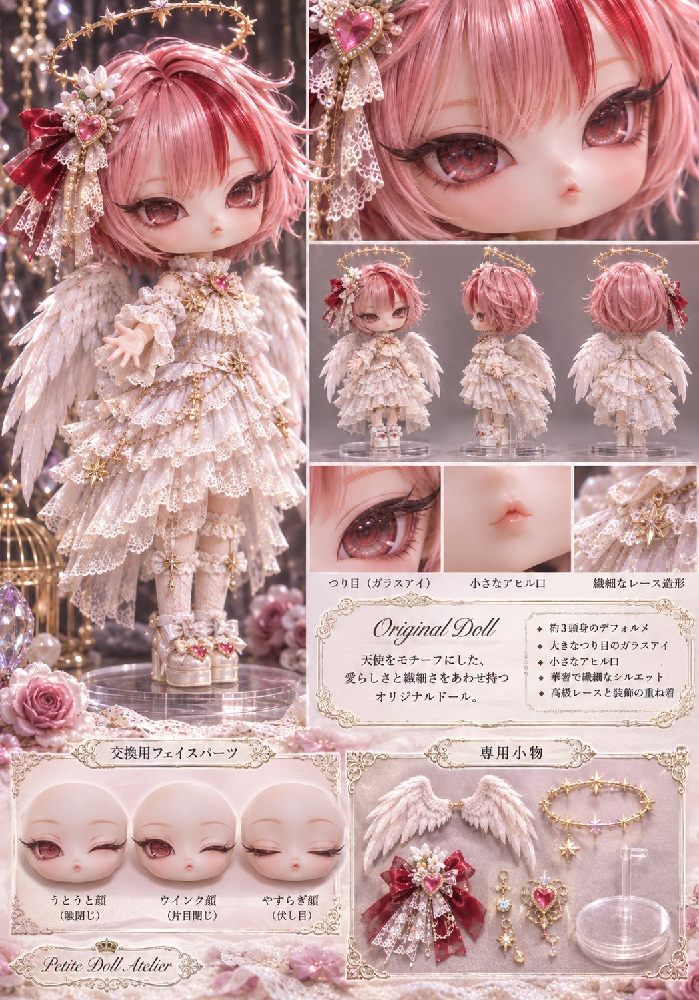
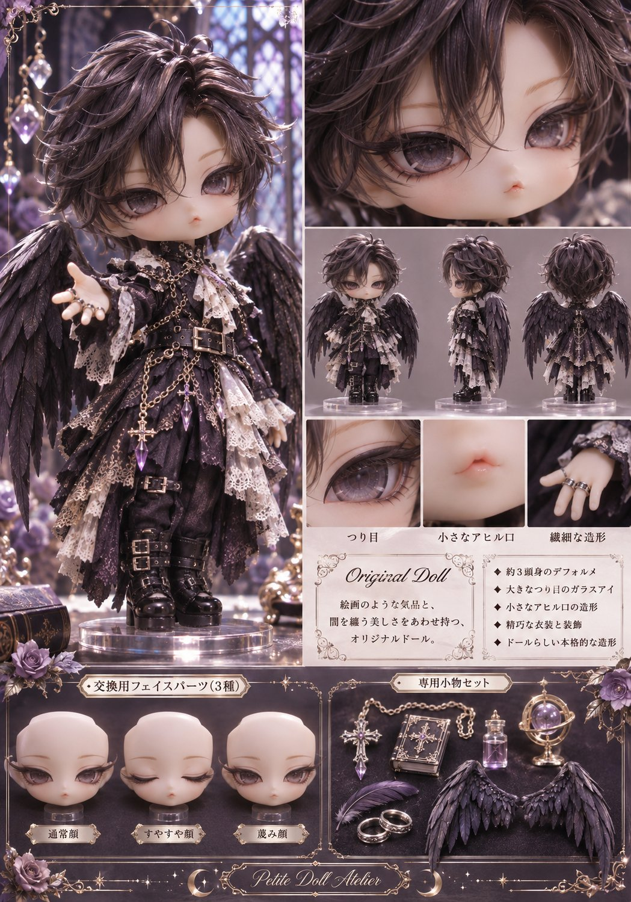
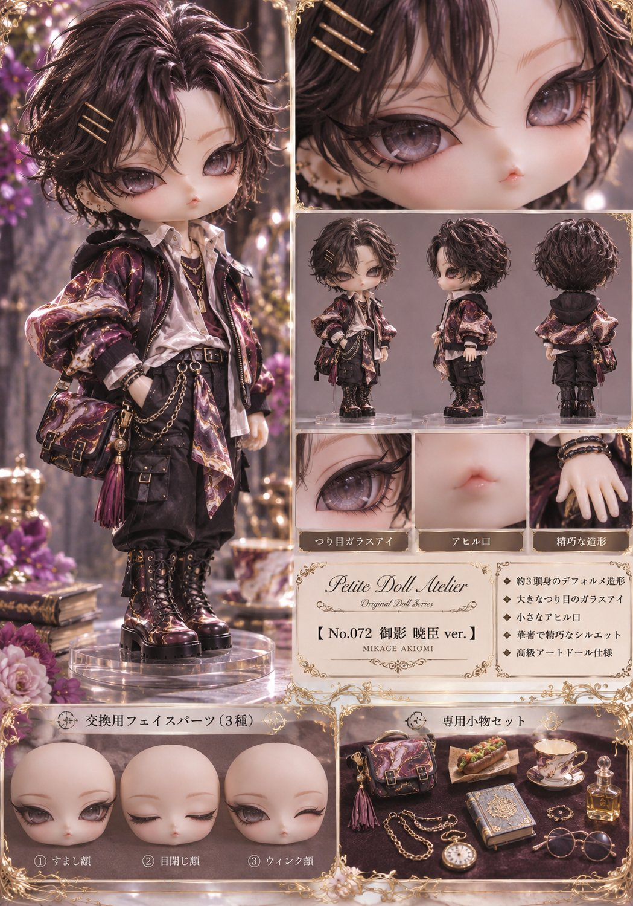
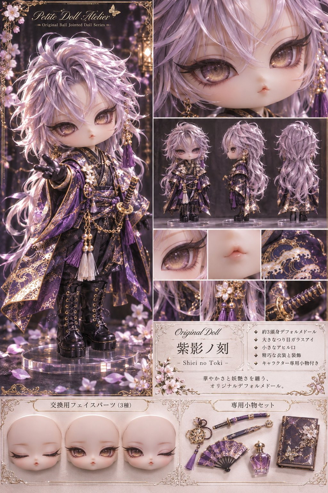
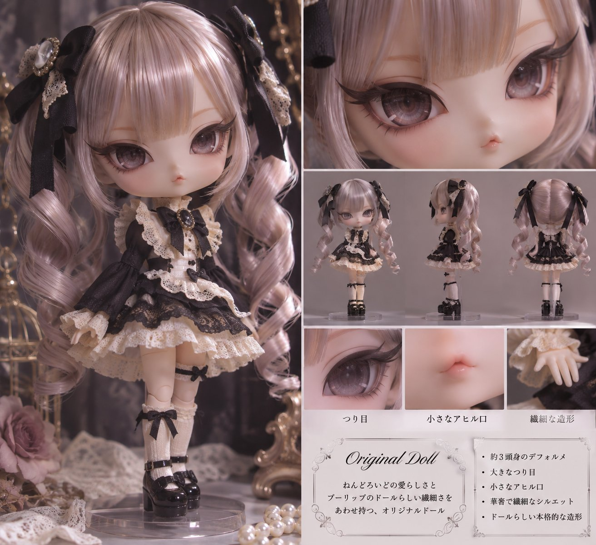

# 「Petite Doll Atelier」：把自家角色做成大头小身高级艺术娃娃的商品目录图（双参考图 + 三视图）

- 原帖链接：https://x.com/irohachang77/status/2123621669084303361
- 作者：のらる（@irohachang77）
- 时间：2026-11-20 11:37 (UTC+8 / Asia/Taipei)
- 互动摘要：点赞 23 · 转发 5 · 回复 1 · 引用 3 · 书签 9 · 浏览 821（采集快照：2026-11-20 19:45 UTC+8）
- 模型/工具：未注明（双参考图驱动的通用 prompt，#のらるプロンプト）
- 标签：二次元
- 媒体路径：
  - `media/images/2123621669084303361_1.jpg`（）
  - `media/images/2123621669084303361_2.jpg`（）
  - `media/images/2123621669084303361_3.jpg`（）
  - `media/images/2123621669084303361_4.jpg`（）
  - `media/images/2123621669084303361_5.jpg`（）
- 入库日期：2026-11-20
- prompt 来源：https://x.com/irohachang77/status/2123621758699991181（作者自回复）
- 备注：prompt 在作者自回复（2123621758699991181），整条原样摘录。需上传两张图：①娃娃造形基准图（作者在同一条回复里附了一张，即本条第 5 张图）②自家角色图。产出为娃娃商品目录风，非性化。

## prompt 原文

```text
🎀 Petite Doll Atelier｜造形完全統一

【最重要：参考画像のコピー】

添付画像①をドール造形の絶対基準とする。

画像①の顔の骨格、頭身、目の形、口元、頬の丸み、手足の長さ、ドールの質感を忠実にコピーし、同じシリーズのドールを制作する。

画像②のキャラクターを、画像①と同じドール素体に変換する。

画像①から引き継ぐもの

- 大きな丸い頭と小さな体
- ふっくらした頬と小さな顎
- 大きく横長のつり目とガラスアイ
- 極小の鼻
- ちゅんと突き出た、閉じた立体アヒル口
- 陶器のような滑らかな肌
- 短い胴体と手足
- 精巧な布服とドール関節
- 高級アートドールの実物撮影風

画像②から引き継ぐもの

髪型・髪色・瞳の色・衣装・装飾・眼鏡・アクセサリー・キャラクター固有の小物。

画像①の髪色や衣装はコピーしない。

男女とも画像①と同じ顔の造形・低頭身素体を使用し、画像②の特徴だけを反映する。

【構図】

9:16縦長。

左にドール全身、右上に顔アップ、右中央に正面・側面・背面の三面図、右下に造形詳細。

下部に交換用フェイスパーツ3種類と専用小物。

高級ドールの商品カタログ風。

【禁止事項】

画像②の高頭身・脚長・大人顔を引き継がない。

アニメフィギュア顔、平面的な目、線状の口、舌出し、開いた口は禁止。

最優先：画像①のドール造形を維持すること。衣装やキャラクターが変わっても、顔と体型を変更しない。
```

---

个人学习归档，非商业。prompt 与媒体版权归原作者 @irohachang77，引用请回到原帖。
