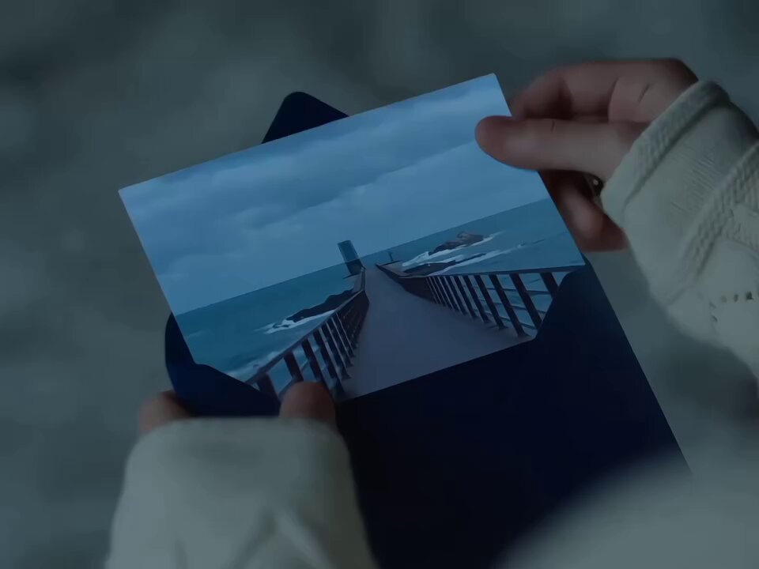

# 海边栈桥与大学回忆：两位昔日对手闺蜜在烟火下和解重逢的 30 秒韩剧风短片

- 原帖链接：https://x.com/KrishnaBio1/status/2123699367223656912
- 作者：KrishnaG（@KrishnaBio1）
- 时间：2026-11-20 16:46 (UTC+8 / Asia/Taipei)
- 互动摘要：点赞 15 · 转发 1 · 回复 13 · 引用 0 · 书签 1 · 浏览 381（采集快照：2026-11-20 19:45 UTC+8）
- 模型/工具：Seedance 2.5（作者标注）
- 标签：真人
- 媒体路径：
  - `media/video-stills/2123699367223656912_still.jpg`（视频封面截图，）
  - 视频本体未入库，仅保留原帖链接：https://x.com/KrishnaBio1/status/2123699367223656912
- 入库日期：2026-11-20
- prompt 来源：https://x.com/KrishnaBio1/status/2123699368557445566（作者自回复）
- 备注：prompt 在作者自回复（2123699368557445566），原样摘录（略去末尾的平台推广短链）。主角写明 late 20s，回忆段为大学校园；作者写明 Wholesome，非性化。视频本体未入库，仅保留原帖链接。

## prompt 原文

```text
Create an ultra-photorealistic cinematic emotional friendship drama video moving between a windswept seaside pier in the present and a nostalgic university memory years earlier. Recreate a bittersweet, warm atmosphere with a long wooden pier stretching over a cool teal sea, a cloudy sky, a lively night festival with glowing string lights, pastel balloons and fireworks, and a bright university corridor lined with lockers.
Scene 1 (0–5 seconds): The Postcard
Begin with a close-up of a pair of hands holding a blue postcard showing a long wooden pier over the sea. A young woman in her late 20s with long black hair and soft bangs, wearing a cream turtleneck, studies it with trembling eyes that slowly fill with tears. Slow push-in on her face as she whispers: "I miss her so much."
Scene 2 (5–10 seconds): The Pier
Cut to a real seaside pier on a cool, cloudy day. She walks along the wooden boards in a light beige trench coat, her long hair whipping in the wind, the sea crashing against dark rocks. She stops, looks up at the sky and closes her eyes as the wind rises. The image softens into a memory.
Scene 3 (10–15 seconds): The Rivals
A bright university corridor with locker doors. Two young women in college cardigans and white shirts bump into each other at the lockers, bickering playfully with competitive glares. Next, they sit side by side in a blue-lit karaoke room, each holding a microphone, rival smiles masking affection. Warm cinematic close-ups of their expressions.
Scene 4 (15–20 seconds): The Night Festival
A lively night festival with strings of warm lights, striped tents, food stalls and a pastel balloon pit. Both friends wear glowing cat-ear headbands, laughing and walking through the crowd, sharing snacks and teasing each other. Glittering bokeh and joyful laughter.
Scene 5 (20–25 seconds): The Fireworks
They sit side by side on stone steps as colorful fireworks burst across the black sky above them, light reflecting in their eyes. One turns to the other. Without words, their hands find each other and hold. Close-up of their interlaced fingers as the fireworks fade into soft smoke.
Scene 6 (25–30 seconds): The Reunion
Return to the present pier. At the far end, a figure in a dark blazer turns around: her old friend. The woman in the beige trench coat walks toward her, tears glistening. The friend smiles: "You came." The woman laughs through tears: "I always lose to you." The friend shakes her head: "That was never the competition." They hold hands. Slow pull-back to a wide shot of the two women on the pier under the cloudy sky, then fade out.
Visual Style & Cinematography
Ultra-photorealistic modern Korean drama with a nostalgic, bittersweet and hopeful tone.
Cool teal-and-blue coastal tones for the present, warm pastel colors and glowing festival lights for the memories.
Shallow depth of field, slow push-ins, soft handheld close-ups, wind and hair in slow motion.
Natural skin, fabric and hair textures, realistic firework light on faces, believable performances.
Consistent faces, hairstyles and outfits for both women in each time period.
Audio: sea wind and crashing waves, festival chatter and fireworks, a gentle piano-and-strings score, clear natural English dialogue.
Wholesome and emotionally respectful. No text, no subtitles, no logos, no watermark.
```

---

个人学习归档，非商业。prompt 与媒体版权归原作者 @KrishnaBio1，引用请回到原帖。
