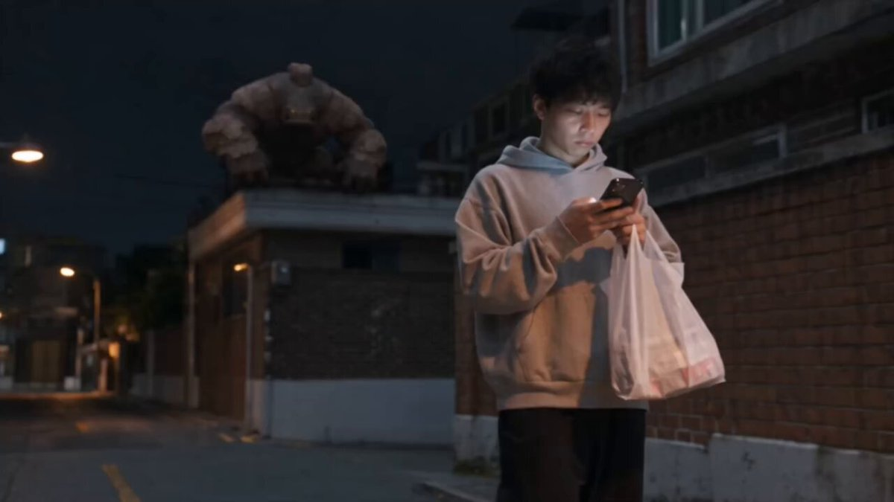

# 巨型岩石怪兽夜袭老城街区：卫衣青年逃亡的 90 秒怪兽惊悚片（分场景好莱坞式 prompt）

- 原帖链接：https://x.com/AiWithZayan/status/2123711436979630328
- 作者：Zayan（@AiWithZayan）
- 时间：2026-11-20 17:33 (UTC+8 / Asia/Taipei)
- 互动摘要：点赞 31 · 转发 3 · 回复 9 · 引用 0 · 书签 0 · 浏览 421（采集快照：2026-11-20 19:45 UTC+8）
- 模型/工具：Seedance 2.5（作者标注；prompt 写明也适用 Kling 4.0 等）
- 标签：真人
- 媒体路径：
  - `media/video-stills/2123711436979630328_still.jpg`（视频封面截图，）
  - 视频本体未入库，仅保留原帖链接：https://x.com/AiWithZayan/status/2123711436979630328
- 入库日期：2026-11-20
- 备注：prompt 在原帖正文（长文帖），从「**TITLE」起原样摘录（略去开头标题与「Here is a detailed…」引导句）。正文写到 SCENE 6（65–80 秒）为止，帖内未见 80–90 秒部分。主角写明 early 20s 男性；怪兽破坏场面，无血腥。视频本体未入库，仅保留原帖链接。

## prompt 原文

```text
**TITLE: THE GIANT MONSTER IN THE CITY – AN UNEXPECTED NIGHTMARE**

**VIDEO SETTINGS:**
Create a 90-second ultra-realistic, cinematic Hollywood-style sci-fi monster thriller. 16:9 widescreen, 4K resolution, 24fps, realistic lighting, detailed environments, professional cinematography, natural character movements, dramatic atmosphere, and seamless scene transitions.

**MAIN CHARACTER:**
A young East Asian man in his early 20s, with short black hair, wearing an oversized light beige hoodie, dark trousers, and casual sneakers. He carries a smartphone and a small shopping bag. Maintain exactly the same face, hairstyle, clothing, and body proportions throughout the entire video.

**MONSTER DESIGN:**
A gigantic muscular, gorilla-like stone monster with rough rocky skin, massive arms, powerful legs, and an intimidating appearance. Its movements should feel heavy, realistic, and physically believable. Maintain consistent monster design throughout every scene.

**SCENE 1 – AN ORDINARY NIGHT (0–10 SECONDS)**

A quiet residential street in an old Asian neighborhood at night. Warm streetlights illuminate narrow roads, brick walls, apartment buildings, and small shops. The young man walks casually while looking at his smartphone and carrying a shopping bag. The camera slowly tracks him from the front and side, establishing a peaceful nighttime atmosphere.

**SCENE 2 – THE MONSTER APPEARS (10–20 SECONDS)**

Without warning, a gigantic rocky monster emerges behind the nearby buildings. Its enormous footsteps shake the street. Dust falls from rooftops as the creature approaches. The young man suddenly notices the enormous shadow behind him. He turns around, freezes in disbelief, and quickly moves away as the monster approaches.

Use dramatic low-angle shots to emphasize the creature's enormous size.

**SCENE 3 – CHAOS IN THE STREET (20–35 SECONDS)**

The monster enters the narrow neighborhood street, knocking over street objects and damaging nearby structures. The young man runs through the street, looking back in panic. His shopping bag falls onto the road. The monster follows him with heavy footsteps while dust and small debris fill the atmosphere.

Capture dynamic tracking shots, wide cinematic shots, and realistic environmental reactions.

**SCENE 4 – HIDING FROM THE MONSTER (35–48 SECONDS)**

The young man reaches a large colorful vending machine filled with transparent capsules and colorful balls. He quickly hides behind it while the monster searches the surrounding street.

The camera moves close to his face, showing his nervous expression as he carefully looks around the machine. The monster passes nearby, creating tension and suspense.

**SCENE 5 – A MASSIVE COLLAPSE (48–65 SECONDS)**

The young man suddenly runs into the open street. Behind him, the monster causes a nearby construction structure to collapse. A huge cloud of dust spreads across the road. Wooden panels, concrete fragments, and construction materials fall around the area.

Show a dramatic wide aerial shot of the neighborhood disappearing behind the enormous dust cloud. The young man remains a small figure in the middle of the street, emphasizing the monster's incredible scale.

**SCENE 6 – THE MONSTER CLIMBS THE BUILDING (65–80 SECONDS)**

Cut to a cinematic overhead shot of the monster moving between the old buildings. It climbs onto a nearby rooftop, its massive rocky body silhouetted against the evening sky. Construction cranes and city buildings appear in the background.
```

---

个人学习归档，非商业。prompt 与媒体版权归原作者 @AiWithZayan，引用请回到原帖。
