# 「みんな大好き三輪車」：自家角色骑三轮车——2 岁幼儿版治愈插画 + 成人硬挤小三轮的热血搞笑版（双 prompt）

- 原帖链接：https://x.com/_a5_s_/status/2123717991447589131
- 作者：A5（@_a5_s_）
- 时间：2026-11-20 18:00 (UTC+8 / Asia/Taipei)
- 互动摘要：点赞 192 · 转发 31 · 回复 2 · 引用 38 · 书签 107 · 浏览 20346（采集快照：2026-11-23 09:05 UTC+8）
- 模型/工具：ChatGPT（作者写「リプ欄のプロンプトをChatGPTに送る」，未注明具体图像模型）
- 标签：二次元
- 媒体路径：
  - `media/images/2123717991447589131_1.jpg`（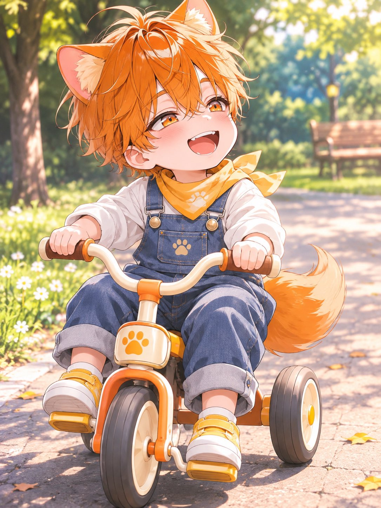）
  - `media/images/2123717991447589131_2.jpg`（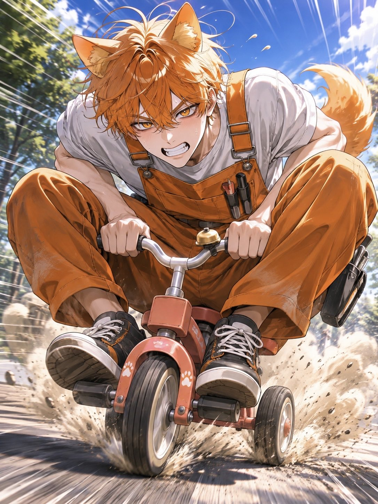）
  - `media/images/2123717991447589131_3.jpg`（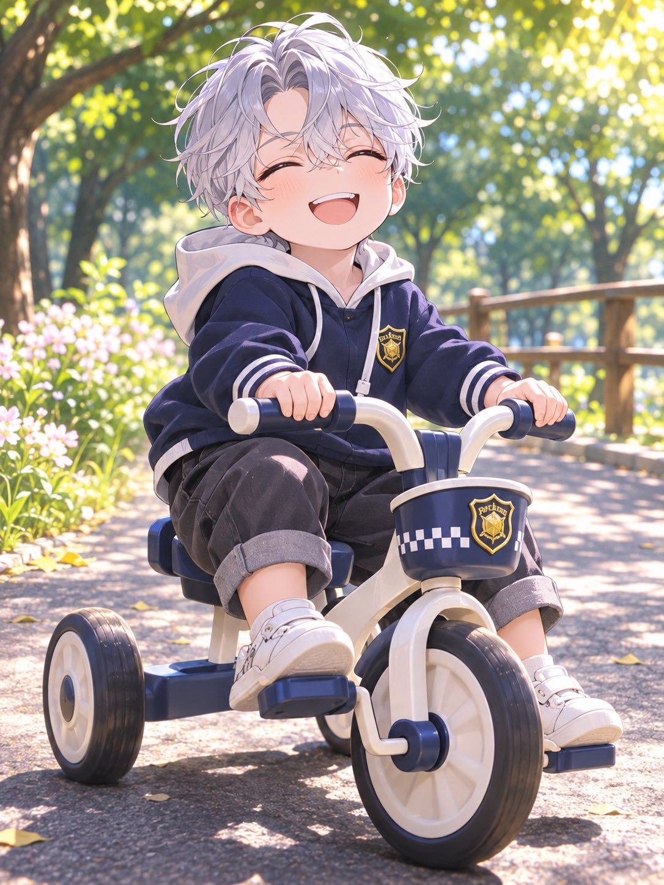）
  - `media/images/2123717991447589131_4.jpg`（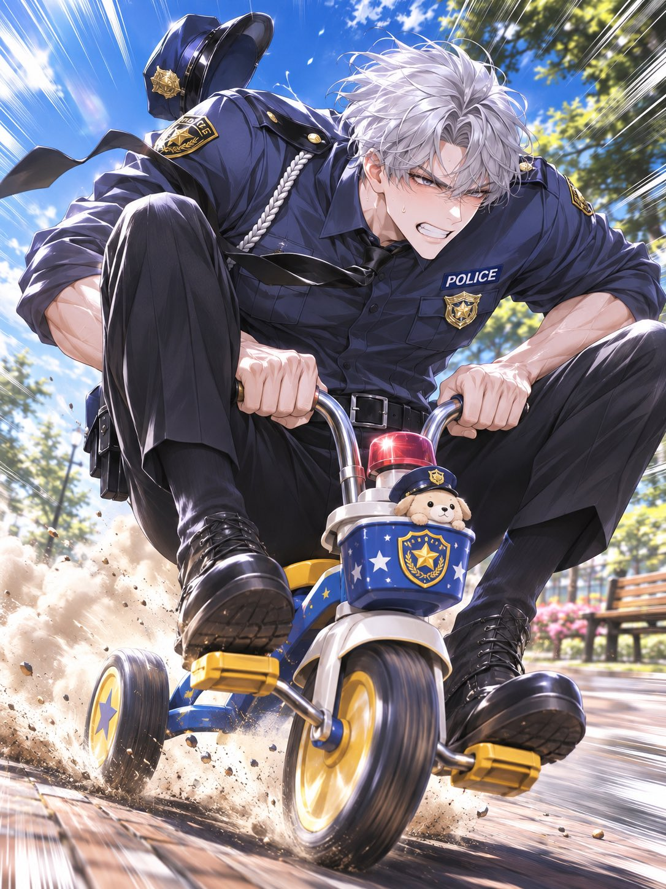）
  - `media/images/2123717991447589131_5.jpg`（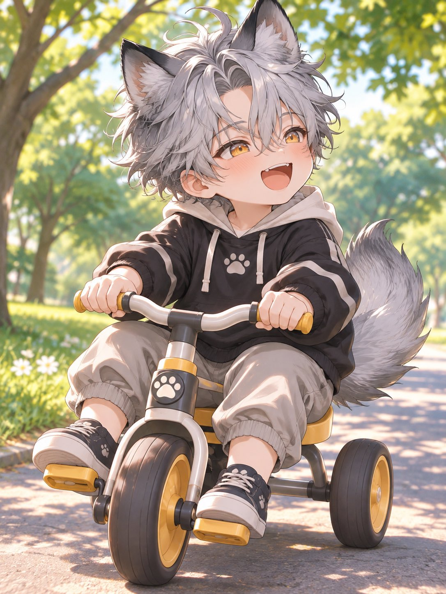）
  - `media/images/2123717991447589131_6.jpg`（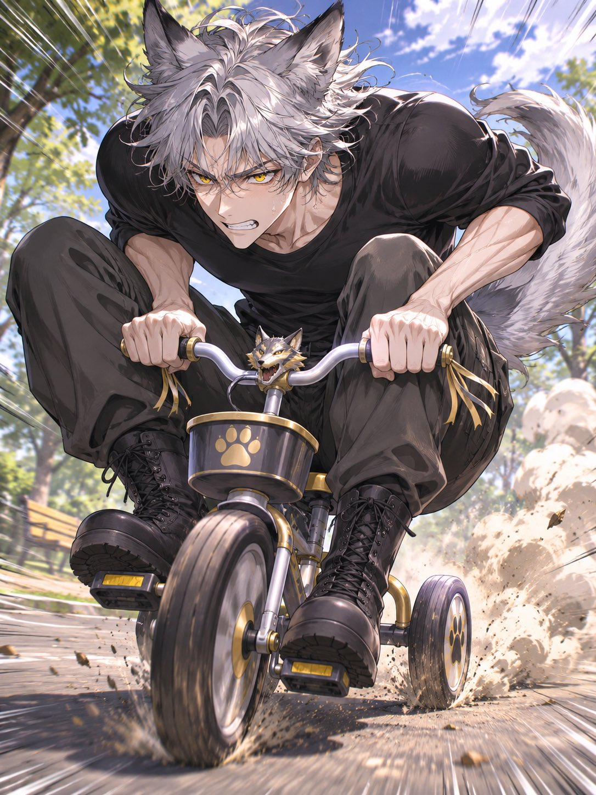）
  - `media/images/2123717991447589131_7.jpg`（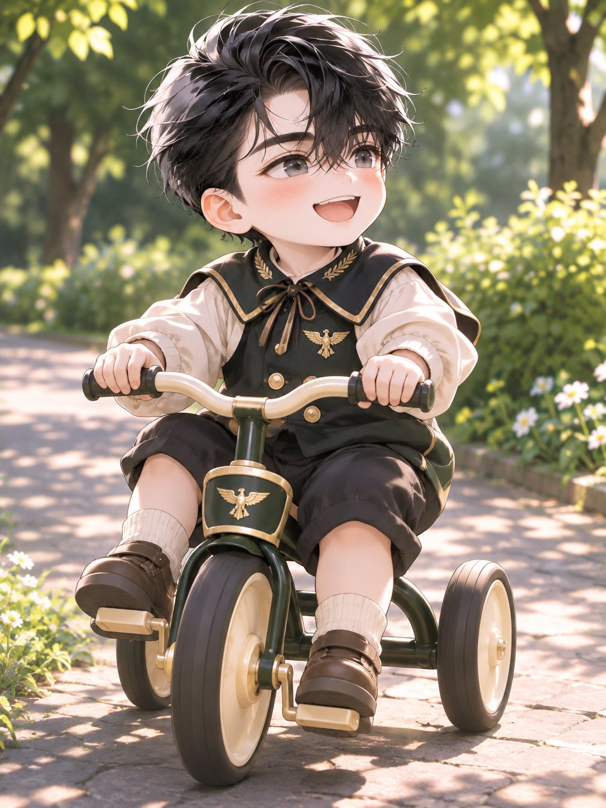）
  - `media/images/2123717991447589131_8.jpg`（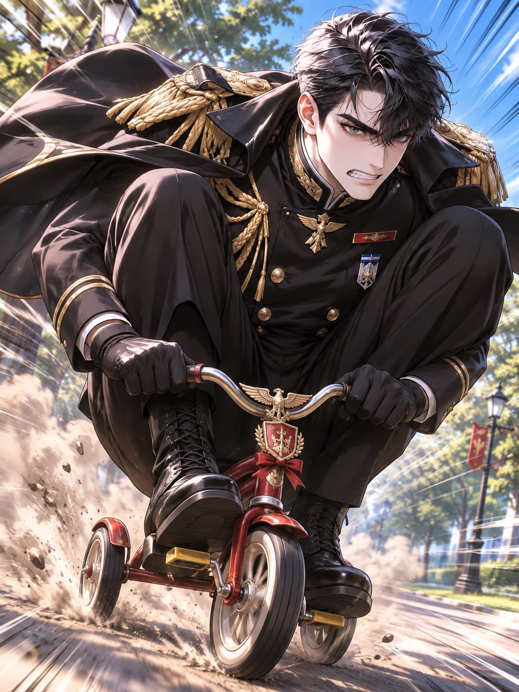）
  - `media/images/2123717991447589131_9.jpg`（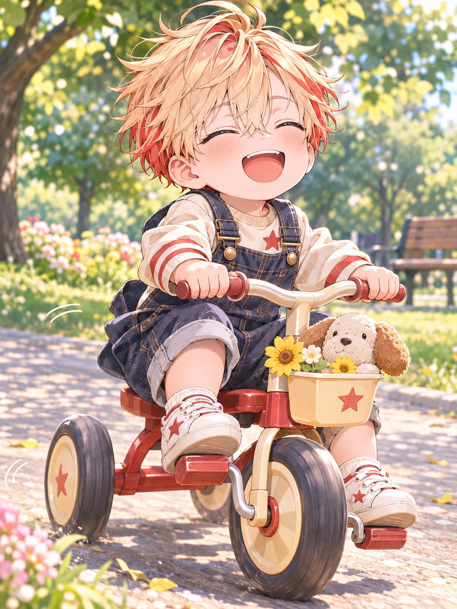）
  - `media/images/2123717991447589131_10.jpg`（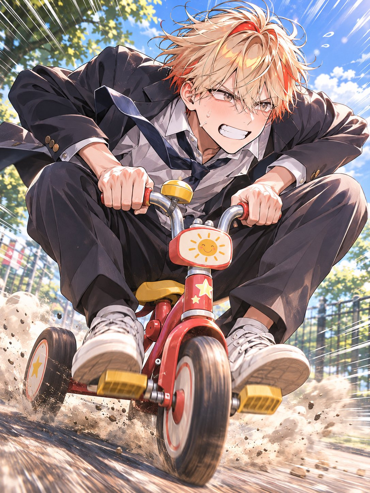）
  - `media/images/2123717991447589131_11.jpg`（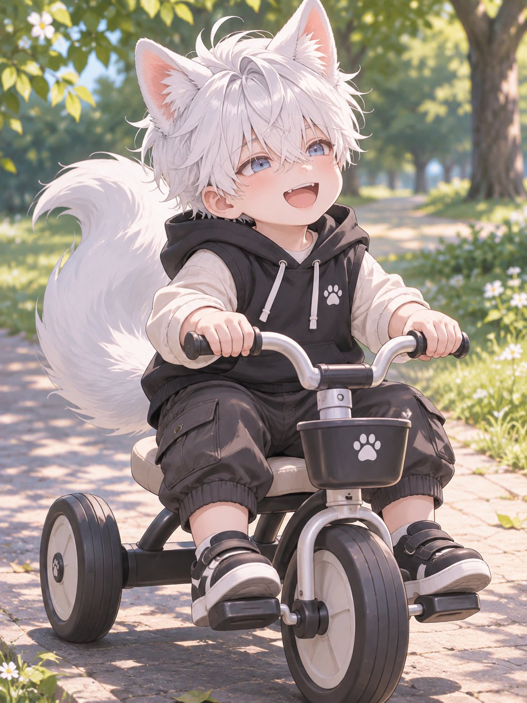）
  - `media/images/2123717991447589131_12.jpg`（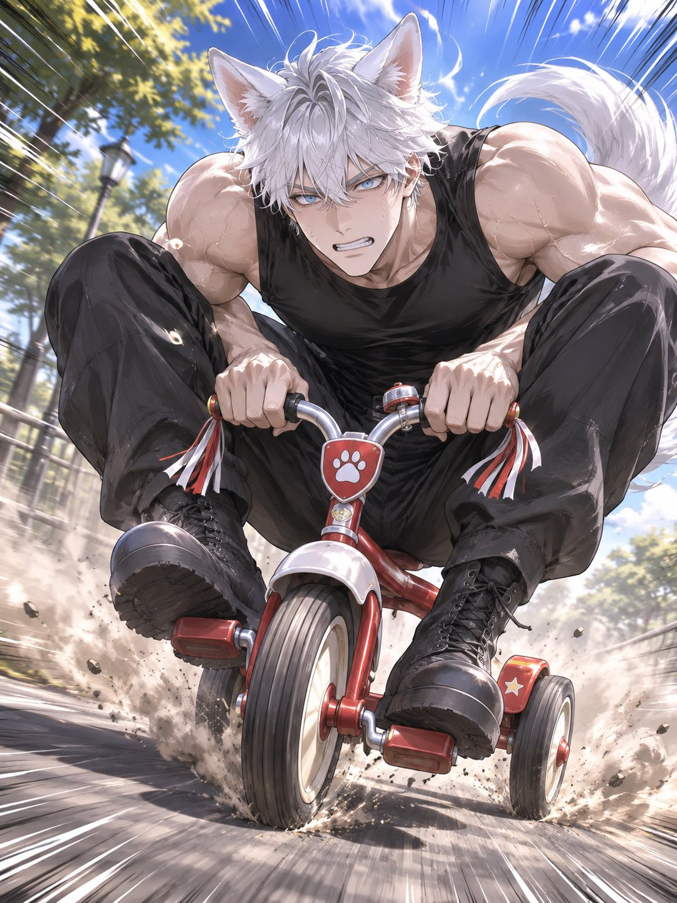）
- 入库日期：2026-11-23
- prompt 来源：https://x.com/_a5_s_/status/2123717992827551807（作者自回复）
- prompt 来源：https://x.com/_a5_s_/status/2123717993620181096（作者自回复）
- 备注：prompt 分两条作者自回复：子供ver.（2123717992827551807）与大人ver.（2123717993620181096），两条均整条原样摘录，中间以空行分隔。用法：先把 prompt 发给 ChatGPT，再按要求发送角色图。子供ver.把角色变成 2 岁幼儿在公园骑三轮车，纯日常治愈向，非性化；大人ver.为成人角色窘迫骑极小三轮车的搞笑动作场面。原帖 12 张示例图全部入库（幼儿版与成人版交替）。

## prompt 原文

```text
子供ver.はこちら
↓↓↓

【人物分析型・オリジナル画像生成｜キャラクター×三輪車(子供)】
このプロンプトを受信したら、まず「キャラクター画像（複数枚）を送ってください」と要求してください。画像が送信されたら、追加の質問をせず、以下の指示に従って自動的に画像を生成してください。
【Concept】
入力されたキャラクター画像をもとに、そのキャラクターが2歳の子供になって三輪車に乗っている姿を、一枚のオリジナル作品として生成する。登場するキャラクターは必ず1人のみとし、キャラクター固有の魅力や特徴を大切にしながら、2歳児ならではの愛らしさと、三輪車でのんびり過ごす穏やかな時間を表現する。画像を受け取ったら、追加質問をせず自動で画像を生成する。
【キャラクター表現】
キャラクター画像の顔立ち、髪型、髪色、目の色、体の特徴、種族的特徴、装飾品など、本人と分かる固有のデザインを維持する。2歳児らしい大きめの頭、短い手足、丸みのある幼児体型、ふっくらした頬など、年齢に合った体型へ自然に変換する。髪は適度なボリュームを持つまとまりのある毛束とし、全体のシルエットや流れる方向、毛束同士の重なりや陰影によって立体感を表現する。細かな毛を一本ずつ描き込む表現や、毛先の細かな分岐、短い飛び毛の多用は避ける。キャラクター画像に動物耳・尻尾・角・翼などの特殊な特徴がある場合のみ維持し、左右一対の特徴は両方を正しく描写する。存在しない特徴は追加しない。衣装はキャラクター画像の服をそのまま縮小・再現せず、2歳児にふさわしい子供服として新たにデザインする。幼児らしいシルエットや着やすさを重視し、丸みのある柔らかな形、ゆったりとしたサイズ感、自然な素材感を取り入れる。キャラクター画像の衣装からは配色や象徴的なモチーフなど、キャラクターを認識できる要素を引き継ぐ。
【幼児らしい個性・表情】
キャラクターの性格や気質を踏まえ、2歳児だった場合の姿を自然に表現する。キャラクターの核となる個性を保ちながら、幼児ならではの純粋さ、好奇心、素直さ、不器用さを加える。楽しそうに微笑んだり、楽しそうに景色に興味を示したりするなど、三輪車に乗っている状況に合った自然な表情や仕草を選択する。年齢相応の豊かな感情表現を取り入れつつ、キャラクター本来の性格や雰囲気からかけ離れないものとする。
【三輪車とポーズ】
2歳児用の小さなペダル式三輪車とする。前輪1つ、後輪2つ、ハンドル、ペダル、サドル、フレームを備えた構造とし、2歳児の体格に合ったサイズとする。三輪車のデザインにもキャラクターの配色やモチーフをさりげなく取り入れる。子供は三輪車に自然に座り、ゆったりとしたペースで楽しそうにペダルを漕ぐ姿とする。無理な前傾や力みを避け、肩や腕、足に余計な緊張のない自然体の姿勢とする。視線は進行方向や周囲の景色へ自然に向け、景色を眺めたり、周囲に興味を示したりする何気ない仕草も取り入れる。
【構図・演出】
画像比率は縦3:4。地面に近い低めの視点を基本とし、三輪車や子供の姿が自然に映える構図とする。広角気味の遠近感を適度に取り入れ、前輪や足元に奥行きを持たせる。走行による軽い動きは表現しつつ、激しいスピード感や必死さは避ける。髪や衣服、尻尾などにはそよ風を感じる程度の自然な揺れを加え、必要に応じて小さな砂埃や控えめな動きの線を添える。
【背景・世界観】
公園や緑の小道、広場など、子供が三輪車で過ごすのにふさわしい穏やかな場所とする。草花、木漏れ日、柔らかな日差しなどを取り入れ、明るく温かな日常の一場面に仕上げる。背景に通行人や別のキャラクター、動物などは登場させず、主役となる1人のキャラクターだけを描写する。地面に落ちる影、車輪の接地、周囲から差し込む光などを自然につなげ、キャラクターと空間との一体感を持たせる。背景は主役を引き立てるよう整理し、過度な描き込みを避ける。
【画風・品質】
高品質で繊細なアニメイラストとする。柔らかな光と自然な陰影、温かみのある鮮やかな色彩、髪・肌・衣服・三輪車それぞれの質感を丁寧に表現する。手足は短く丸みのある2歳児らしい形とし、手のひらや指先、足先にも自然な柔らかさを持たせる。全体を優しく親しみやすい雰囲気にまとめ、幼児らしい丸みと愛らしさを重視する。
【身体・接触の整合性】
手は自然にハンドルを握り、足はペダルに無理なく届く状態とする。座る位置、膝や肘の曲がり方、手足と三輪車の接触を正確に描写する。手足の本数、指、関節の形状やつながりを自然に保ち、身体や車体の不自然な貫通・融合・重なりを避ける。2歳児らしい体型と自然な動作を両立させる。
【文字・レイアウト】
文字は使用しない。一枚の独立したイラストとして完成させる。

大人ver.はこちら
↓↓↓

【人物分析型・オリジナル画像生成｜キャラクター×三輪車(大人)】
このプロンプトを受信したら、まず「キャラクター画像（複数枚）を送ってください」と要求してください。画像が送信されたら、追加の質問をせず、以下の指示に従って自動的に画像を生成してください。
【Concept】
大人のキャラクターが、子供向けの極端に小さな三輪車に必死になって乗っている、シュールでコミカルな一枚を制作する。大人の身体に対して三輪車があまりにも小さく、窮屈な姿勢で無理やり乗っているアンバランスさを最大の笑いどころとする。本人は必死にペダルを漕いでいるが、見た目はどこか滑稽というギャップを表現する。演出は本格的なレースやバトルシーンのように大げさで迫力満点にし、その壮大さと極小三輪車の組み合わせによって独特の面白さを生み出す。
【人物分析・三輪車のデザイン】
送信されたキャラクター画像を総合的に分析し、外見的特徴だけでなく、表情、雰囲気、性格を感じさせる要素、モチーフ、色彩、世界観などを読み取る。顔立ち、髪型、髪色、目、体格、種族的特徴、耳、尻尾、角、装飾品など、キャラクター固有のデザインと本人性を維持する。抽出した個性や特徴を、今回の表情・ポーズ・服装・三輪車のデザインに一貫して反映する。キャラクターのイメージを崩さない範囲で、表情・ポーズ・服装は必ず変更し、元画像の表現をそのまま流用しない。三輪車は明確に子供向けと分かる小型のペダル式とし、自動車や四輪車にはしない。前輪1つ、後輪2つの合計3輪構造とし、ペダル、ハンドル、サドル、フレームを備えた一般的な構造を正確に表現する。大人が乗るには明らかに小さすぎる寸法とし、人物分析で抽出したイメージカラー、モチーフ、世界観を取り入れた、そのキャラクター専用のオリジナルデザインとする。
【ポーズ・表情・身体構造】
小さなサドルに窮屈そうに座り、膝を大きく曲げながら必死にペダルを漕ぐなど、サイズの不釣り合いが伝わる乗車姿勢とする。ハンドルを強く握り、身体を前のめりにするなど、全力で三輪車を操縦している様子を表現する。顔と視線は必ず三輪車の進行方向へ向け、カメラ目線や後方への振り向きは禁止する。必死さや焦りが伝わる表情とし、キャラクター本来の個性も残す。頭部から胴体、肩、腕、手、腰、脚、足先まで、全身の骨格・関節・筋肉のつながりを自然かつ正確に描写する。腕と脚の本数、左右の整合性、関節の向き、手指・足指の形状と本数を正しく保ち、欠損、増殖、融合、ねじれ、不自然な重なりを防ぐ。膝や肘の曲がり方、腰の位置、サドルへの着座、身体と三輪車の前後関係を明確にし、無理のない乗車姿勢として成立させる。両手とハンドル、両足とペダルの接触を正確に描写する。身体、衣服、三輪車の各パーツが不自然に貫通・融合しないようにし、接触部分まで一貫した立体構造を維持する。
【構図・アクション・漫画的演出】
縦長3:4の一枚絵。地面すれすれのローアングルを基本とし、見上げるような視点でキャラクターと三輪車を大きく捉える。広角レンズのような遠近感とパースを活用し、前輪や足元を大胆に手前へ配置して迫力を生み出す。三輪車は勢いよく走行している瞬間を描写する。後輪付近や地面から土煙、砂埃、小石などが勢いよく巻き上がり、車輪の回転や地面の流れによって強い疾走感を演出する。髪、衣服、尻尾、装飾品なども走行風で自然になびかせる。画面の奥行きや斜めの動きを活かし、静止画でありながら動きが伝わる構図にする。漫画やコミックの視覚表現として、集中線、スピード線、動線、振動線、汗マーク、焦りを表す記号などを場面に合わせて使用する。集中線やスピード線は進行方向と画面の奥行きを意識して配置し、土煙や砂埃などの立体的な演出と組み合わせる。演出は大げさでドラマチックにする一方、極小三輪車に必死に乗っている滑稽さが常に伝わるようにする。演出記号は適度な強弱と密度をつけ、主役の顔や身体、三輪車を隠さない。過剰に画面を埋め尽くさず、イラスト全体に自然に馴染ませる。キャラクター、三輪車、手足、3つの車輪、ペダルなどの重要部分を画面内に収め、サイズ差が明確に伝わる構図とする。
【背景・画風・仕上げ】
背景は公園や広場、舗装された遊歩道などからキャラクターの世界観に合う場所を選択する。背景にも奥行きを持たせ、土煙や砂埃が自然に広がる空間を描く。高品質で精密なアニメイラスト。少年漫画のアクションシーンのようなダイナミックな演出と、緻密な描写、立体的な質感を融合させる。自然な光と影、車体の素材感、土煙や砂埃の質感を丁寧に描写する。迫力あるアクション表現とコミカルな状況のギャップを両立させる。
【文字・レイアウト】
文字は入れない。一枚の完成されたイラストとして仕上げる。
```

---

个人学习归档，非商业。prompt 与媒体版权归原作者 @_a5_s_，引用请回到原帖。
