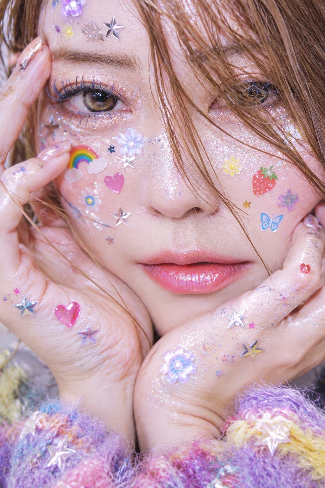

# 一张自拍变「Y2K × 原宿デコラ」闪粉贴纸艺术人像：湿发、全息亮片、双手捧脸大特写

- 原帖链接：https://x.com/momoka_saotome2/status/2123725181600571731
- 作者：早乙女桃華💎💎（@momoka_saotome2）
- 时间：2026-11-20 18:28 (UTC+8 / Asia/Taipei)
- 互动摘要：点赞 165 · 转发 14 · 回复 3 · 引用 5 · 书签 16 · 浏览 7967（采集快照：2026-11-23 09:05 UTC+8）
- 模型/工具：ChatGPT（作者写「写真を1枚添付して、ChatGPTに送るだけ」，未注明具体图像模型）
- 标签：真人
- 媒体路径：
  - `media/images/2123725181600571731_1.jpg`（）
- 入库日期：2026-11-23
- prompt 来源：https://x.com/momoka_saotome2/status/2123725221777826267（作者自回复）
- 备注：prompt 在作者自回复（2123725221777826267），整条原样摘录。需上传一张本人照片作参考；构图为面部与双手特写，非性化。

## prompt 原文

```text
添付した人物写真1枚のみを、唯一の人物参照画像として使用してください。

元写真の人物本人の顔立ち、目の形、鼻、口、輪郭、骨格、肌色、髪色、髪型、年齢感、本人特有の雰囲気を忠実に維持してください。

別人化、過度な美顔加工、顔の作り変えは禁止。本人がそのままファッションアートの世界に入り込んだようなリアルな写真にしてください。

【作品のコンセプト】
海外の個性的なファッションマガジンや、Y2K・原宿デコラファッションを融合させた、ポップで幻想的なアートポートレート。

【ヘアメイク】
髪は濡れたようなウェットヘア。
自然に顔にかかる細い毛束や、少し乱れた無造作な髪。
肌は透明感のあるツヤ肌で、頬や鼻筋に繊細な光沢をプラス。
目元や頬には細かなホログラムラメを散りばめる。

【デコレーション】
顔、頬、額、手の甲、指先などに、大小さまざまな可愛いシールをたくさん貼る。

星、ハート、お花、いちご、蝶々、フルーツ、虹、カラフルな小さなキャラクターなど、子供の頃の宝物箱をひっくり返したような自由で楽しいデザイン。

シルバーの星型パーツ、透明なホログラム、偏光ラメ、細かなグリッターをふんだんに使用。

シールやラメは肌に自然に密着しているように表現し、光を反射してキラキラと輝かせる。

【ポージング・構図】
顔を大きく写した大胆なアップのポートレート。
両手で頬を包み込むようなポーズ。
指先や手の甲にもデコレーションを施す。
カメラを見つめる印象的な眼差し。
少しアンニュイで、いたずらっぽく、無邪気な表情。

顔、手、肩などが画面いっぱいに入る近距離撮影。
自然で少し崩したポージングで、作り込みすぎない雰囲気。

【衣装・背景】
カラフルな毛糸やモヘア素材、立体的な編み物、個性的なテクスチャーの布を画面の手前に配置。
背景はシンプルな淡いグレーやホワイト。
人物とデコレーションが際立つ構成。

【撮影・質感】
プロのファッションフォトグラファーが撮影したような超高精細な実写写真。
強めのフラッシュ撮影。
肌の質感、濡れた髪、ラメの反射、シールの立体感までリアルに描写。
透明感のある明るい光と、少し無機質な海外エディトリアル風の色調。

【重要】
イラストやCGではなく、あくまで実在する人物を撮影したリアルな写真にすること。
人物本人の顔を絶対に別人に変えないこと。
装飾や世界観は大胆に変えても、人物の同一性は維持すること。

完成イメージは、キラキラ、カラフル、少し奇抜で、遊び心のあるデコラティブなアートポートレート。
```

---

个人学习归档，非商业。prompt 与媒体版权归原作者 @momoka_saotome2，引用请回到原帖。
