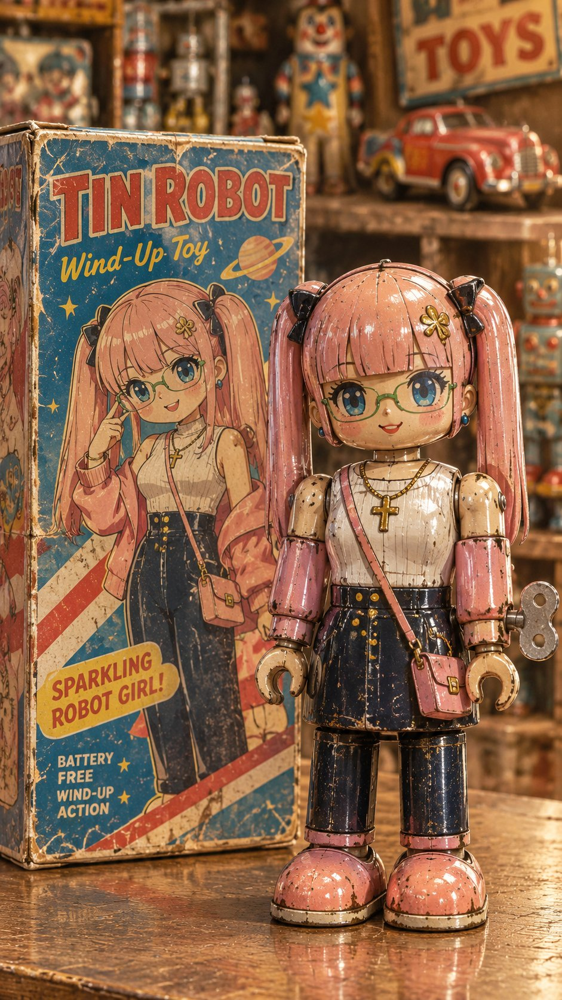
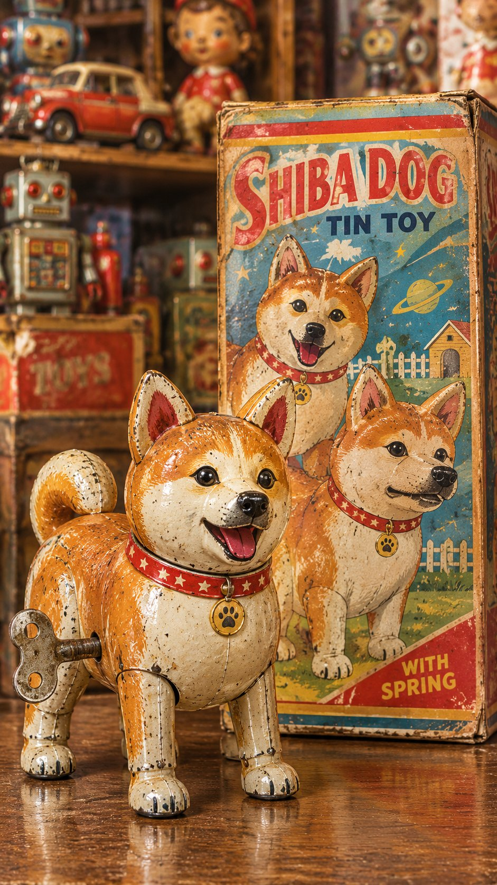

# 把自家角色做成 1950–60 年代昭和レトロ发条铁皮玩具 + 复古纸盒包装的商品摄影（#うはおけプロンプト）

- 原帖链接：https://x.com/uhaoke_stamp/status/2123727809978007739
- 作者：うはおけ@スタンプ作成（@uhaoke_stamp）
- 时间：2026-11-20 18:39 (UTC+8 / Asia/Taipei)
- 互动摘要：点赞 46 · 转发 8 · 回复 4 · 引用 9 · 书签 8 · 浏览 2739（采集快照：2026-11-23 09:05 UTC+8）
- 模型/工具：未注明
- 标签：其它
- 媒体路径：
  - `media/images/2123727809978007739_1.jpg`（）
  - `media/images/2123727809978007739_2.jpg`（）
- 入库日期：2026-11-23
- prompt 来源：https://x.com/uhaoke_stamp/status/2123770134464799006（作者自回复）
- 备注：prompt 同时写在原帖第 1 张图的 ALT 与作者自回复（2123770134464799006）里；这里从自回复「最高品質。」起原样摘录（略去开头「■プロンプト■」标签）。需上传角色图作参考；示例为双马尾女孩角色与柴犬两款铁皮玩具。

## prompt 原文

```text
最高品質。昭和レトロの玩具文化を感じさせる、1950〜1960年代のヴィンテージ・ブリキ玩具を忠実に再現した、リアルでノスタルジックなプロダクトイラスト。

【基本構図】 縦長9:16。画面中央に、添付したキャラクターをモチーフにしたブリキ製のゼンマイ式ロボット玩具を配置する。その隣には、当時の玩具店で販売されていたような、オリジナルのレトロな紙製パッケージ箱を並べる。玩具本体と箱の両方が全体まで見える構図。

【キャラクター・玩具の再現】 添付キャラクターの顔立ち、髪型、特徴的な色彩、服装のデザインや個性をできる限り忠実に残しながら、実際に量産されていた古いブリキ玩具の造形に変換する。人体をそのまま立体化するのではなく、当時の玩具らしい丸みのある胴体、円筒形の手足、単純化された関節、少し不格好で愛嬌のあるフォルムにする。塗装は経年変化したような光沢のあるエナメル塗装。金属の継ぎ目、リベット、ネジ、ゼンマイ機構、細かな擦り傷や塗装の剥がれもリアルに表現する。

【パッケージデザイン】 玩具の隣に、キャラクターを描いた当時風の紙箱を配置。色褪せた水色やクリーム色、赤や黄色を基調としたレトロな配色。手描き風のキャラクターイラスト、大胆な英語の商品名、星や惑星などの装飾、古い印刷特有の色ズレや紙の黄ばみを表現。実際の昭和時代の輸出玩具のパッケージのようなデザイン。

【背景・質感】 古い玩具専門店やアンティークショップで撮影した商品写真のような雰囲気。柔らかな自然光、リアルな接地影、精巧な金属表面、紙箱の質感。玩具コレクターが大切に保管していた希少なヴィンテージ品のような存在感。

【仕上げ】 フォトリアル、実物のブリキ玩具の商品撮影、精密なディテール、アナログ感、昭和レトロ、ヴィンテージ、ノスタルジック、アンティーク、博物館級のコレクターズアイテム。CG特有の滑らかさや現代的なプラスチック玩具の質感は避け、実在する古いブリキ玩具に見える仕上がり。縦横比9:16。
```

---

个人学习归档，非商业。prompt 与媒体版权归原作者 @uhaoke_stamp，引用请回到原帖。
