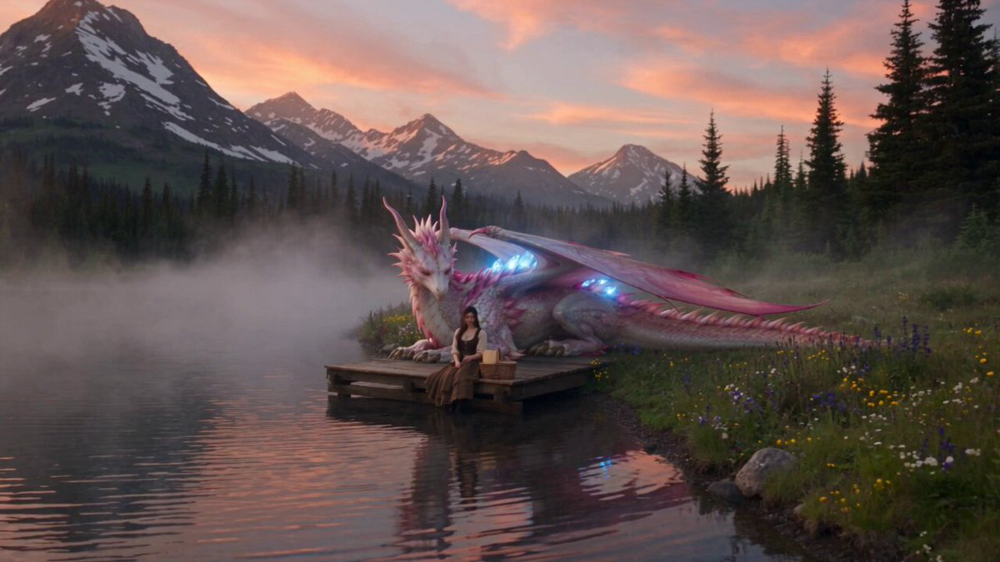

# 黄昏湖畔的少女与蓝银巨龙：一起放飞纸灯笼许愿的 30 秒奇幻短片（8 镜头分镜 + 台词）

- 原帖链接：https://x.com/mehwishkiran07/status/2123732495099420725
- 作者：Mehwish kiran（@mehwishkiran07）
- 时间：2026-11-20 18:57 (UTC+8 / Asia/Taipei)
- 互动摘要：点赞 126 · 转发 26 · 回复 32 · 引用 1 · 书签 18 · 浏览 1696（采集快照：2026-11-23 09:05 UTC+8）
- 模型/工具：Seedance 2.5（作者标注）
- 标签：真人
- 媒体路径：
  - `media/video-stills/2123732495099420725_still.jpg`（视频封面截图，）
  - 视频本体未入库，仅保留原帖链接：https://x.com/mehwishkiran07/status/2123732495099420725
- 入库日期：2026-11-23
- prompt 来源：https://x.com/mehwishkiran07/status/2123732502301008021（作者自回复）
- 备注：prompt 在作者自回复（2123732502301008021），从「Cinematic, photorealistic」起原样摘录（略去开头「Video Prompt ⤵️」标签）。prompt 写明 young woman，中世纪风长裙装束，温馨奇幻题材，非性化。视频本体未入库，仅保留原帖链接。

## prompt 原文

```text
Cinematic, photorealistic fantasy video, 16:9, 30 seconds. Setting: a calm mountain lake at dusk, with a wooden dock, wildflowers on the shore, pine trees and snowy peaks in the distance, a pink and orange sunset sky reflected on the water, and a few early stars. Soft magical lighting, gentle mist over the lake, realistic motion, shallow depth of field.

Characters: a young woman with long silver-blonde braided hair, a cream puff-sleeved blouse, a brown leather corset bodice and a long brown skirt, holding a small paper lantern; and a huge, gentle blue-and-silver dragon with pale scales, glowing blue crystal spikes, warm golden eyes and large blue wings.

Shot 1 (0–3s): Wide shot. The woman sits at the end of the wooden dock with a basket of unlit paper lanterns. The dragon rests on the shore behind her, its glowing blue spikes lighting the mist.

Shot 2 (3–7s): Close-up of the woman, smiling. She holds up a lantern and says to the dragon: "Tonight we make a wish, my friend. Just one, and we send it across the water." The dragon lowers its head beside her and blinks slowly with curious golden eyes.

Shot 3 (7–11s): Medium shot. The woman places the lantern on the dock and looks up at the dragon. She says: "Can you light it for me? Gently, please, just a tiny spark." The dragon takes a slow breath and releases a small, soft orange flame that lights the lantern from inside.

Shot 4 (11–15s): Close-up. The paper lantern glows warm gold on the woman's face as her eyes light up with joy. She whispers: "It's beautiful. You did it perfectly." The dragon makes a soft, happy rumble.

Shot 5 (15–19s): Wide shot. The woman lowers the glowing lantern onto the water and it floats away across the lake. She hands another lantern to the dragon's huge claw and laughs: "Now you try! Be careful, they're delicate!"

Shot 6 (19–23s): Close-up. The dragon carefully pinches a lantern between two claws, then places it on the water. Its golden eyes reflect the glow. The woman claps her hands and says: "Look at that! You're so gentle!"

Shot 7 (23–27s): Wide, slightly high shot. Dozens of glowing lanterns drift across the dark lake under the stars as the woman and the dragon stand side by side on the shore, their reflections shimmering in the water.

Shot 8 (27–30s): Medium close-up. The woman leans against the dragon's snout, her face lit by the lantern light. She says softly: "Thank you for staying with me. This is my favorite night." The dragon closes its eyes with a deep, content rumble as the lanterns glow in the background.

Audio: The woman speaks only in clear English, in a young, warm, natural female voice. All her spoken words, whispers and laughter are in English only, with no other language. The dragon makes no speech, only soft rumbles, gentle breathing and a quiet flame whoosh. Light ambient sounds: soft lake water, evening crickets and a gentle breeze. Soft, warm, magical background music.
```

---

个人学习归档，非商业。prompt 与媒体版权归原作者 @mehwishkiran07，引用请回到原帖。
