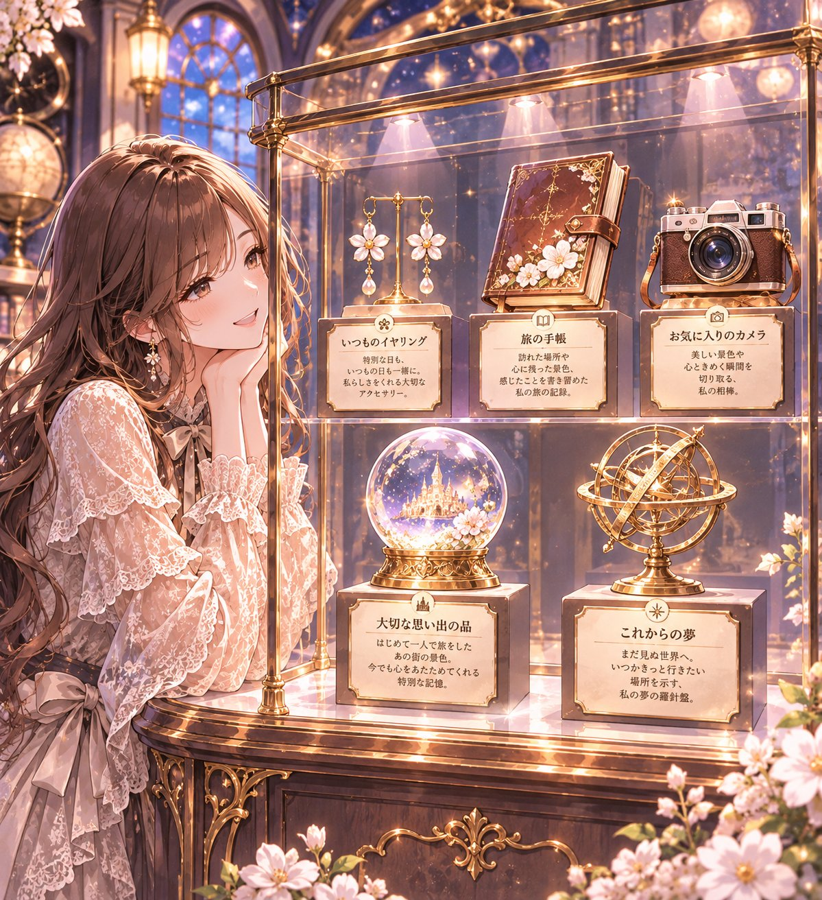
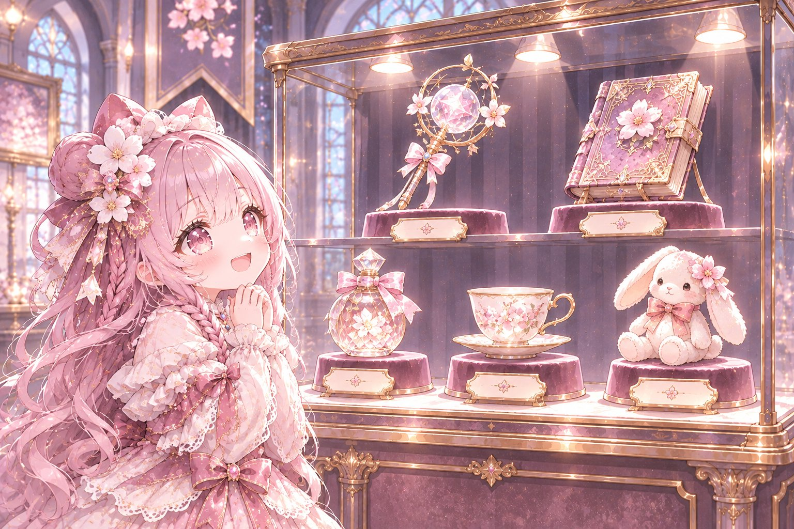

# 「うちの子・架空の博物館展示」：为自家角色开一间专属博物馆，5 件愛用品/回忆之物进玻璃展柜（#ゆきプロンプト）

- 原帖链接：https://x.com/AIXyu1v/status/2123748269730025497
- 作者：ゆき　AIイラストXで収益化（@AIXyu1v）
- 时间：2026-11-20 20:00 (UTC+8 / Asia/Taipei)
- 互动摘要：点赞 59 · 转发 7 · 回复 3 · 引用 7 · 书签 26 · 浏览 2577（采集快照：2026-11-23 09:05 UTC+8）
- 模型/工具：未注明
- 标签：二次元
- 媒体路径：
  - `media/images/2123748269730025497_1.jpg`（）
  - `media/images/2123748269730025497_2.jpg`（）
- 入库日期：2026-11-23
- prompt 来源：https://x.com/AIXyu1v/status/2123748272514965893（作者自回复）
- 备注：prompt 在作者自回复（2123748272514965893），整条原样摘录（含原文的 ** 粗体标记）。需上传角色图作参考。

## prompt 原文

```text
うちの子・架空の博物館展示 🏛️✨

添付画像のキャラクターを参考に、**その子の愛用品や思い出が展示された、世界にひとつだけの博物館**を描いてください。

髪型・髪色・瞳・衣装・アクセサリーなど、元キャラの特徴を忠実に再現してください。

【展示テーマ】
キャラクターの性格・設定・世界観から、**その子を象徴する展示物を5点**考えてください。

例：
・いつも身につけているアクセサリー
・お気に入りの愛用品
・キャラを象徴する特別なアイテム
・大切な思い出の品
・秘密や物語を感じさせる宝物

キャラクターごとに展示内容を変えてください。

【シーン】
美しくライトアップされた小さな博物館の展示室。

**透明なガラスケースの中に、5点の展示物が丁寧に並べられています。**

それぞれの展示物には小さな解説プレートを設置。

キャラクター本人は展示ケースの横に立ち、自分の博物館を嬉しそうに眺めています。

【可愛さのポイント】
・本人と展示物のつながりが伝わる
・キャラのイメージカラーを展示室に反映
・展示物ごとに異なる形や質感
・小さなスポットライトで宝物を美しく演出
・本当に存在する博物館のような特別感

【構図・背景】
**キャラクター1人と展示物5点が、すべてはっきり見える構図。**

展示物はそれぞれ独立した台座に置き、重ならないようにしてください。

展示ケースのガラスは透明で、内部が見やすいように反射を控えめに。

解説プレートには短い装飾線やシンボルを使用し、読めない文字は無理に描かないでください。

背景は上品で幻想的な博物館。柔らかな照明と落ち着いた色彩で、展示物を主役にしてください。

【仕上がり】
高品質なアニメイラスト。精巧な展示物、透明なガラスの質感、繊細な照明、キャラクターの物語が伝わる幻想的な世界観。

【禁止事項】
元キャラの特徴変更、人物の追加、展示物の増殖や欠落、展示物同士の融合、展示ケースの不自然な変形、展示物が見えない構図、余分な手足、顔や手の崩れ、読めない文字、実在企業のロゴ、透かし。
```

---

个人学习归档，非商业。prompt 与媒体版权归原作者 @AIXyu1v，引用请回到原帖。
