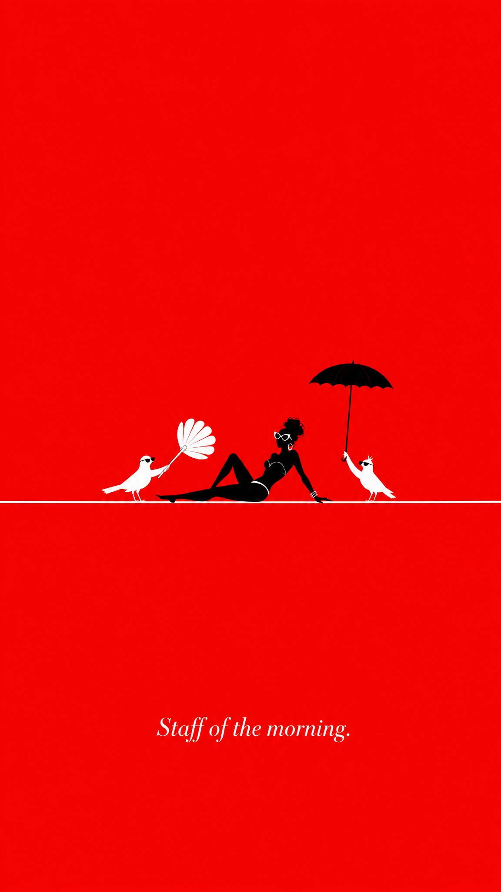

# 极简红底漫画海报：躺在细线上戴墨镜的小黑剪影女士，两只小白鸟为她扇花瓣、撑伞（「Staff of the morning.」）

- 原帖链接：https://x.com/abulu8/status/2124106817399894332
- 作者：Syed Abuthahir ∞（@abulu8）
- 时间：2026-11-21 19:45 (UTC+8 / Asia/Taipei)
- 互动摘要：点赞 158 · 转发 8 · 回复 38 · 引用 0 · 书签 3 · 浏览 10540（采集快照：2026-11-23 09:05 UTC+8）
- 模型/工具：未注明
- 标签：其它
- 媒体路径：
  - `media/images/2124106817399894332_1.jpg`（）
- 入库日期：2026-11-23
- 备注：prompt 在原帖图片的 ALT 文本里（作者写「Prompt in ALT」），整段原样摘录。

## prompt 原文

```text
Ultra-minimal comic poster, flat scarlet background, a tiny black adult woman silhouette lounging on a thin white line in sunglasses, a tiny white bird fanning her with a large white flower petal, a second bird holding a tiny black umbrella over her, vast red negative space, small refined white serif italic text 'Staff of the morning.' near the bottom, white, black and red, glamorous and funny, flat vector, exact text.
```

---

个人学习归档，非商业。prompt 与媒体版权归原作者 @abulu8，引用请回到原帖。
