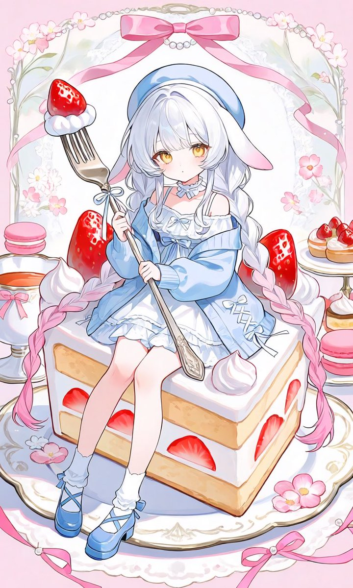
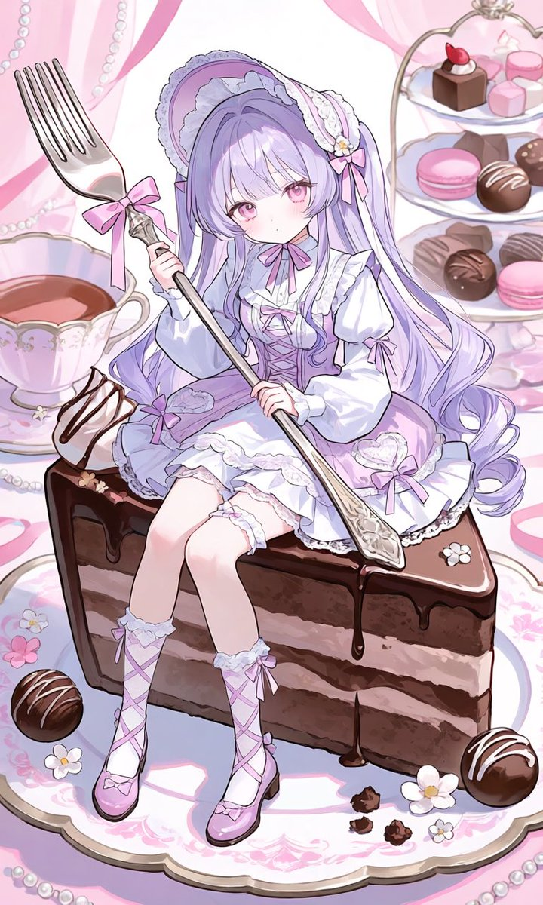
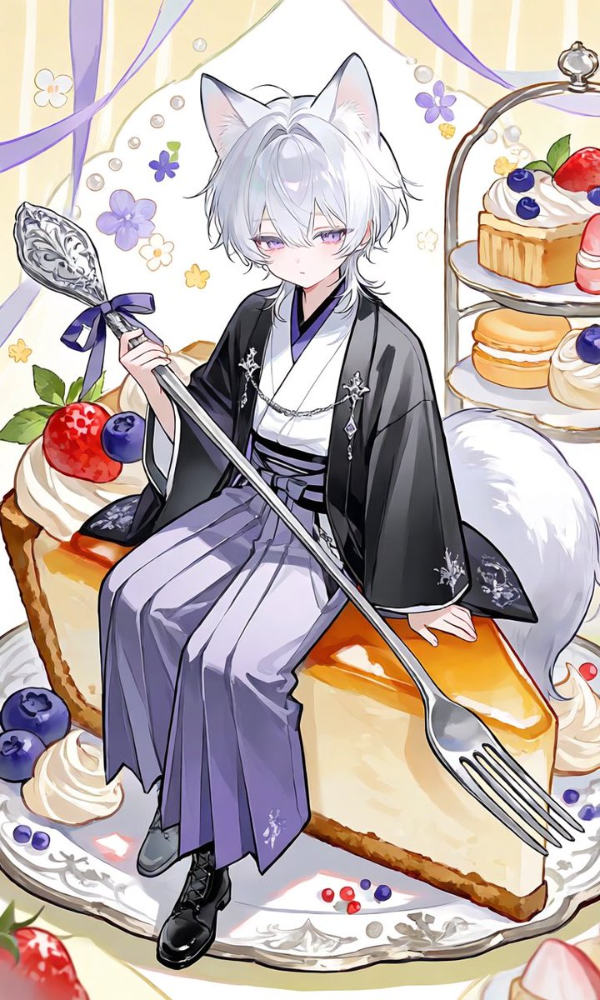

# 「Petit Sweets Wonderland」：坐在巨大草莓蛋糕/巧克力蛋糕/芝士蛋糕切块上、握银叉的甜点微缩世界（3 款 + 共通负面）

- 原帖链接：https://x.com/xOwOx_U/status/2124442771377533159
- 作者：🐰🎀⸝꙳（@xOwOx_U）
- 时间：2026-11-22 18:00 (UTC+8 / Asia/Taipei)
- 互动摘要：点赞 158 · 转发 21 · 回复 1 · 引用 11 · 书签 130 · 浏览 6118（采集快照：2026-11-23 19:55 UTC+8）
- 模型/工具：未注明（作者写「TSUBAKI推奨」）
- 标签：二次元
- 媒体路径：
  - `media/images/2124442771377533159_1.jpg`（）
  - `media/images/2124442771377533159_2.jpg`（）
  - `media/images/2124442771377533159_3.jpg`（）
- 入库日期：2026-11-23
- prompt 来源：https://x.com/xOwOx_U/status/2124442771780219217（作者自回复）
- prompt 来源：https://x.com/xOwOx_U/status/2124442772065439800（作者自回复）
- prompt 来源：https://x.com/xOwOx_U/status/2124442772388344217（作者自回复）
- prompt 来源：https://x.com/xOwOx_U/status/2124442772686159907（作者自回复）
- 备注：prompt 在作者 4 条自回复的图片 ALT 里（作者注明「2つ繋げてね」）：🍰/🍫/🧀 三款各由两张 ALT 拼接（两段 ALT 之间以一个空格连接），最后一段为「共通ネガ」。每段首行为该自回复正文（emoji 标识），其余为 ALT 原文。作者写「FF内外さん問わずご自由に」。

## prompt 原文

```text
🍰
masterpiece, best quality, ultra-detailed, beautiful anime illustration, delicate detailed face, well-defined facial features, symmetrical face, balanced facial proportions, clear beautiful eyes, symmetrical eyes, natural eye placement, delicate eyelashes, detailed nose and mouth, clean facial lineart, sharp facial details, crisp focus on face, sitting on top of a giant triangular strawberry shortcake slice, holding an oversized elegant silver fork in hand, clearly gripping the fork handle, cute relaxed sitting pose, dangling legs, large strawberry shortcake slice, distinct layers of soft sponge cake and whipped cream, fresh red strawberries, strawberry slices, fluffy whipped cream decorations, decorative cream swirls, ornate porcelain dessert plate, pastel pink and white color palette, whimsical miniature sweets world, illustrated diorama style, miniature tea party scenery, delicate pearls, tiny flowers, macarons and pastries, decorative ribbons, dreamy pastel background, beautiful composition, soft luminous lighting, intricate details, charming fantasy atmosphere

🍫
masterpiece, best quality, ultra-detailed, beautiful anime illustration, delicate detailed face, well-defined facial features, symmetrical face, balanced facial proportions, clear beautiful eyes, symmetrical eyes, natural eye placement, delicate eyelashes, detailed nose and mouth, clean facial lineart, sharp facial details, crisp focus on face, sitting on top of a giant triangular chocolate cake slice, holding an oversized elegant silver fork in hand, clearly gripping the fork handle, cute relaxed sitting pose, dangling legs, large chocolate cake slice, distinct layers of rich chocolate sponge and chocolate cream, glossy chocolate ganache, chocolate shavings, chocolate curls, chocolate decorations, fluffy whipped cream, tiny chocolate truffles, ornate porcelain dessert plate, pastel pink and cocoa brown color palette, whimsical miniature sweets world, illustrated diorama style, miniature chocolate tea party scenery, delicate pearls, tiny flowers, macarons and pastries, decorative ribbons, dreamy pastel background, beautiful composition, soft luminous lighting, intricate details, charming fantasy atmosphere

🧀
masterpiece, best quality, ultra-detailed, beautiful anime illustration, delicate detailed face, well-defined facial features, symmetrical face, balanced facial proportions, clear beautiful eyes, symmetrical eyes, natural eye placement, delicate eyelashes, detailed nose and mouth, clean facial lineart, sharp facial details, crisp focus on face, sitting on top of a giant triangular cheesecake slice, holding an oversized elegant silver fork in hand, clearly gripping the fork handle, cute relaxed sitting pose, dangling legs, large creamy cheesecake slice, thick smooth cream cheese filling, golden baked surface, distinct buttery biscuit crust, glossy honey glaze, fresh blueberries, raspberries and strawberries, decorative whipped cream swirls, tiny berry decorations, ornate porcelain dessert plate, pastel cream and pale yellow color palette, whimsical miniature sweets world, illustrated diorama style, miniature dessert tea party scenery, delicate pearls, tiny flowers, macarons and pastries, decorative ribbons, dreamy pastel background, beautiful composition, soft luminous lighting, intricate details, charming fantasy atmosphere

共通ネガ
worst quality, low quality, low resolution, photorealistic, realistic photography, realistic food photography, clay sculpture, resin figure, deformed face, distorted face, asymmetrical face, unbalanced facial features, uneven eyes, misaligned eyes, crossed eyes, malformed eyes, extra eyes, missing eyes, blurry face, poorly drawn face, distorted mouth, malformed nose, merged facial features, low facial detail, blurry eyes, bad anatomy, deformed body, extra arms, extra hands, extra fingers, missing fingers, fused fingers, malformed hands, poorly drawn hands, floating fork, fork on table, missing fork, tiny fork, fork not held, holding fork incorrectly, whole round cake, entire birthday cake, standing pose, sitting beside cake, floating character, photorealistic 3d render, plastic texture, text, watermark
```

---

个人学习归档，非商业。prompt 与媒体版权归原作者 @xOwOx_U，引用请回到原帖。
