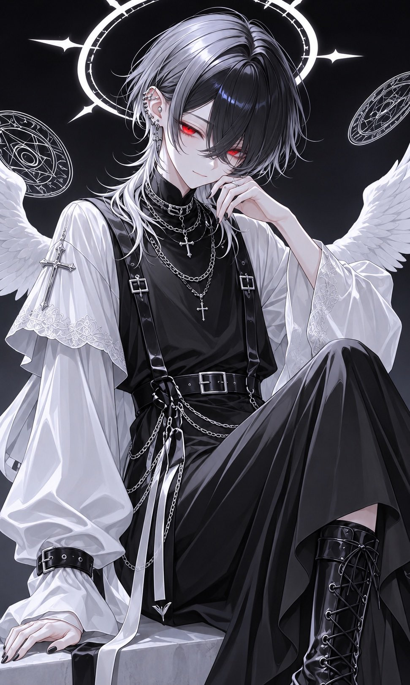
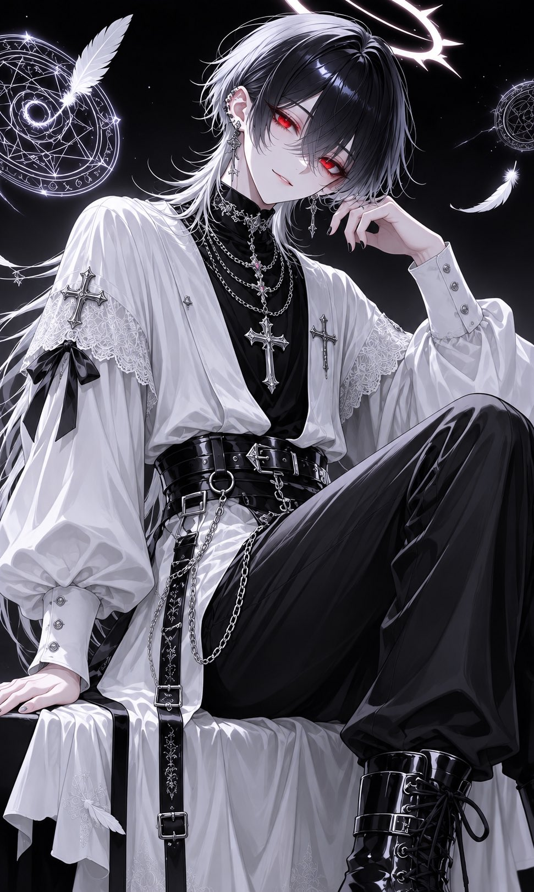
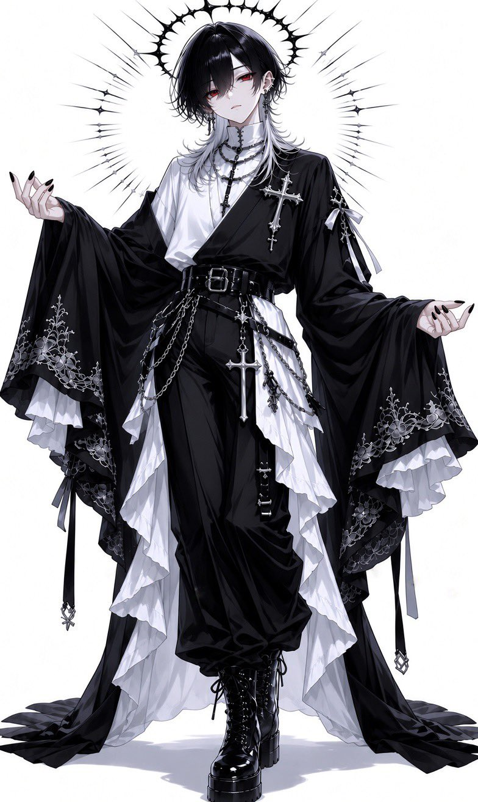

# 「神衣装」：黑白双色中性风哥特天使·地雷系神明服装（光环、十字、银链、厚底靴）

- 原帖链接：https://x.com/Shii_yuumrg/status/2124486177873137746
- 作者：椎名（@Shii_yuumrg）
- 时间：2026-11-22 20:52 (UTC+8 / Asia/Taipei)
- 互动摘要：点赞 20 · 转发 3 · 回复 1 · 引用 1 · 书签 15 · 浏览 979（采集快照：2026-11-23 19:55 UTC+8）
- 模型/工具：未注明（作者提到 LoRA 会影响腿长等）
- 标签：二次元
- 媒体路径：
  - `media/images/2124486177873137746_1.jpg`（）
  - `media/images/2124486177873137746_2.jpg`（）
  - `media/images/2124486177873137746_3.jpg`（）
- 入库日期：2026-11-23
- prompt 来源：https://x.com/Shii_yuumrg/status/2124486187968774513（作者自回复）
- 备注：prompt 在作者自回复（2124486187968774513）图片 ALT 里，整段原样摘录。作者说明：用日文写「魔法陣」可能出魔法阵；黑白配色有随机性。

## prompt 原文

```text
Divine subculture fashion, an androgynous gothic celestial outfit, oversized layered clothing, elegant black and white layered fabric, asymmetrical design, decorative lace, cross ornaments, silver chains, multiple belts and buckles, dangling ribbons, feather details, halo-inspired accessories, intricate silver jewelry, layered necklaces, long flowing sleeves, stylish platform boots, dark angel aesthetic, holy yet rebellious atmosphere, delicate gothic details, highly detailed fashion design.
```

---

个人学习归档，非商业。prompt 与媒体版权归原作者 @Shii_yuumrg，引用请回到原帖。
