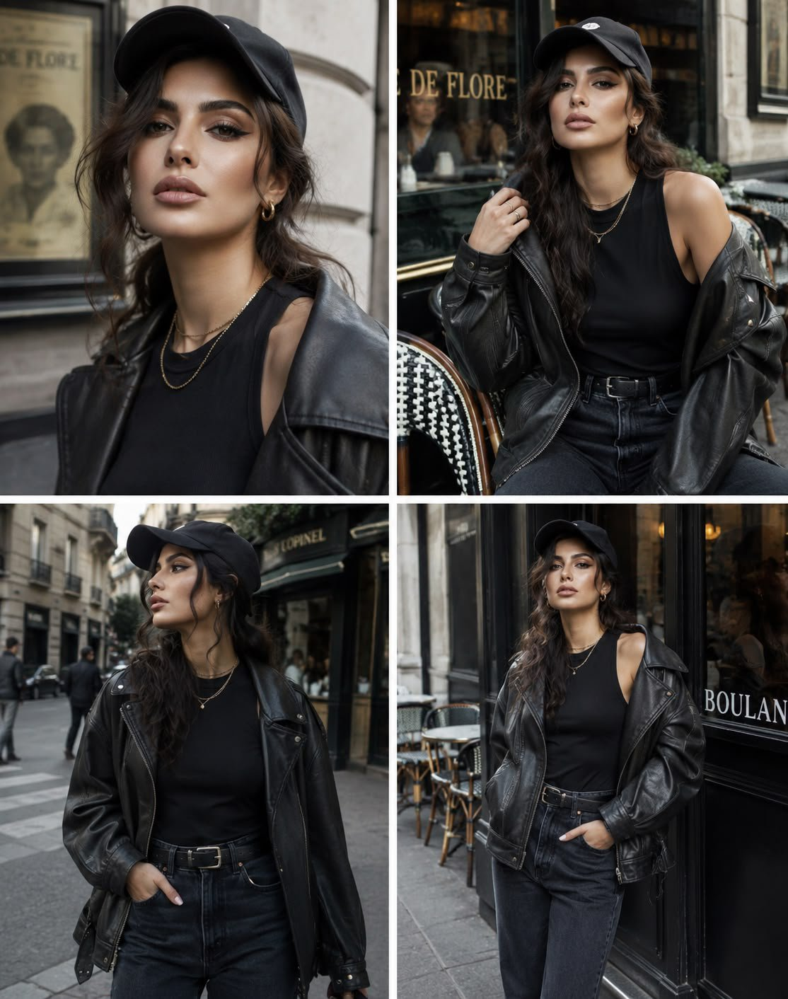

# 欧洲街头的黑帽皮夹克街拍：同一参考人物的 4 种时装社论构图（85mm 人像）

- 原帖链接：https://x.com/mehvishs25/status/2124501638635561464
- 作者：Meem（@mehvishs25）
- 时间：2026-11-22 21:53 (UTC+8 / Asia/Taipei)
- 互动摘要：点赞 33 · 转发 1 · 回复 15 · 引用 1 · 书签 9 · 浏览 1049（采集快照：2026-11-23 19:55 UTC+8）
- 模型/工具：GPT Image 2.6（作者标注，经 ChatGPT）
- 标签：真人
- 媒体路径：
  - `media/images/2124501638635561464_1.jpg`（）
- 入库日期：2026-11-23
- 备注：prompt 在原帖正文，从「Create a premium」起原样摘录。prompt 明写 adult woman，需上传人物参考图。

## prompt 原文

```text
Create a premium, ultra-photorealistic street-fashion editorial featuring the same adult woman from the uploaded reference image. Preserve her exact facial identity, face shape, eyes, nose, lips, skin tone, and natural facial proportions. She must remain instantly recognizable. Do not modify, beautify, or reinterpret her face.

Appearance & Hair:
Keep her original facial features and natural complexion. Style her hair in a relaxed, slightly undone low ponytail with soft loose strands framing her face. Add a black cap worn casually, creating an effortlessly fashionable look.

Outfit & Styling:
She wears a fitted charcoal-black sleeveless top, paired with a relaxed oversized dark leather jacket hanging naturally around her shoulders. Style with high-waisted straight-leg dark denim jeans, a slim black belt, delicate layered gold chains, small gold hoop earrings, and understated rings. Contemporary, sophisticated streetwear with a modest, effortless silhouette.

Location & Atmosphere:
A fashionable European-style city street with elegant stone architecture, oversized café windows, pavement seating, muted storefront signage, and a few distant pedestrians. The environment should feel authentic and naturally lived-in rather than staged.

Photography & Poses:
Create a collection of varied fashion-editorial compositions:

* Tight head-and-shoulders portrait with confident eye contact.
* Waist-up shot with one hand casually adjusting her jacket.
* Three-quarter street portrait looking away from the camera.
* Relaxed standing pose with one hand in her jeans pocket.

Her expressions should feel spontaneous, confident, and effortlessly cool.

Visual Direction:
Shot on a professional full-frame camera with an 85mm portrait lens. Soft overcast daylight, subtle natural shadows, beautifully separated background, crisp facial details, realistic skin pores, authentic leather grain, and natural fabric folds. Use muted urban tones with a refined editorial color grade.

Final Quality:
Luxury contemporary fashion magazine aesthetic, candid Pinterest-inspired street photography, natural anatomy, realistic hands, accurate proportions, exceptional subject sharpness, and lifelike photographic detail. No plastic skin, beauty filters, exaggerated makeup, artificial posing, CGI appearance, or excessive retouching.

Important: The uploaded reference image is the sole identity reference. Preserve the woman’s original face exactly across every composition.
```

---

个人学习归档，非商业。prompt 与媒体版权归原作者 @mehvishs25，引用请回到原帖。
