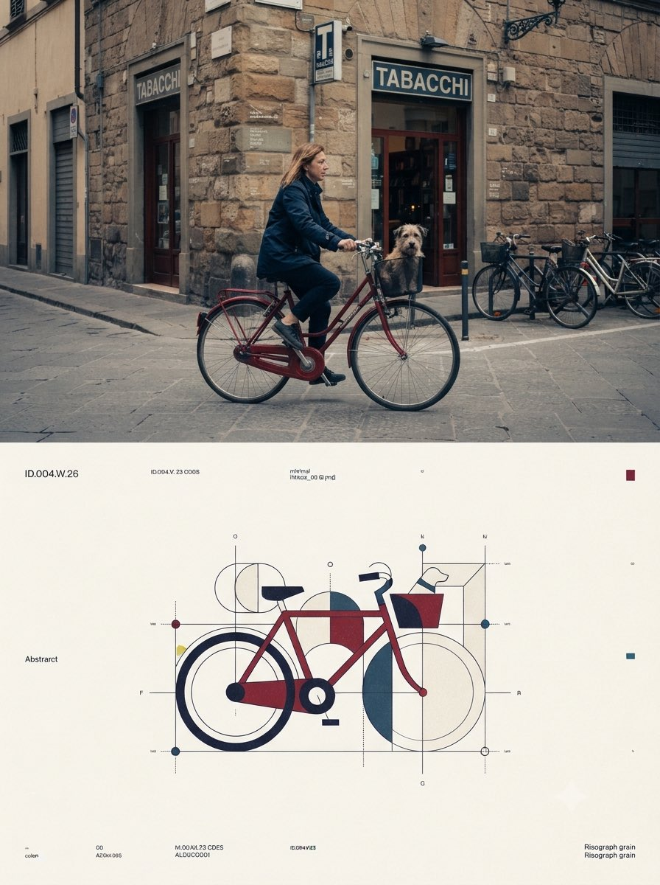

# 1970 年代意大利生活杂志风：佛罗伦萨石板街骑车女子街拍 + 下半瑞士风自行车技术图解海报

- 原帖链接：https://x.com/aniyaintel/status/2124704121089581130
- 作者：Aniya（@aniyaintel）
- 时间：2026-11-23 11:18 (UTC+8 / Asia/Taipei)
- 互动摘要：点赞 59 · 转发 3 · 回复 28 · 引用 1 · 书签 15 · 浏览 4282（采集快照：2026-11-23 19:55 UTC+8）
- 模型/工具：Nano Banana（作者标注 Google Gemini Nano Banana，经 Higgsfield）
- 标签：真人
- 媒体路径：
  - `media/images/2124704121089581130_1.jpg`（）
- 入库日期：2026-11-23
- 备注：prompt 在原帖正文，从「Create a sophisticated」起原样摘录（含 NEGATIVE PROMPT 段）。

## prompt 原文

```text
Create a sophisticated vintage European street photography and graphic design composition inspired by a 1970s Italian lifestyle magazine.

TOP HALF: A candid, ultra-realistic photograph of a stylish young European woman riding a classic burgundy-red vintage bicycle through a narrow cobblestone street in Florence, Italy. She wears a navy-blue jacket, dark trousers, and casual sneakers. A fluffy golden-brown dog sits comfortably inside a front bicycle basket, looking toward the camera. Historic stone buildings, traditional TABACCHI storefronts, parked bicycles, and authentic European street details create a nostalgic atmosphere. Natural overcast daylight, subtle film grain, muted earthy colours, documentary photography aesthetic.

BOTTOM HALF: A minimalist Swiss-style graphic design poster featuring an abstract technical illustration of the same vintage burgundy bicycle. Use geometric shapes, overlapping circles, thin construction lines, measurement marks, typography, and architectural diagram elements.

DESIGN STYLE: Cream/off-white paper background, burgundy red, navy blue, muted teal, subtle yellow accents, minimalist editorial typography, precise geometric composition, and authentic Risograph printing grain.

LAYOUT: Vertical 3:4 editorial poster, photograph occupying the upper half and technical bicycle illustration occupying the lower half. Add tiny design labels, abstract serial numbers, alignment marks, and subtle typography.

QUALITY: Photorealistic street photography combined with premium graphic design, sophisticated art direction, authentic vintage European atmosphere, sharp details, beautiful composition.

NEGATIVE PROMPT: Cartoon, anime, glossy 3D rendering, oversaturated colours, distorted bicycle wheels, extra limbs, duplicated people, messy typography, excessive text, watermarks, and logos.
```

---

个人学习归档，非商业。prompt 与媒体版权归原作者 @aniyaintel，引用请回到原帖。
