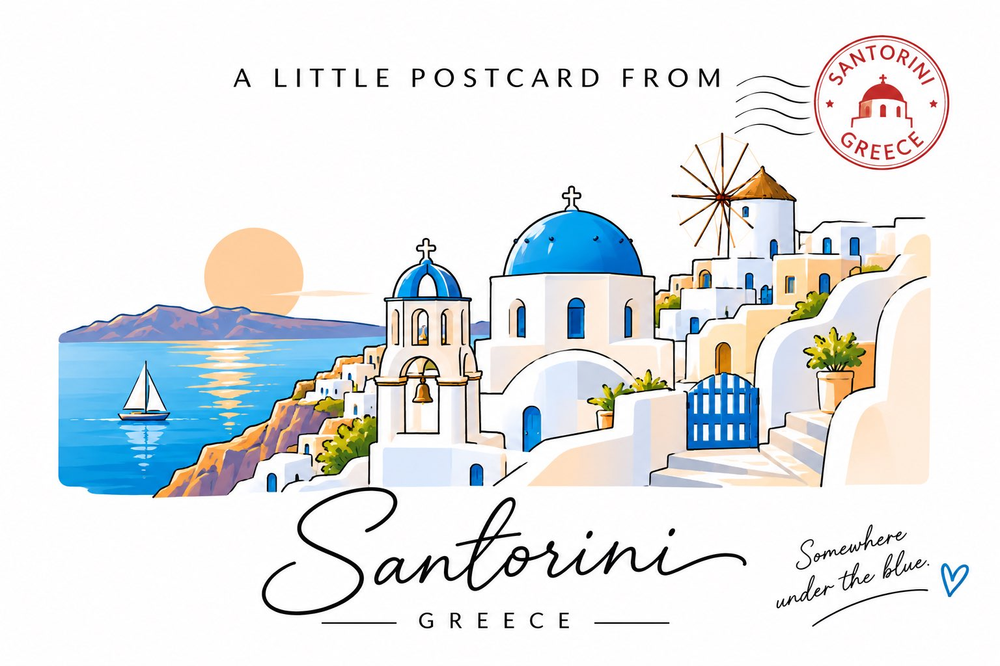
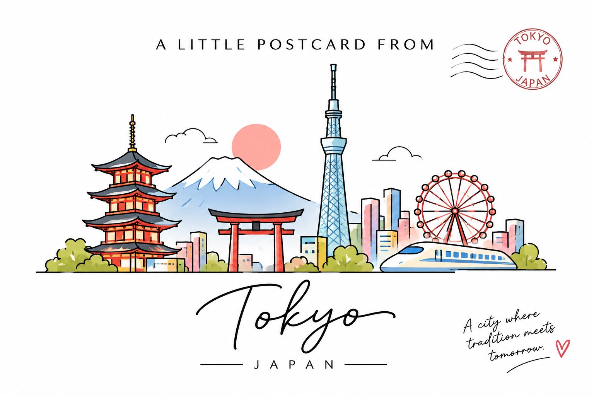
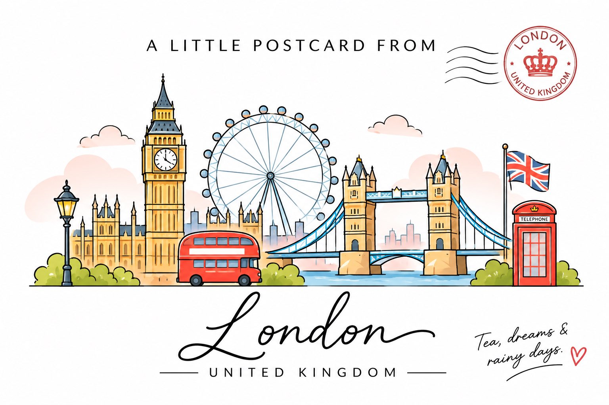
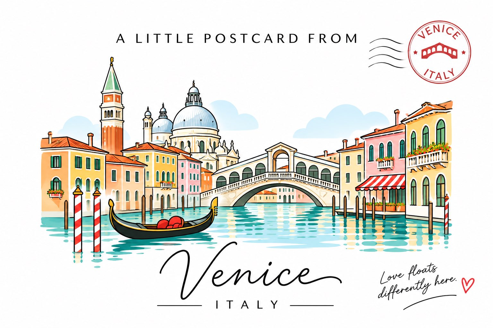

# 「A LITTLE POSTCARD FROM…」：极简手绘水彩城市地标明信片（替换 [CITY]/[COUNTRY] 即用）

- 原帖链接：https://x.com/Naiknelofar788/status/2124723328414048351
- 作者：simeon-sanai（@Naiknelofar788）
- 时间：2026-11-23 12:34 (UTC+8 / Asia/Taipei)
- 互动摘要：点赞 155 · 转发 15 · 回复 24 · 引用 1 · 书签 100 · 浏览 3972（采集快照：2026-11-23 19:55 UTC+8）
- 模型/工具：GPT Image 2.6（作者标注）
- 标签：其它
- 媒体路径：
  - `media/images/2124723328414048351_1.jpg`（）
  - `media/images/2124723328414048351_2.jpg`（）
  - `media/images/2124723328414048351_3.jpg`（）
  - `media/images/2124723328414048351_4.jpg`（）
- 入库日期：2026-11-23
- 备注：prompt 在原帖正文，从「Create an exceptionally」起原样摘录（末行「Little thoughts for different destinations」为原文一部分，照录）。示例为圣托里尼、东京、伦敦、威尼斯。

## prompt 原文

```text
Create an exceptionally cute, charming and minimalist illustrated travel postcard featuring [CITY], [COUNTRY].
ART STYLE & COMPOSITION
A clean, bright white postcard background with a delicate hand-drawn illustration of 4–6 iconic landmarks arranged side by side along a simple horizontal baseline.
Include the most recognisable architectural landmarks of the destination, illustrated in a playful, slightly imperfect sketch style with fine black outlines, soft pastel watercolour fills and charming architectural details.
Keep the landmarks simple, recognisable, colourful and beautifully balanced, almost like a little illustrated travel diary.
COLOUR PALETTE
Use gentle, cheerful pastel shades inspired by the destination. Soft lavender, peach, butter yellow, powder blue, blush pink and muted coral. Every city should have its own distinctive colour combination.
TYPOGRAPHY
At the top, write:
A LITTLE POSTCARD FROM
At the bottom, feature the city name in beautiful flowing handwritten script.
THE LITTLE THOUGHT — SIGNATURE DETAIL
Place one tiny handwritten sentence in a bottom corner, almost like a personal travel journal note.

Keep this thought small, subtle and intimate.
FINAL LOOK
Airy composition, generous white negative space, delicate imperfect ink lines, soft pastel illustrations, whimsical charm and a lovely handmade postcard aesthetic.
Vertical 4:5 format. Elegant, cute, minimal, nostalgic and timeless.
No realistic photography, no heavy backgrounds, no excessive decorations, no unnecessary flowers, no clutter, no 3D effects.
Little thoughts for different destinations
```

---

个人学习归档，非商业。prompt 与媒体版权归原作者 @Naiknelofar788，引用请回到原帖。
