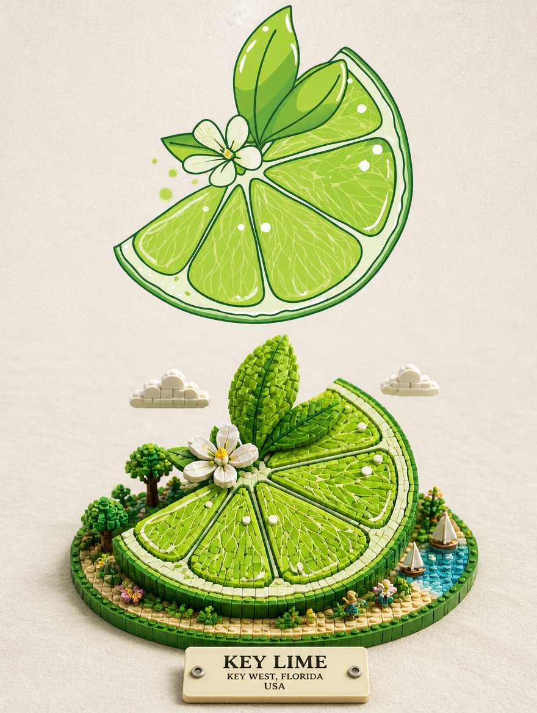
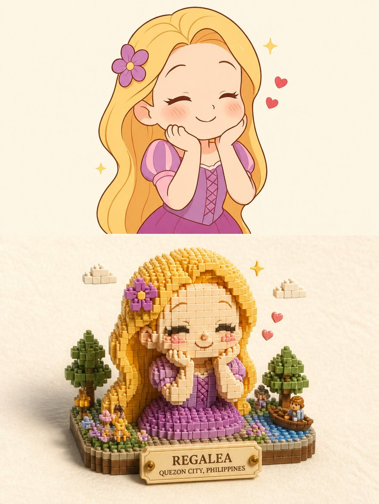
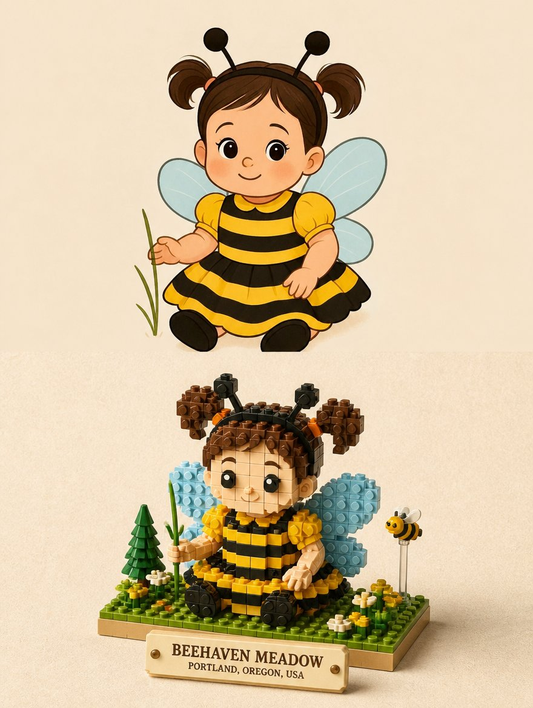
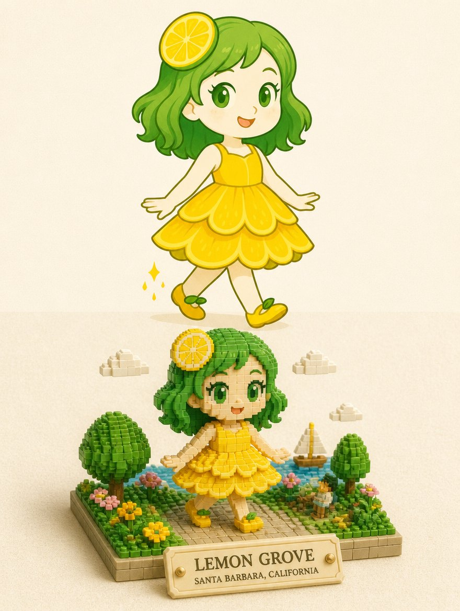

# 上半原照片 + 下半同场景微缩积木模型：带铭牌的微距产品摄影风「小小杰作」

- 原帖链接：https://x.com/sipteaandcoffee/status/2124732867549053196
- 作者：kold Coffee（@sipteaandcoffee）
- 时间：2026-11-23 13:12 (UTC+8 / Asia/Taipei)
- 互动摘要：点赞 122 · 转发 5 · 回复 27 · 引用 0 · 书签 9 · 浏览 854（采集快照：2026-11-23 19:55 UTC+8）
- 模型/工具：GPT Image 2.6（作者标注，经 TapNow）
- 标签：其它
- 媒体路径：
  - `media/images/2124732867549053196_1.jpg`（）
  - `media/images/2124732867549053196_2.jpg`（）
  - `media/images/2124732867549053196_3.jpg`（）
  - `media/images/2124732867549053196_4.jpg`（）
- 入库日期：2026-11-23
- 备注：prompt 在原帖正文，从「3:4 vertical image」起原样摘录。需上传一张照片；示例为青柠、卡通角色等照片的积木版。

## prompt 原文

```text
3:4 vertical image, top 48% / bottom 52%, seamless join, no white line or border. Top: the uploaded photo, unchanged. Bottom: warm off-white textured paper background. Centered, the same scene recreated as a miniature diorama built from tiny micro building bricks with visible studs: same layout, key details and colors, on a thin brick base plate, slight three-quarter front view. Small trees, flowers, clouds, boats or people become tiny brick pieces or mini figures. Below it, a small cream plaque with two screws: the place name in bold uppercase serif, and city and country in smaller caps underneath. Soft studio light, gentle shadow, macro product photo, photorealistic. Avoid: white divider, border, extra text, watermark, logos.
```

---

个人学习归档，非商业。prompt 与媒体版权归原作者 @sipteaandcoffee，引用请回到原帖。
