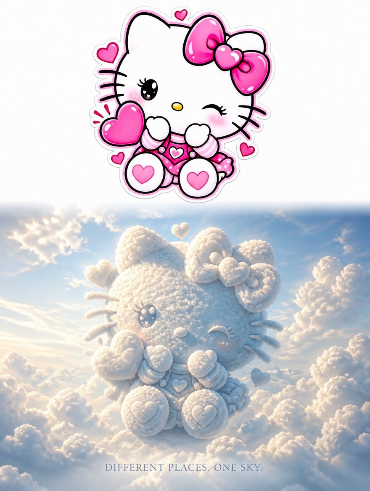
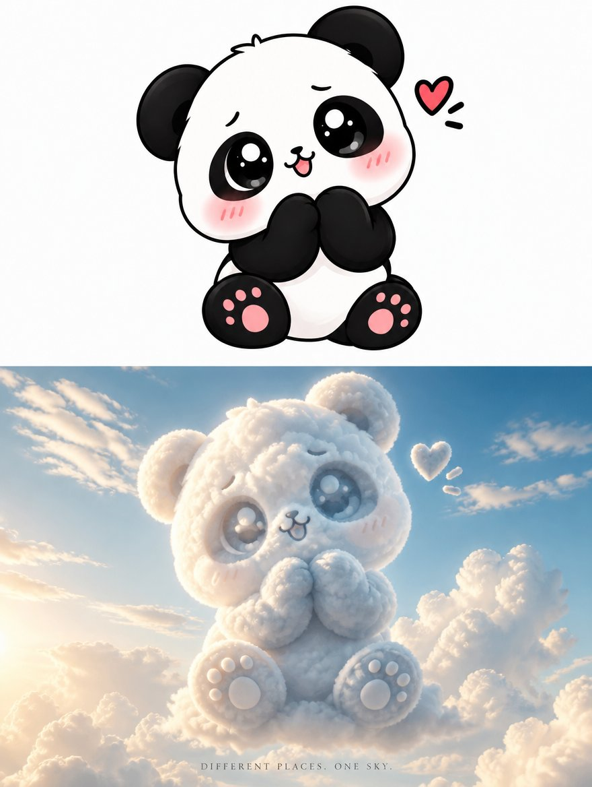
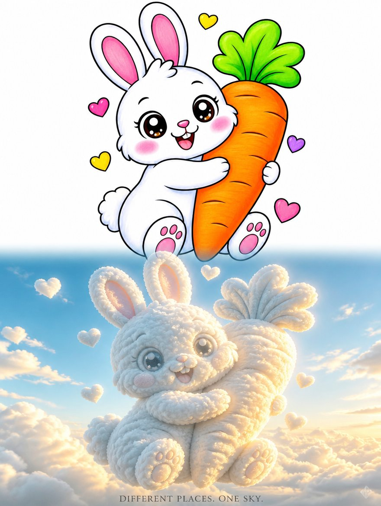

# 「DIFFERENT PLACES. ONE SKY.」：上半保留原照片、下半把同一场景全部用云朵雕塑重建的概念海报

- 原帖链接：https://x.com/Just_sharon7/status/2124744066021925290
- 作者：Sharon Riley（@Just_sharon7）
- 时间：2026-11-23 13:57 (UTC+8 / Asia/Taipei)
- 互动摘要：点赞 162 · 转发 9 · 回复 50 · 引用 0 · 书签 1 · 浏览 16630（采集快照：2026-11-23 19:55 UTC+8）
- 模型/工具：GPT Image 2.6（作者标注，经 TapNow）
- 标签：其它
- 媒体路径：
  - `media/images/2124744066021925290_1.jpg`（）
  - `media/images/2124744066021925290_2.jpg`（）
  - `media/images/2124744066021925290_3.jpg`（）
  - `media/images/2124744066021925290_4.jpg`（）
- 入库日期：2026-11-23
- 备注：prompt 在原帖正文，从「Transform the uploaded」起原样摘录。需上传一张照片；示例 4 张为 Hello Kitty、熊猫、兔子、蘑菇等卡通形象的云朵版。

## prompt 原文

```text
Transform the uploaded photograph into an extraordinary 3:4 vertical conceptual art composition celebrating the beauty and importance of the sky.
TOP 48%: Preserve the uploaded photograph exactly as it appears, with no changes to its subject, environment, or composition.
BOTTOM 52%: Recreate the same photographed scene entirely from soft, sculptural clouds and atmospheric formations.
Every recognizable object, building, landscape feature, and environmental detail must appear formed from dense, delicately shaped clouds.
Architecture becomes beautifully structured white cloud formations. Trees become fluffy cloud sculptures. Roads and pathways become soft atmospheric layers. People and other recognizable subjects become carefully shaped volumetric cloud forms.
Maintain the exact visual arrangement and recognizable silhouettes of the original scene.
Position the entire cloud recreation floating above a luminous pale-blue atmospheric background, illuminated by delicate golden sunlight.
Add realistic volumetric lighting, soft cloud shadows, atmospheric depth, subtle mist, and a dreamy but physically believable appearance.
Place a small elegant inscription beneath the floating scene:
"DIFFERENT PLACES. ONE SKY."
Fine-art environmental photography, ethereal sculptural realism, premium editorial design, ultra-detailed cloud textures, 8K.
Seamless composition, no visible divider, no border, no logos, no watermark.
SYMBOLIC MESSAGE: Wherever we live, the same atmosphere connects us, reminding us that our planet is one shared home.
```

---

个人学习归档，非商业。prompt 与媒体版权归原作者 @Just_sharon7，引用请回到原帖。
