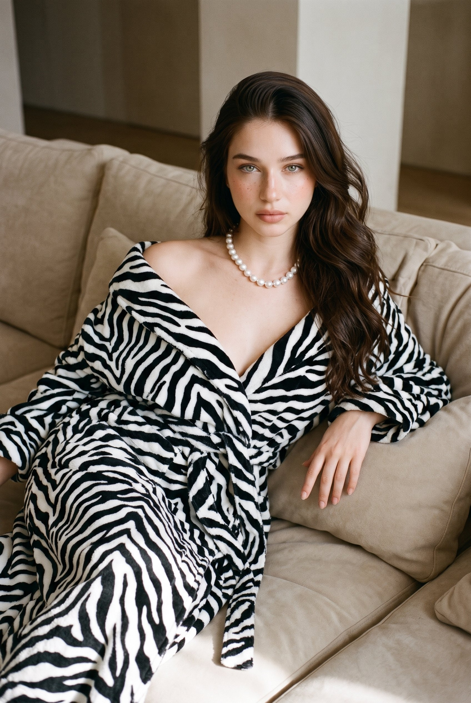
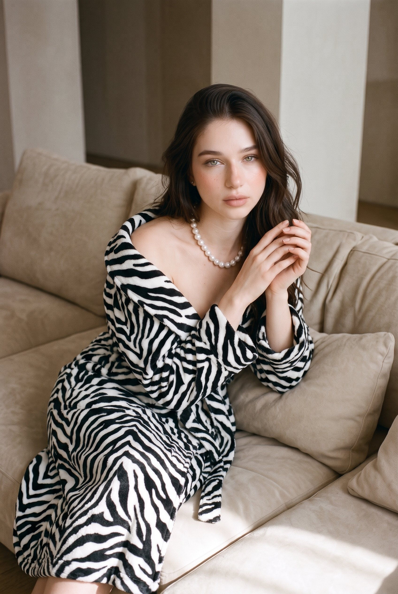

# 斑马纹宽松长袍 + 珍珠项链：米色沙发上的奢华时尚社论人像（参考图换脸写法）

- 原帖链接：https://x.com/MahiraEhan/status/2124749699248738376
- 作者：Mahira（@MahiraEhan）
- 时间：2026-11-23 14:19 (UTC+8 / Asia/Taipei)
- 互动摘要：点赞 95 · 转发 4 · 回复 18 · 引用 0 · 书签 24 · 浏览 635（采集快照：2026-11-23 19:55 UTC+8）
- 模型/工具：Nano Banana 2.1（作者标注）
- 标签：真人
- 媒体路径：
  - `media/images/2124749699248738376_1.jpg`（）
  - `media/images/2124749699248738376_2.jpg`（）
- 入库日期：2026-11-23
- 备注：prompt 在原帖正文，从「Ultra-realistic luxury」起原样摘录。需上传人物参考图；成年女性时装社论人像，衣着完整、非性化。

## prompt 原文

```text
Ultra-realistic luxury fashion editorial photograph of a woman as a reference.

Her hair as a reference styled in loose, flowing waves, swept back from her forehead and cascading over her right shoulder. Natural luminous skin with visible pores, delicate microtexture, subtle peach blush and minimal elegant makeup.

She wears a luxurious oversized black-and-white zebra-patterned robe dress made of soft, thick, textured fabric. Deep V-shaped neckline with relaxed off-the-shoulder styling, revealing her collarbones and shoulders. Voluminous long sleeves, loosely draped fabric and a matching belt tied at the waist. A short, elegant necklace of large white pearls rests around her neck.

The woman reclines comfortably on a large beige upholstered sofa with wide, softly padded back cushions. Her body is slightly angled, shoulders relaxed, one arm extended along the sofa while the other rests naturally near her lap. The flowing zebra-patterned fabric covers her legs.

She looks directly into the camera with a calm, confident, slightly serious expression. Relaxed lips, effortless sophisticated pose.

Medium-close portrait, photographed from a slightly elevated frontal angle. Soft natural daylight from the left, warm neutral tones, delicate shadows, realistic fabric texture and subtle highlights on her face and hair as a reference.

Minimalist beige interior, understated luxury atmosphere, intimate high-fashion editorial photography, natural skin texture without excessive retouching, realistic hair strands, subtle analog film grain, refined cinematic composition.
```

---

个人学习归档，非商业。prompt 与媒体版权归原作者 @MahiraEhan，引用请回到原帖。
