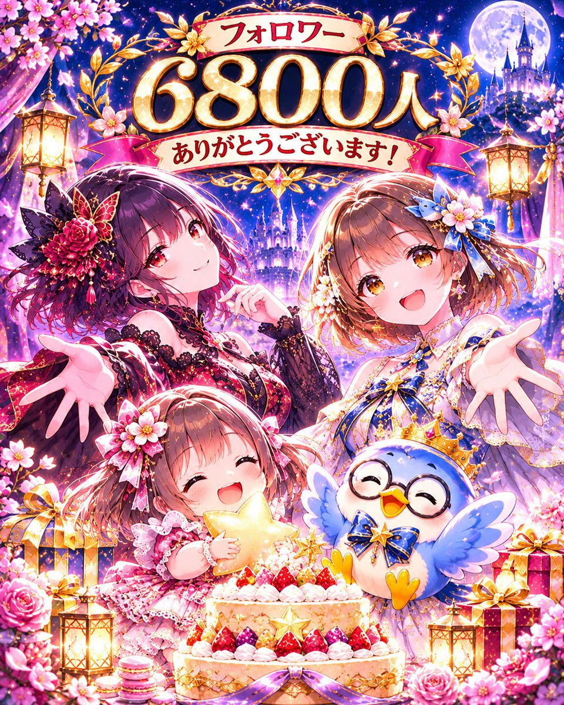
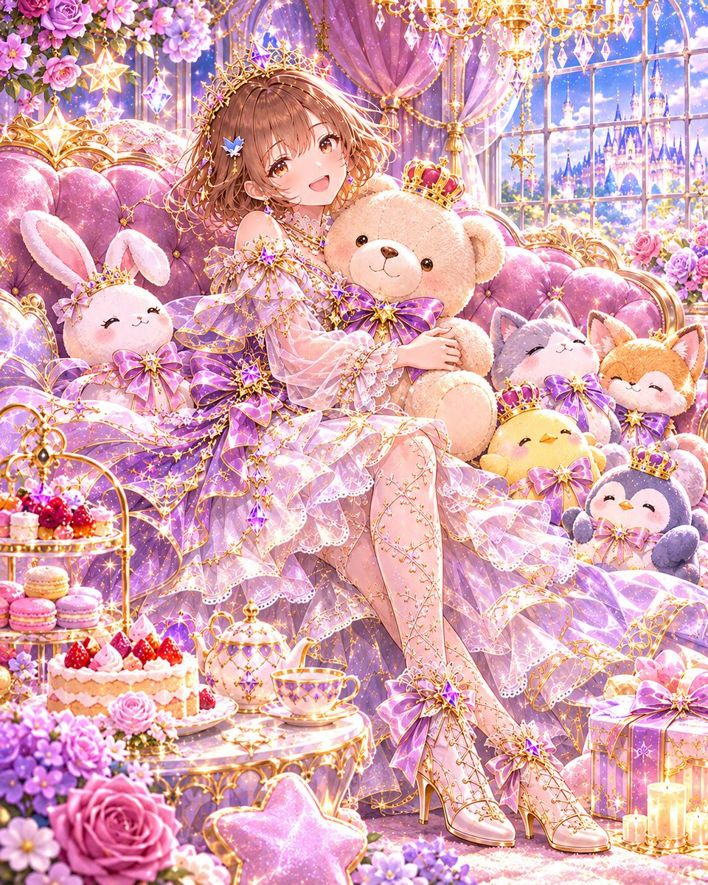
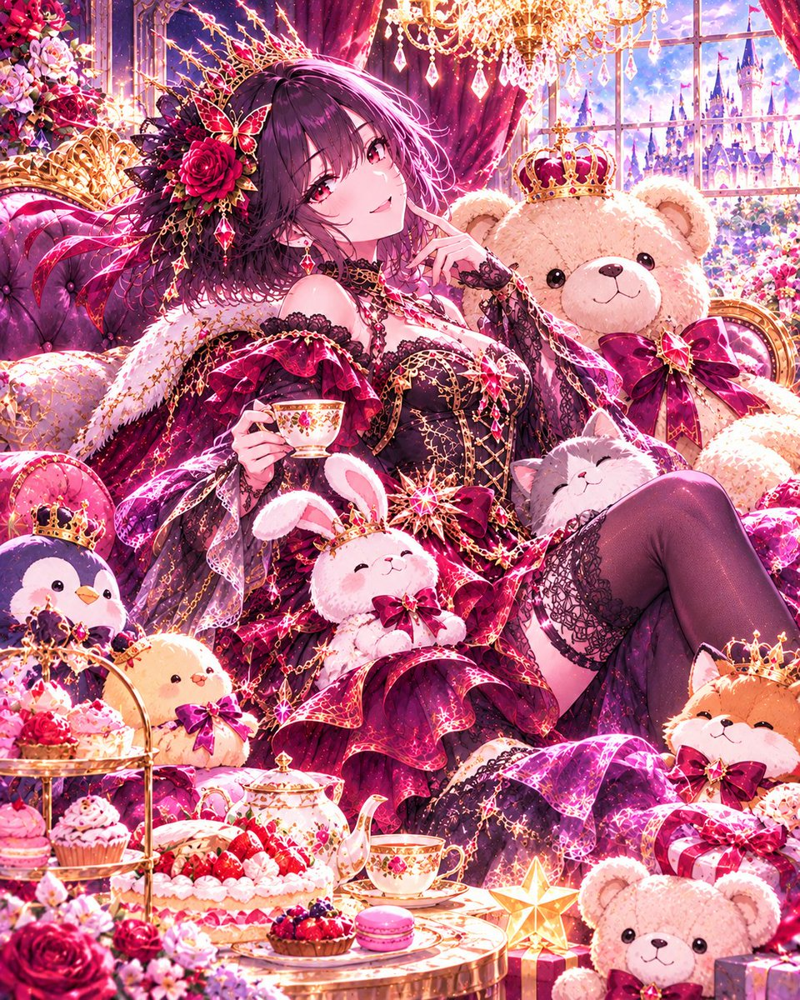
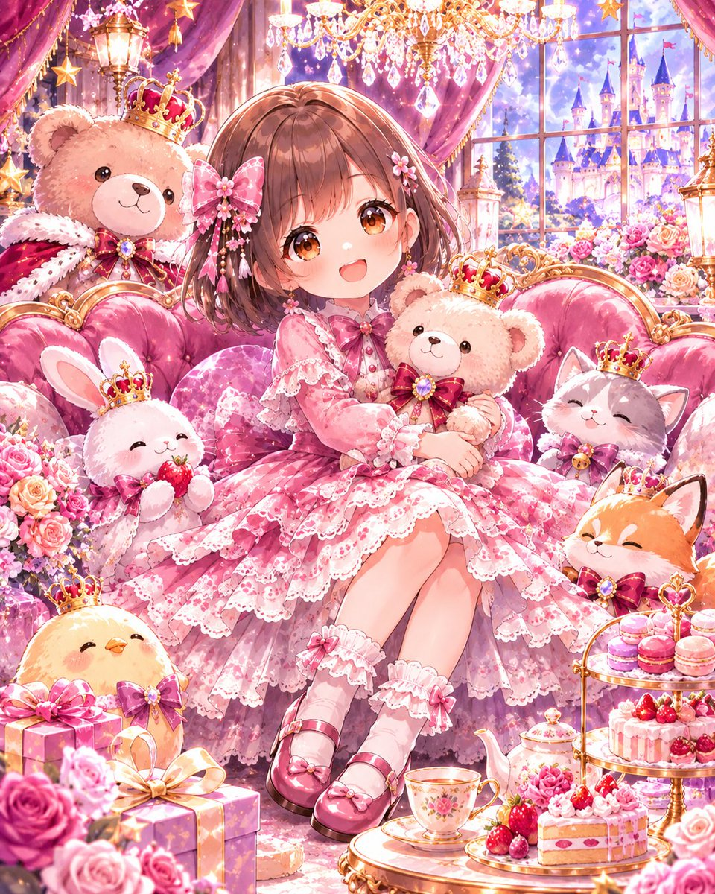

# 「ぬいぐるみ王国のVIPルーム」：自家角色作为特别嘉宾被一屋子毛绒玩偶款待（6800 关注纪念配布）

- 原帖链接：https://x.com/harubobo_san/status/2124766767377699008
- 作者：はるぼぼ🦉｜介護×AIイラスト（@harubobo_san）
- 时间：2026-11-23 15:27 (UTC+8 / Asia/Taipei)
- 互动摘要：点赞 152 · 转发 53 · 回复 93 · 引用 5 · 书签 1 · 浏览 2450（采集快照：2026-11-23 19:55 UTC+8）
- 模型/工具：未注明
- 标签：二次元
- 媒体路径：
  - `media/images/2124766767377699008_1.jpg`（）
  - `media/images/2124766767377699008_2.jpg`（）
  - `media/images/2124766767377699008_3.jpg`（）
  - `media/images/2124766767377699008_4.jpg`（）
- 入库日期：2026-11-23
- prompt 来源：https://x.com/harubobo_san/status/2124766771966304603（作者自回复）
- 备注：prompt 在作者自回复（2124766771966304603），整条原样摘录。需上传角色图作参考，可选填名字显示在名牌上；男女、Q 版、动物、人外角色均适用。

## prompt 原文

```text
🧸👑 ぬいぐるみ王国のVIPルーム
― うちの子だけに贈られる、ふわもこな夢の特等席 ―
🎉 はるぼぼ フォロワー6800人達成記念プレゼント！

添付したキャラクター画像を最優先の参考資料として、可愛いぬいぐるみたちが暮らす幻想的な王国で、特別なゲストとしておもてなしされる、高品質な日本アニメ風イラストを1枚生成してください。
衣装案や説明文ではなく、完成画像を1枚だけ生成してください。

━━━━━━━━━━━━━━
🌟【名前】
（ここに入力／空欄可）

※入力された名前は正式なキャラクター名として扱い、一字一句そのまま正確に画像内へ表示してください。
※名前の変更・省略・言い換え・英字化・別名化は禁止です。
※名前が未入力の場合は、主人公の名前・愛称・別名・称号・コードネームなどを自動生成しないでください。
※未入力の場合は、画像内に主人公を表す名前や文字を表示しないでください。
※名前が入力されている場合のみ、王国のウェルカムプレートや上品なネームプレートに、自然で読みやすく表示してください。
※名前以外の不要な文章は生成しないでください。

━━━━━━━━━━━━━━
🚨【最重要：キャラクターの維持】
添付画像の主役キャラクター1体だけを描いてください。
顔立ち、髪型、髪色、瞳の色、年齢感、体型、種族、本人らしい雰囲気を可能な限り忠実に維持してください。
元画像のキャラクターを別人に変更しないでください。
髪飾り、眼鏡、耳、角、尻尾、羽、装身具など、本人を象徴する重要な特徴は必ず残してください。
男性・女性・子ども・動物・鳥・獣人・ドラゴン・ロボット・人外キャラクターにも対応してください。
小さなデフォルメキャラは、元の小さな体型と可愛らしさを維持してください。
動物や鳥を勝手に人間化しないでください。
人外キャラを人間の体型に変更しないでください。
元画像の性別・年齢感・種族を変更しないでください。

ぬいぐるみは周囲のゲストや装飾として登場させ、主人公自身をぬいぐるみに変身させないでください。
主人公本人の魅力を最優先してください。
━━━━━━━━━━━━━━
🧸【テーマ：ぬいぐるみ王国のVIPルーム】
舞台は、世界中の可愛いぬいぐるみたちが暮らす、不思議な王国の特別なVIPルーム。
大きな扉を開けると、そこには夢のような空間が広がっています。
ふわふわのカーペット、ベルベットのソファ、レースのクッション、可愛いティーセット、優しく輝くシャンデリア。
壁には星やハートの装飾が輝き、窓の向こうにはパステルカラーのお城と美しい庭園が見えています。
そして、この王国で最も特別なゲストとして招かれた主人公を、たくさんのぬいぐるみたちが歓迎しています。
大きなクマのぬいぐるみ、ふわふわのウサギ、丸いヒヨコ、小さなネコ、愛らしいキツネなど、個性豊かなぬいぐるみたち。
ぬいぐるみたちは主人公の周りに集まり、花束やプレゼント、スイーツを用意しておもてなししています。
まるで絵本の中に入り込んだような、優しく温かい世界。
主人公が王国の特別なゲストとして大切にされ、幸せな時間を過ごしている様子を描いてください。

━━━━━━━━━━━━━━

👑【衣装・アクセサリー】
主人公の性格・年齢感・種族・雰囲気に合わせて、最も魅力的に見えるVIPゲスト衣装を自然に選んでください。
🎀 可愛い女性キャラクター
・パステルカラーの華やかなワンピース
・レースやフリルをあしらった上品な衣装
・小さなリボンや宝石のアクセサリー
・ふわふわのケープや可愛いヘッドドレス
🌹 大人っぽい女性キャラクター
・上質なベルベットやサテンのドレス
・美しい刺繍や繊細なレース
・上品なジュエリー
・高級感のあるロイヤルファッション
🗝️ かっこいい男性キャラクター
・王子様風のロイヤルジャケット
・上品なベストや装飾付きコート
・ゴールドやシルバーのアクセント
・キャラクターに似合う洗練されたスタイル
🧁 小さなデフォルメキャラクター
・小さな体型に合う可愛い衣装
・ふんわりしたケープやリボン
・小さな王冠や星のアクセサリー
・元の頭身と体型を維持した自然なデザイン
🐣 動物・鳥キャラクター
・小さな王冠
・ふわふわのリボン
・可愛い蝶ネクタイ
・体型に合った小さなケープ
・元の姿を損なわない自然な装飾
🐉 獣人・ドラゴン・ロボット・人外キャラクター
・種族や体格に合わせた特別な装飾
・角や翼、尻尾を隠さない衣装
・メタリックな王冠や宝石装飾
・本来のかっこよさや個性を尊重したデザイン
衣装は主人公の個性に合わせて調整し、全キャラクターに同じドレスやフリルを着せないでください。
元画像の重要なアクセサリーは必ず維持してください。
━━━━━━━━━━━━━━
💕【ポーズ・表情】
主人公が最も魅力的に見える、自然で幸せそうなポーズを選んでください。

例えば、
・豪華なソファに座り、大きなクマのぬいぐるみを抱きしめて微笑む
・ぬいぐるみたちに囲まれながら、幸せそうにティータイムを楽しむ
・小さなウサギのぬいぐるみを膝に乗せ、優しくなでる
・王国の特別な椅子に座り、ぬいぐるみたちから花束を受け取る
・可愛いぬいぐるみたちと一緒に記念撮影をする
・大きなぬいぐるみに寄り添い、安心した表情でくつろぐ
・ぬいぐるみたちに囲まれ、少し照れながら微笑む
・王子様や騎士のように優雅に座り、ぬいぐるみたちに歓迎される
主人公の性格に合わせて、可愛い笑顔、優しい微笑み、落ち着いた表情、クールな表情などを自然に選んでください。
主人公の顔がはっきり見え、ぬいぐるみたちとの自然な交流が伝わる構図にしてください。
ぬいぐるみで主人公の顔や重要な特徴を隠さないでください。

━━━━━━━━━━━━━━

🏰【背景・空間演出】
王国のVIPルームを、豪華で可愛らしい空間として描いてください。
・ふわふわの大きなソファ
・ベルベットのクッション
・大きなクマのぬいぐるみ
・ウサギ、ネコ、ヒヨコ、キツネのぬいぐるみ
・王冠をかぶった特別なぬいぐるみ
・可愛いティーカップとティーポット
・マカロン、ケーキ、クッキー
・星形のクッション
・リボン付きプレゼントボックス
・花束と美しいフラワーアレンジメント
・優しく輝くシャンデリア
・パステルカラーのカーテン
・窓の向こうに広がる幻想的なお城
・キラキラと漂う小さな光の粒
背景は華やかにしつつ、主人公の存在感が埋もれないようにしてください。
ぬいぐるみたちは大小さまざまなサイズで配置し、自然な奥行きと立体感を作ってください。

━━━━━━━━━━━━━━
🎨【色彩・雰囲気】
基本カラーは、
ミルキーピンク × クリームホワイト × ラベンダー × シャンパンゴールド
を中心とした、柔らかく上品な色合い。

ただし、主人公の元の色合いや個性に合わせて、色彩を自然に調整してください。
・可愛いキャラクターには、明るく優しいパステルカラー
・大人っぽいキャラクターには、落ち着いたローズやゴールド
・かっこいいキャラクターには、ネイビー、ワインレッド、ブラック、アンティークゴールドなどを取り入れても構いません
暗い雰囲気のキャラクターでも、本人の個性を維持しながら、温かく幻想的なVIPルームに仕上げてください。
全体に柔らかな光を取り入れ、ぬいぐるみの毛並み、衣装の質感、宝石の輝きを丁寧に描写してください。

━━━━━━━━━━━━━━
📸【構図・カメラワーク】
縦長4:5構図。
主人公を画面の中央からやや手前に大きく配置してください。
主人公を中心に、ぬいぐるみたちが自然に集まっている構図にしてください。

カメラは主人公の表情が魅力的に見える角度を選び、少し斜めからの視点や、奥行きのある構図を取り入れてください。
ソファやテーブル、ぬいぐるみ、背景の窓などを立体的に配置し、実際に王国の特別な部屋に招かれたような臨場感を演出してください。

単なる正面の立ち絵や、ぬいぐるみを並べただけの記念写真にはしないでください。
主人公とぬいぐるみたちが触れ合う、物語のワンシーンのようなイラストにしてください。
Xのタイムラインで小さく表示されても、主人公の顔と可愛らしいぬいぐるみたちが一目で分かるようにしてください。
━━━━━━━━━━━━━━

🖼️【完成画像の指定】
・縦長4:5構図
・高品質な日本アニメ風イラスト
・主役キャラクター1体のみ
・周囲には可愛いぬいぐるみたち
・元の顔立ち・髪型・瞳・体型・年齢感・種族を維持
・重要なアクセサリーを維持
・キャラクターに似合う特別なVIP衣装
・豪華で可愛らしい王国の特別室
・ぬいぐるみの柔らかな質感
・温かく幻想的なライティング
・自然で幸せそうな表情
・奥行きと動きのある構図
・Xで映える華やかな色彩
・完成イラスト1枚のみ
・不要な文字・ロゴ・透かしなし
masterpiece, best quality, ultra detailed, high quality anime illustration, plush toy kingdom, royal VIP room, adorable stuffed animals, luxurious fantasy interior, soft fluffy textures, magical atmosphere, elegant character outfit, warm cinematic lighting, dreamy pastel colors, beautiful composition, joyful expression, 4:5 vertical
━━━━━━━━━━━━━━
💖【最終仕上げ】
主人公がぬいぐるみ王国で、世界に一人だけの特別なゲストとして歓迎されている様子を描いてください。
可愛いキャラクターは、とびきり愛らしく。
美しいキャラクターは、上品で華やかに。
かっこいいキャラクターは、気品と存在感を大切に。
動物や鳥、人外キャラクターは、元の姿と個性をそのまま活かしてください。

見た瞬間に「こんな場所に行ってみたい！」と思えるような、幸せと癒やしが詰まった特別な1枚にしてください。
※箇条書きの部分は、読みやすいように頭に「・」をつけました。いらなければ消して使ってください。
```

---

个人学习归档，非商业。prompt 与媒体版权归原作者 @harubobo_san，引用请回到原帖。
