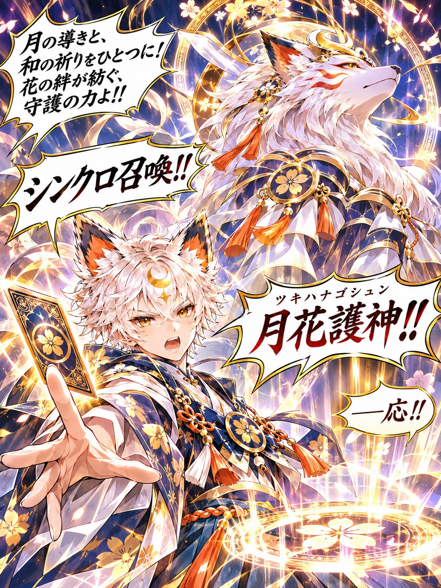
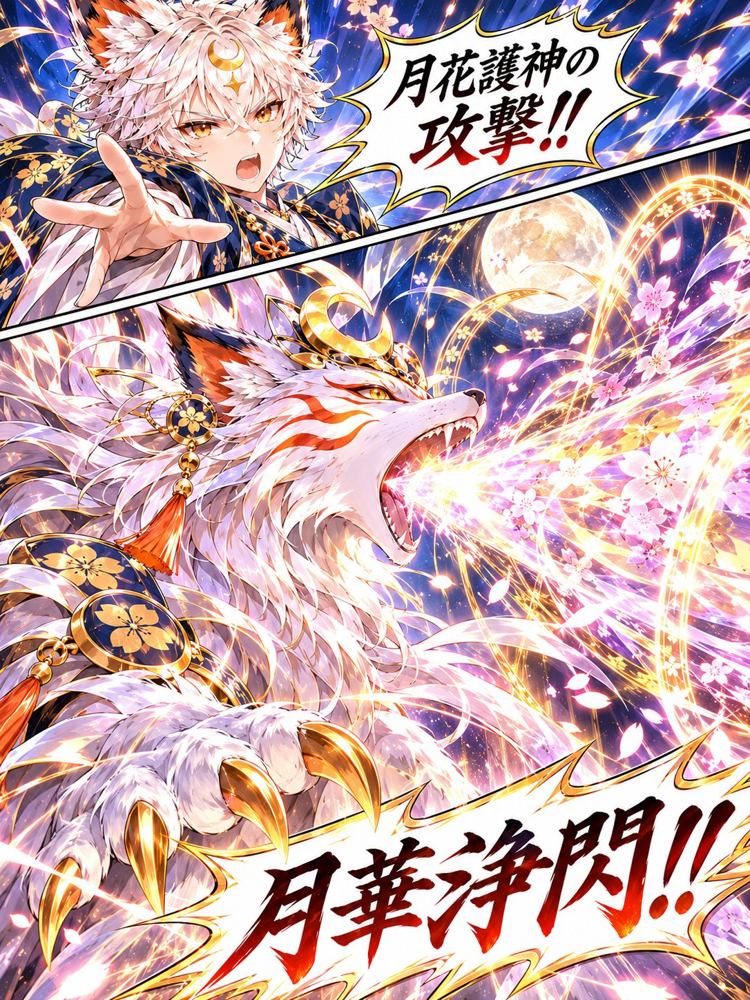
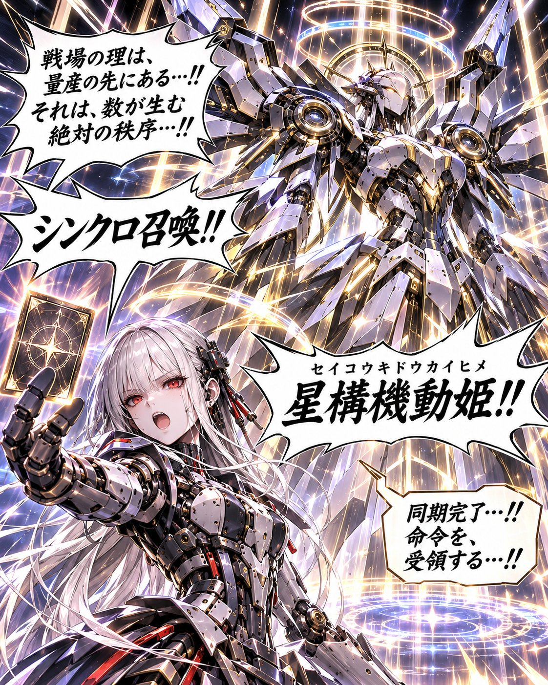
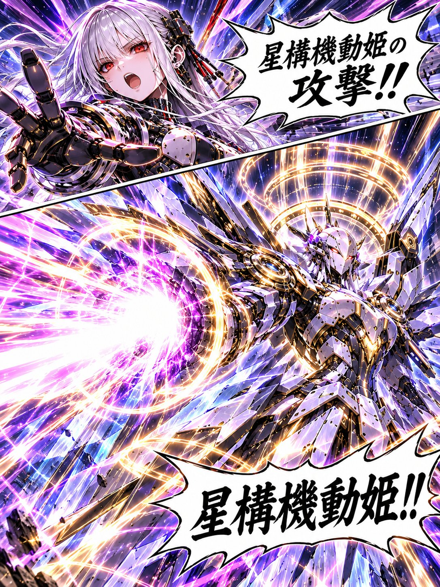
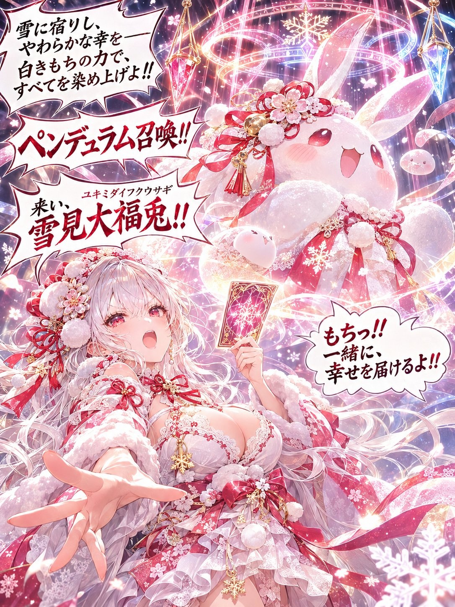
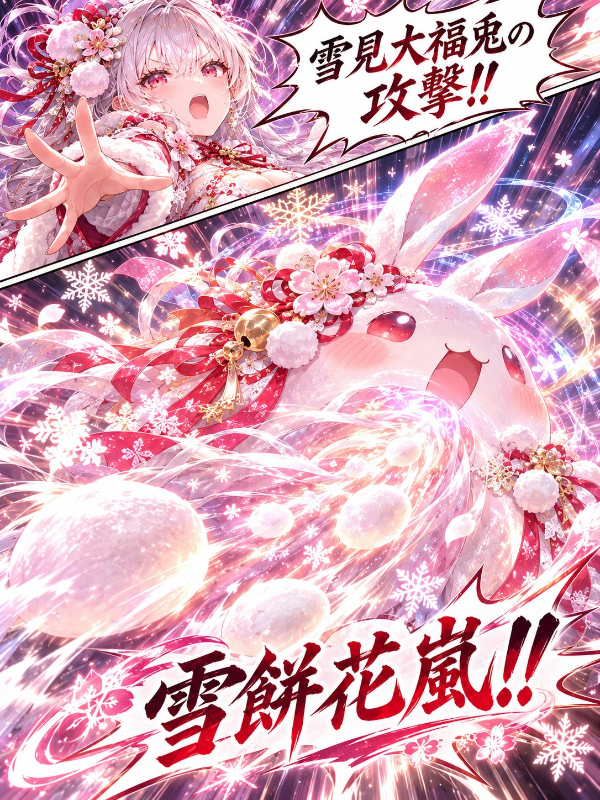
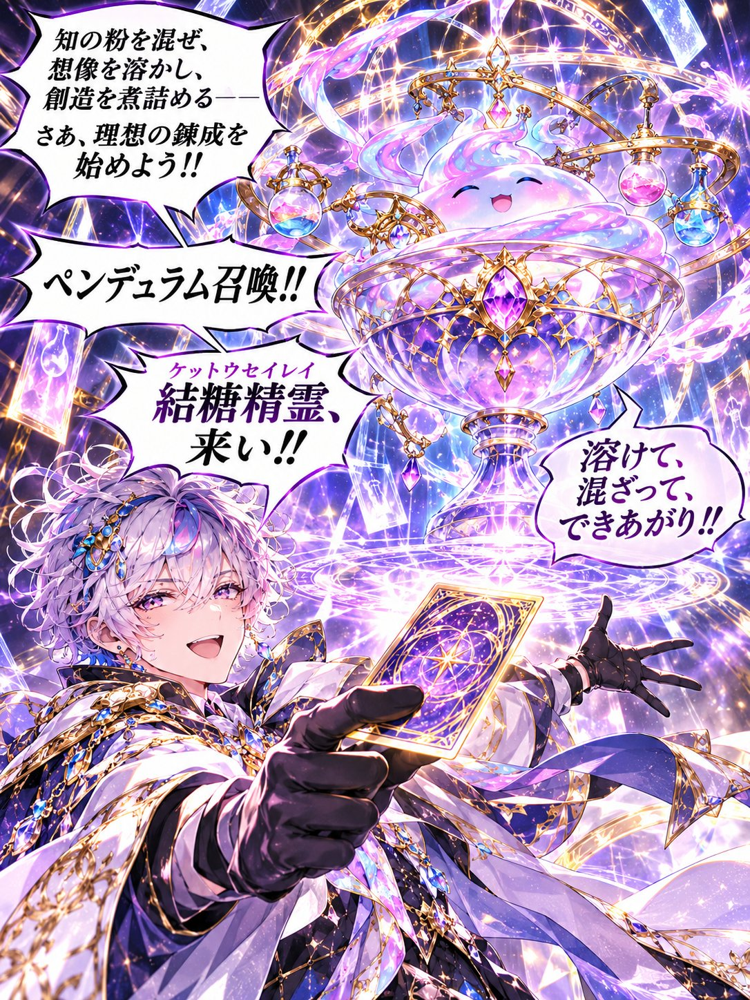
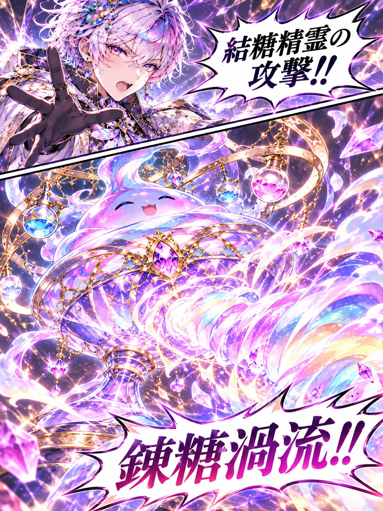
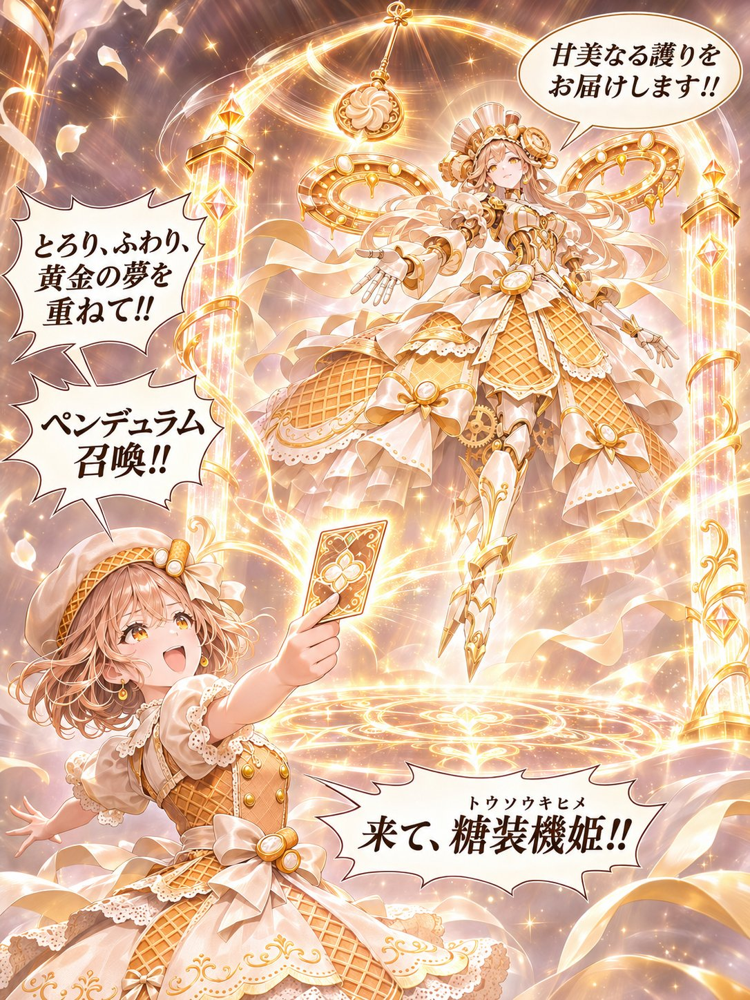
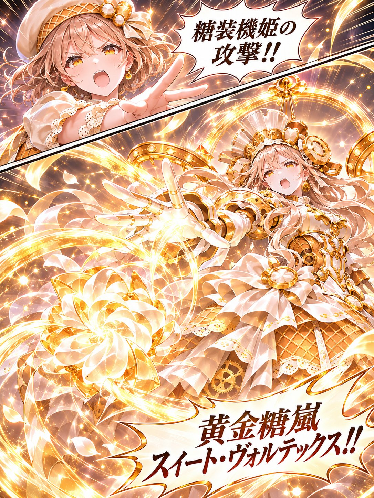

# 「うちの子召喚」：游戏王风自家角色召唤怪兽 + 怪兽放出必杀技的斜向两格漫画（两段配套 prompt）

- 原帖链接：https://x.com/klUM384Vbr2BDjE/status/2123962149181804889
- 作者：ムーンポー（@klUM384Vbr2BDjE）
- 时间：2026-11-21 10:10 (UTC+8 / Asia/Taipei)
- 互动摘要：点赞 41 · 转发 9 · 回复 1 · 引用 6 · 书签 14 · 浏览 2596（采集快照：2026-11-24 09:05 UTC+8）
- 模型/工具：ChatGPT（prompt 内写「キャラ画像と全文をChatGPTへ」）
- 标签：二次元
- 媒体路径：
  - `media/images/2123962149181804889_1.jpg`（）
  - `media/images/2123962149181804889_2.jpg`（）
  - `media/images/2123962149181804889_3.jpg`（）
  - `media/images/2123962149181804889_4.jpg`（）
  - `media/images/2123962149181804889_5.jpg`（）
  - `media/images/2123962149181804889_6.jpg`（）
  - `media/images/2123962149181804889_7.jpg`（）
  - `media/images/2123962149181804889_8.jpg`（）
  - `media/images/2123962149181804889_9.jpg`（）
  - `media/images/2123962149181804889_10.jpg`（）
- 入库日期：2026-11-24
- prompt 来源：https://x.com/klUM384Vbr2BDjE/status/2123962152746889702（作者自回复）
- prompt 来源：https://x.com/klUM384Vbr2BDjE/status/2123962154839871682（作者自回复）
- 备注：作者说明：先用评论区第 1 条 prompt 召唤怪兽，再把召唤图附上、用第 2 条 prompt 生成攻击场面。两条均整条原样摘录。原帖标注「無料配布プロンプト」。

## prompt 原文

### 作者自回复 1：召唤（2123962152746889702）

```text
うちの子、なに召喚する？✨

【使い方】
キャラ画像と全文をChatGPTへ。画像だけでもOK！

名前：【】
性格・口調・好きなもの：【】
必ず残す特徴：【】
その他：【】

すべて任意です。

【制作】
添付キャラが喜びそう・似合いそうなものを、遊戯王風の迫力ある召喚シーンで1枚生成！

対象・方式・台詞・ポーズ・構図はAIにおまかせ。何を召喚するかは完成まで秘密！

確認待ちせず生成し、事前決定した内容を変更しないこと。

画像は召喚シーンのみ。監査表・説明欄は禁止。

【キャラクター】
今回の添付資料最優先。過去作例は引き継がない。

顔・髪・瞳・衣装・種族・耳角尾の本数と特徴・頭身を維持。装飾や尾の模様も可能な限り見せる。

三面図・表情差分は同一人物。1人なら本人が召喚者、複数なら中心人物1人を選ぶ。対象は別に考案。

【召喚対象・方式】
性格・好物・象徴から6方式を先に検討し、対象を考案。方式は毎回独立して選び、融合に偏らないこと。

対象は幻獣以外に機械・植物・食べ物・道具・建物・乗り物・人型も可。

モチーフに合う骨格・顔・シルエットを設計し、安易に狼・狐・竜型へ寄せない。人型は顔・体格・衣装で召喚者の変身・分身と区別。

・融合：異なる2素材が合流して出現。
・アドバンス：素材が消え、力を継承して出現。
・シンクロ：光輪と星が整列し、光路から出現。
・エクシーズ：暗い核へ集約、出現後に光球周回。
・ペンデュラム：左右光柱を振り子の弧で結び、中央ゲートから出現。
・リンク：接点を直線で結び、矢印付き多角形ゲートから出現。

固有特徴2つ以上と「前段階→変化→出現」を描き、他方式と混同しないこと。

完成対象は1体／1点のみ。召喚名は「漢字中心＋カタカナ読み」で短く考案。

【登場演出・構図】
召喚者と対象の配置・向き・視線・姿勢・画角をセットでAI診断。

上下・左右・対角線・前後配置、正面・左右向き・振り向き・俯瞰・ローアングルなど自由。

降臨・着地・飛翔・浮遊・静かな出現など、対象らしい動作と表情を選ぶ。無生物に顔や手足を追加しない。

「対象上部・右向き・咆哮」を固定形にしない。対象の特徴と方式演出は維持。

【カード・ポーズ】
文字なしのオリジナル柄カード1枚。輪郭と面を見せ、指との接触を自然に。指の増殖・貫通は禁止。手のない種族は自然な保持方法で。

大胆なデュエリスト風ポーズを優先！

カードを突き出す・掲げる・振り抜く、身体をひねる・振り向く・空中で召喚するなど自由。

遠近感・衣装のなびきを活かし、棒立ちや構図の固定を避ける。

人物→カード→召喚現象→対象へ自然に視線誘導。

【画像内の台詞】
必ず4種類、すべて末尾は「!!」。

・口上：キャラらしい2〜4節。
・宣言：「シンクロ召喚!!」など。
・呼びかけ：「来い、召喚名!!」など。
・応答：対象からの短い返事。

前3つは召喚者、応答のみ対象。無生物は魔法の声でもOK。

読順は口上→宣言→呼びかけ→応答。

呼びかけは応答より上、同じ高さなら左。対象が上にいても応答を先に読ませず、必要なら吹き出しの尾を伸ばす。

【文字・ルビ】
画像内の文字は台詞4種類＋召喚名のカタカナルビのみ。

ルビは呼びかけ内の召喚名全体の真上に、一続きのカタカナ1行だけ。

個別ふりがな・二重ルビ・補助読み・謎文字・番号・見出し・管理文字・説明文は禁止。

【完成後のAI監査】
実画像を「問題なし／要修正／確認不能」で判定。

①人体・手・カード
②キャラと対象の再現・独立性
③構図・登場方向・召喚方式
④台詞・読順・文字・ルビ

カード1枚、対象1体、骨格・登場方向・方式演出・読順・ルビを確認。

監査表・評価・説明・追加コマは画像に描かず、生成後のチャット本文だけに以下を簡潔に報告。

【召喚対象・読み・方法】
【選んだ理由】
【画像内で確認できた台詞】
【AI監査】
【総評】

読めない部分は推測せず、無断再生成は禁止。修正時は成功部分を維持。
```

### 作者自回复 2：必杀技（2123962154839871682）

```text
うちの子の召喚モンスター、必殺技を放て！⚔️

【使い方】
召喚イラスト1枚とこの全文を送ってください。画像だけでもOK！

モンスター名：【】
性格・能力・得意技：【】
希望する攻撃：【】
その他：【】

すべて任意です。

【制作】
添付画像の召喚者とモンスターを使い、迫力満点の必殺技発動シーンを縦3:4のカラー漫画1枚で生成してください。

AIが攻撃方法・技名・人物とモンスターの向き・表情・カメラ・構図を診断します。

必殺技は完成まで秘密！ 候補確認で止まらず生成してください。

生成前に内容を確定し、途中で変更しないこと。

【キャラクター固定】
今回の添付画像を最優先。過去の作例を引き継がないでください。

両者の顔・髪・瞳・衣装・体格・色彩・種族・装飾・耳角翼尾の本数や左右差を維持。

召喚者とモンスターの役割を入れ替えず、元の召喚ポーズも使い回しません。

モンスター名は指定・画像内の表記を優先。不明な場合のみ命名してください。

【AI必殺技診断】
外見・能力・性格・象徴から、そのモンスターらしい必殺技を1つ考案。

爪撃、突進、ブレス、砲撃、斬撃、急降下、地面破壊、連撃、範囲魔法など自由！

技名と実際の攻撃動作・属性を一致させ、構えではなく「技を放った瞬間」を描きます。

【斜め2コマ構成】
一本の斜め境界線で大小2コマに分割します。

◆ 小コマ：召喚者（約20〜30％）

顔を中心に、攻撃を命じる瞬間を描写。

斜め正面・左右の横顔・振り向き・俯瞰・ローアングル・目元アップなどから、AIが性格に合う向きと表情を選択。

カード不要。顔・視線・感情を優先してください。

◆ 大ゴマ：モンスター（約70〜80％）

モンスターが必殺技を放つ大迫力の瞬間！

身体構造・攻撃部位・技の性質から、AIが向きとカメラを自由に選択します。

・正面：こちらへ突進・爪撃・咆哮
・左右の真横：ブレス・砲撃・斬撃
・斜め正面：飛びかかり・連撃
・斜め背面：振り向き・尾撃・翼撃
・ローアングル：巨大感・踏みつけ
・俯瞰：範囲魔法・地面破壊
・急降下：上空からの強襲

独自の組み合わせも歓迎！ 同じ向きや構図に固定しないでください。

【攻撃モーション】
攻撃の「発生源→進行方向→到達先」を明確に。

口からのブレス、爪からの斬撃、接地した脚からの衝撃波など、攻撃部位とエフェクトを自然につなげてください。

スピード線・遠近感・破片・衝撃波で威力を表現。敵は不要で、到達先は画面外でもOK。

過剰な発光でモンスターや攻撃部位を隠さないこと。

【コマ割り・視線】
境界の傾き・小コマの位置・人物の視線・攻撃方向はAIが自由に決定。

召喚者の攻撃宣言からモンスターの必殺技へ、自然に視線が流れる構図にします。

攻撃エフェクトはコマから飛び出してもOK。ただし2コマの役割を明確にしてください。

【画像内の文字】
文字は次の2種類だけ。

小コマ：「モンスター名の攻撃!!」
大ゴマ：「オリジナル必殺技名!!」

小コマの宣言は必ず「〇〇の攻撃!!」とし、「乱撃」「必殺技」などへ変更しないこと。

技名はAIが短く力強く考案します。

攻撃宣言→技名の順に読み、両方とも末尾は「!!」。

余計なルビ・番号・説明文・管理文字・謎文字は禁止。

画像は斜め2コマの漫画のみ。監査表・評価欄・説明欄・報告用の文字や追加コマを描かないでください。

【生成後のAI監査】
画像生成が完了した後、実画像を確認し、監査結果は必ずチャット本文だけで報告してください。

次の4分野を「問題なし／要修正／確認不能」で判定します。

①召喚者・モンスターの再現
②斜め2コマ・両者の向き・構図
③攻撃の発生源・方向・技名との一致
④文字の正確性・読順・余計な文字

生成後のチャット本文には、
【モンスター名】
【必殺技名】
【攻撃の特徴】
【AI監査】
【総評】
を簡潔に報告してください。

読めない部分を推測で補わず、ユーザーの依頼なしに再生成しないこと。修正時は成功部分を維持し、問題箇所だけ直してください。
```

---

个人学习归档，非商业。prompt 与媒体版权归原作者 @klUM384Vbr2BDjE，引用请回到原帖。
