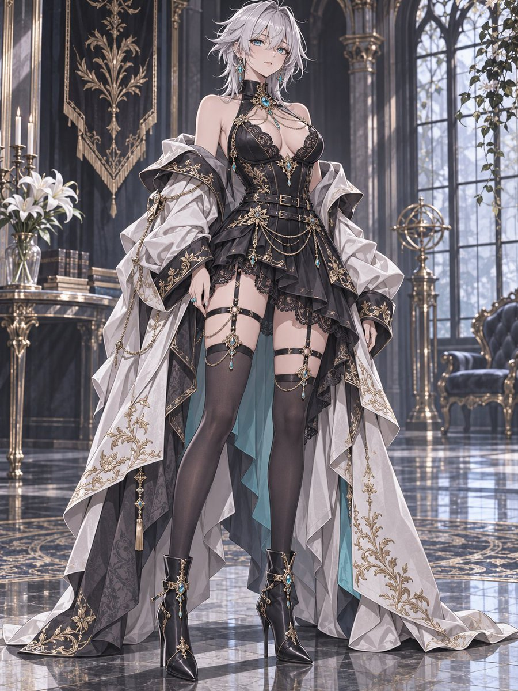
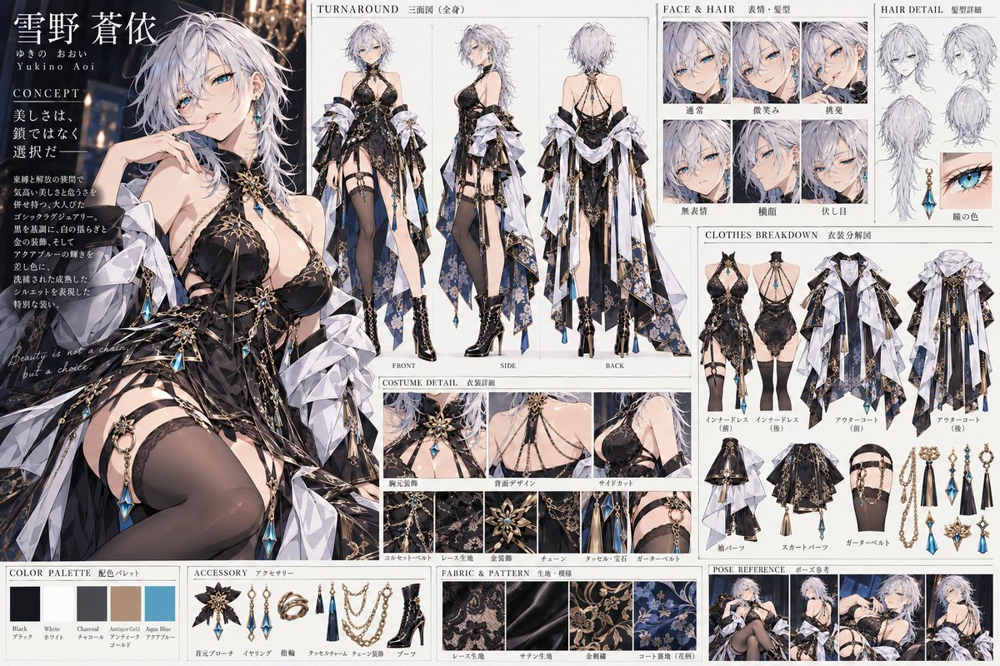
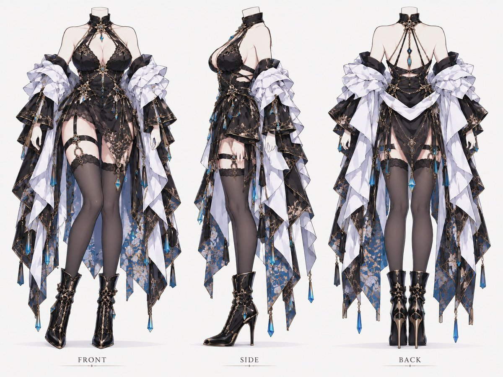

# 「ゴシックラグジュアリー」：黑白金 + 水蓝宝石配色的成熟哥特奢华衣装（紧身胸衣迷你裙 + 落肩大衣，#kk衣装プロンプト）

- 原帖链接：https://x.com/uRMS7Vm26qqEE5J/status/2124069150410920227
- 作者：k k（@uRMS7Vm26qqEE5J）
- 时间：2026-11-21 17:15 (UTC+8 / Asia/Taipei)
- 互动摘要：点赞 272 · 转发 25 · 回复 0 · 引用 6 · 书签 132 · 浏览 7894（采集快照：2026-11-24 09:05 UTC+8）
- 模型/工具：未注明
- 标签：二次元
- 媒体路径：
  - `media/images/2124069150410920227_1.jpg`（）
  - `media/images/2124069150410920227_2.jpg`（）
  - `media/images/2124069150410920227_3.jpg`（）
- 入库日期：2026-11-24
- 备注：prompt 在原帖正文，从「original mature gothic-luxury」起原样摘录。prompt 明写 mature / refined grown-up look，示例为成年女性角色；第 3 张为衣装三视图，作者说明可直接拿来用。

## prompt 原文

```text
original mature gothic-luxury fashion outfit, black, white, antique gold and aqua blue color scheme, elegant black halter-neck corset-style mini dress, high black collar, deep V-shaped chest framing, structured fitted bodice, black lace and satin fabric, ornate antique-gold floral embroidery, gold filigree ornaments, central jeweled brooch with small aqua-blue gemstone, delicate gold chains draped across chest and waist, multiple slim black waist straps, asymmetrical layered short skirt with black lace trim, black thigh garter straps with ornate gold rings and dangling chains, black thigh-high stockings, oversized white and charcoal outer coat worn loosely off the shoulders, voluminous sleeves, black cuffs with gold embroidery, luxurious flowing fabric, aqua gemstone earrings and small matching jewelry, sophisticated aristocratic gothic aesthetic, sensual but elegant, refined grown-up look, fixed costume design, preserve exact silhouette, colors, lace, corset structure, gold embroidery, chains, garter straps, gemstones and oversized coat
```

---

个人学习归档，非商业。prompt 与媒体版权归原作者 @uRMS7Vm26qqEE5J，引用请回到原帖。
