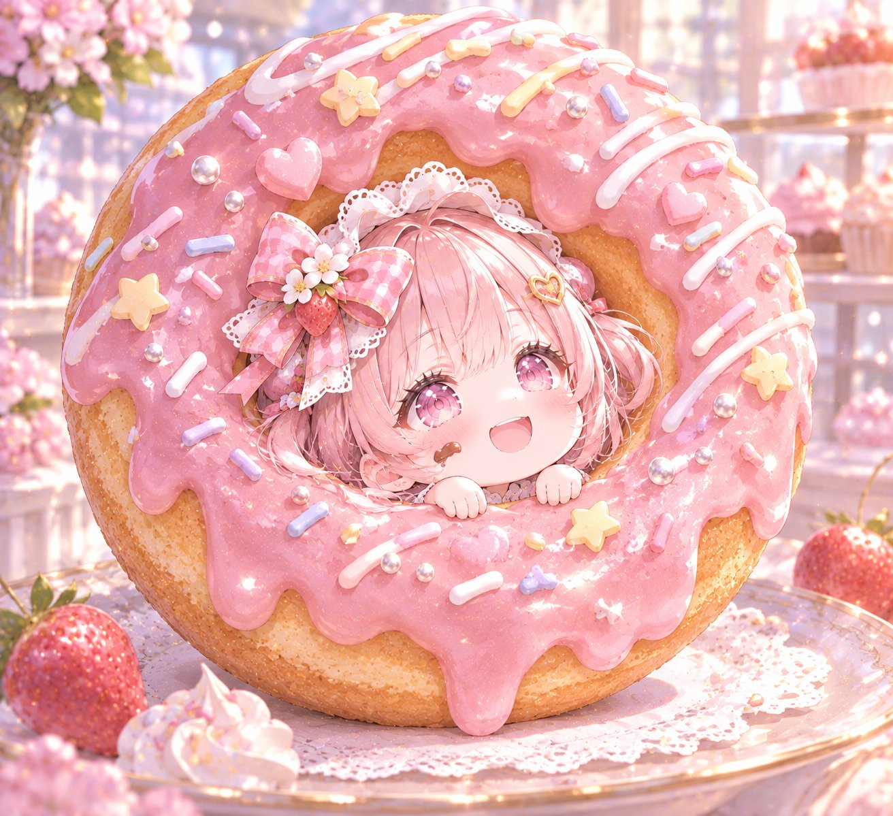

# 「ドーナツの穴にすっぽり」：二头身迷你自家角色从大甜甜圈中间的洞里探出脸（#ゆきプロンプト）

- 原帖链接：https://x.com/AIXyu1v/status/2124110597814116571
- 作者：ゆき　AIイラストXで収益化（@AIXyu1v）
- 时间：2026-11-21 20:00 (UTC+8 / Asia/Taipei)
- 互动摘要：点赞 84 · 转发 13 · 回复 3 · 引用 22 · 书签 26 · 浏览 5723（采集快照：2026-11-24 09:05 UTC+8）
- 模型/工具：未注明
- 标签：二次元
- 媒体路径：
  - `media/images/2124110597814116571_1.jpg`（）
  - `media/images/2124110597814116571_2.jpg`（）
- 入库日期：2026-11-24
- prompt 来源：https://x.com/AIXyu1v/status/2124110599802286308（作者自回复）
- 备注：prompt 在作者自回复（2124110599802286308），整条原样摘录（含原文的 ** 粗体标记）。需上传角色图作参考。

## prompt 原文

```text
ドーナツの穴にすっぽり 🍩💕

添付画像のキャラクターを、**二頭身の可愛いミニキャラ**にしてください。

髪型・髪色・瞳・衣装・アクセサリーなど、元キャラの特徴を忠実に再現してください。

【シーン】
大きなふわふわドーナツの真ん中の穴に、ミニキャラがすっぽり！

**ドーナツの穴から小さな顔をひょこっと出して、にっこり笑っています。**

ドーナツは立てた状態で、キャラクターが穴の中にちょこんと収まっています。

【可愛さのポイント】
・大きな頭と小さな身体の二頭身
・ドーナツの穴からのぞく可愛い笑顔
・小さな両手でドーナツの縁をぎゅっと持つ
・ほっぺにちょこんと付いたチョコ
・カラフルなスプリンクルと甘いシュガーグレーズ

【構図・背景】
**キャラクター1人と、大きなドーナツ1個が全体まで見える構図。**

ドーナツはキャラクターよりずっと大きく、穴から顔と小さな手だけが見えるようにしてください。

ドーナツの穴はしっかり貫通し、キャラクターの顔を自然に囲む形にしてください。

背景はパステルカラーの可愛いスイーツカフェ。柔らかな陽射しとキラキラした光で、甘く夢のような雰囲気に。

【仕上がり】
高品質な可愛いアニメイラスト。ふんわりしたドーナツ生地、ツヤツヤのチョココーティング、繊細なスイーツ装飾、優しいパステルカラー、癒やされる世界観。

【禁止事項】
元キャラの特徴変更、人物の追加、ドーナツの増殖、穴が塞がる、顔が隠れる、ドーナツと身体の不自然な融合、余分な手足、顔や手の崩れ、文字、ロゴ、透かし。
```

---

个人学习归档，非商业。prompt 与媒体版权归原作者 @AIXyu1v，引用请回到原帖。
