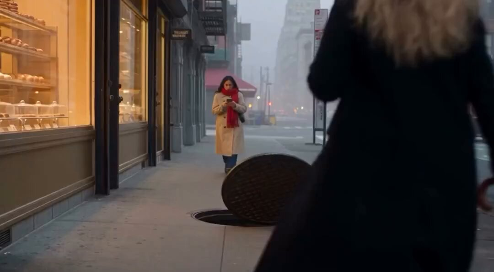

# 「THE BLONDE WOMAN WITH THE BLACK UMBRELLA」：金发女子用黑伞在纽约街头制造 8 段连环小意外的 30 秒写实街头喜剧

- 原帖链接：https://x.com/Grow_withAI/status/2124485164030214407
- 作者：Ryan Carter（@Grow_withAI）
- 时间：2026-11-22 20:48 (UTC+8 / Asia/Taipei)
- 互动摘要：点赞 153 · 转发 85 · 回复 40 · 引用 0 · 书签 45 · 浏览 8021（采集快照：2026-11-24 09:05 UTC+8）
- 模型/工具：Seedance 2.5（作者标注）
- 标签：真人
- 媒体路径：
  - `media/video-stills/2124485164030214407_still.jpg`（视频封面截图，）
  - 视频本体未入库，仅保留原帖链接：https://x.com/Grow_withAI/status/2124485164030214407
- 入库日期：2026-11-24
- prompt 来源：https://x.com/Grow_withAI/status/2124485217792782350（作者自回复）
- 备注：prompt 在作者自回复（2124485217792782350），整条原样摘录（含 NEGATIVE PROMPT 与 FINAL RESULT 段）。视频本体未入库，仅保留原帖链接。

## prompt 原文

```text
THE BLONDE WOMAN WITH THE BLACK UMBRELLA

Duration: 30 Seconds
Aspect Ratio: 16:9
Style: Photorealistic live-action, cinematic urban comedy.

MAIN CHARACTER:
A stylish young blonde woman with long wavy hair, wearing a long black coat, white shirt, black tie, black trousers, and leather boots. She carries a white takeaway coffee cup and a closed black umbrella. Maintain identical appearance throughout.

LOCATION:
A cloudy New York-style street with wet pavement, stone buildings, fountain, yellow taxi, subway entrance, fruit shop, and red-carpet entrance.

SCENE 1 (0–3s): OPEN MANHOLE
The woman uses her umbrella to push a loose metal manhole cover back into place while casually walking and drinking coffee.

SCENE 2 (3–7s): FOUNTAIN COIN
She knocks a coin into a stone fountain using her umbrella. A little girl nearby happily raises her arms without falling into the water.

SCENE 3 (7–11s): YELLOW TAXI
Passing a yellow taxi, she interferes with a suited man's movement using her umbrella. He loses balance and falls backward while she walks away calmly.

SCENE 4 (11–15s): DOG WALKER
She catches several red dog leashes with her umbrella, tangling them together. The confused man raises his hands as the dogs gather around him.

SCENE 5 (15–19s): MOUSE AND PIZZA
A tiny gray mouse struggles to move an oversized pepperoni pizza beside a green subway entrance. A cardboard tube and the woman's black boots remain visible.

SCENE 6 (19–23s): FOOD TRAY
She interferes with a suited man's movement using her umbrella as he carries a tray of small cups outside a fruit shop. He struggles to keep everything balanced.

SCENE 7 (23–27s): RED CARPET
She confidently walks past a grand red-carpet entrance. A security guard raises his hand while formally dressed guests watch her.

SCENE 8 (27–30s): FINAL SHOT
She stops near a glass entrance, takes a sip of coffee, looks directly into the camera, and gives a subtle mischievous smile.

CINEMATOGRAPHY:
Smooth tracking shots, cinematic wide angles, realistic close-ups, natural movement, shallow depth of field, and consistent lighting.

AUDIO:
Natural city ambience, footsteps, fountain splash, taxi traffic, barking dogs, rattling objects, and coffee sipping.

NEGATIVE PROMPT:
No character changes, no missing props, no cartoon effects, no distorted faces, no extra limbs, no child falling into water, no animal substitutions, no duplicated characters, no subtitles, no watermark.

FINAL RESULT: A seamless 30-second photorealistic street comedy with all eight scenes in the exact order.
```

---

个人学习归档，非商业。prompt 与媒体版权归原作者 @Grow_withAI，引用请回到原帖。
