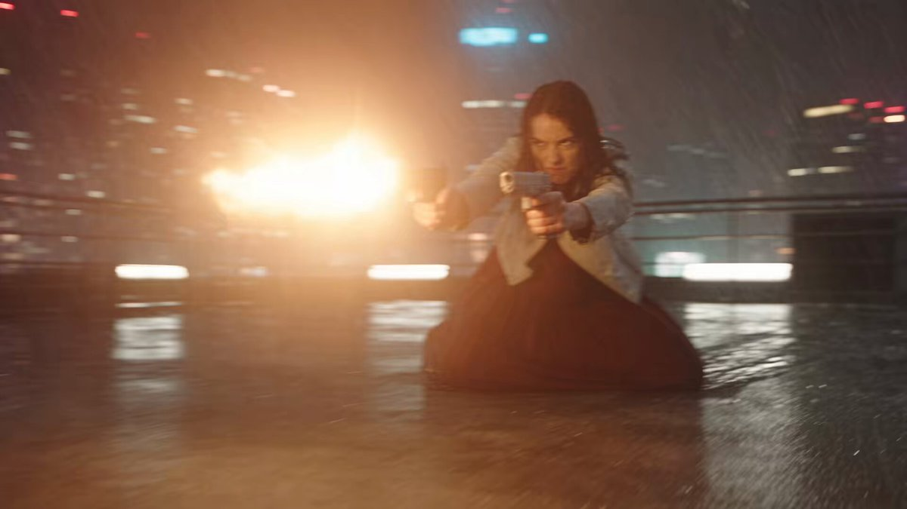

# 雨夜赛博朋克天台决斗：银焰双枪手 vs 紫晶机械臂剑士的 30 秒连续动作戏（分秒分镜 + 镜头 + 音效）

- 原帖链接：https://x.com/whizz_xD/status/2124775736351367301
- 作者：whizz（@whizz_xD）
- 时间：2026-11-23 16:03 (UTC+8 / Asia/Taipei)
- 互动摘要：点赞 316 · 转发 21 · 回复 100 · 引用 1 · 书签 100 · 浏览 9709（采集快照：2026-11-24 09:05 UTC+8）
- 模型/工具：Seedance 2.5（作者标注；写「made this with claude + seedance 2.5」）
- 标签：其它
- 媒体路径：
  - `media/video-stills/2124775736351367301_still.jpg`（视频封面截图，）
  - 视频本体未入库，仅保留原帖链接：https://x.com/whizz_xD/status/2124775736351367301
- 入库日期：2026-11-24
- prompt 来源：https://x.com/whizz_xD/status/2124775743645225036（作者自回复）
- prompt 来源：https://x.com/whizz_xD/status/2124775825509679588（作者自回复）
- 备注：prompt 分两条作者自回复连续给出，两段均整条原样摘录。prompt 明写 two adult women，半写实 3D CGI 动作戏，无血腥特写。视频本体未入库，仅保留原帖链接。

## prompt 原文

### 作者自回复 1（2124775743645225036）

```text
Rain-soaked cyberpunk skyscraper rooftop duel at night, premium semi-realistic 3D CGI, cinematic action film. Two adult women fight in one continuous space: a wet rooftop platform with a glass curtain wall on one side and a steel catwalk bridge on the other, neon billboards, metal railings, vents, hanging cables, puddles, bokeh city lights.

Fighter A, SILVER FLAME GUNNER: adult woman, long black hair whipping across her face, cold and menacing; torn grey-white upper jacket, flowing deep-red long skirt; dual pistols. Her power: silver-white liquid metal streams and platinum-white sparks only, liquid metal forming whips, shields and thrust jets around her, muzzle flashes of dense white-gold sparks, shell casings and spark trails on the ground. Gun-kata, slides, rolls, flips, aggressive pressure.

Fighter B, VIOLET CRYSTAL BLADE: adult woman, short black hair, sharp eyes, black cyber-armor bodysuit with mechanical limbs; one long slim katana plus several mechanical arms on her back, each tipped with a glowing blue-violet energy crystal blade. Her power: blue-violet crystal cutting trails and ionized violet sparks only. Precise, cold, ultra-fast multi-angle slashes, counterattacks, slicing bullets mid-air.

Their effects never mix: silver/white-gold for A, blue-violet for B.

0-5s: Fight starts on frame one. A slides in low firing both guns; B's crystal arms cross and slice the bullets into sparks. B zigzags low through the fire, slashes at A's face; A blocks with her left gun, metal sparks and violet shards burst. A back-arm blade grazes A's shoulder, tearing her jacket. A fires point-blank, B deflects with the blade but is knocked back half a step.
5-10s: A sweeps B's legs; B braces on mechanical arms and opens a ring of four crystal blades. A rolls behind her, shoots off one blade tip. B spins, top and bottom blades scissor in; A blocks with a liquid-metal arm shield and slides out across the wet floor in a spray of sparks and water, then fires into B's left mechanical arm joint: sparks and debris, the arm stutters. B lunges with a stab; A blocks with crossed guns and is pushed back, feet carving a long water trail.
10-15s: B leaps up onto steel beams, mechanical arms gripping like spider legs, dive-slashing from changing angles; A wall-runs firing, bullets sparking off beams. B's blade cuts A's thigh-side skirt. A rolls, fires both guns into the ground: a forward wave of silver flame blasts B back through a glass panel, glass shards and violet sparks exploding.
15-20s: B bursts out of the glass with a larger blade array, wave-like combo attacks; a back blade slashes A's left arm, armor cracks, liquid metal spills, A staggers. B goes for the neck; A jams the blade with her left gun and fires the right gun into B's chest armor, blasting her back so two mechanical arms snap a railing. A pulls all liquid metal into a spinning silver-flame vortex around herself.
20-25s: Both power up: a silver liquid-metal storm swirling around A; B's crystal blades spread into huge blue-violet wings. A dashes in zigzags firing; B's blades slice bullets and cut the silver streams, gunfire knocks blades aside, each impact sparks in its own colors. A fires at B's face, B dodges and slashes down, A lands a liquid-metal-coated kick to B's side; B spins away and her blades circle behind A.
25-30s: B fuses all blades into a spinning blue-violet drill and charges like an arrow; A stands firm and unleashes a forward torrent of silver flame and gunfire. The two forces collide in a storm of white-gold and violet sparks. A suddenly cuts her left gun, the blade slips past her side, and she blasts both guns into the blade-array core; the crystal blades shatter and fly apart while B's last slash tears A's right shoulder. A huge silver and violet shockwave flings railings, billboards and glass. The camera pulls high and dives back: A kneels on one side, shoulder wounded, silver flame still flowing; B crouches on the other, broken blades flickering.
```

### 作者自回复 2（2124775825509679588，接续上一条）

```text
In the rain and neon they lift their heads, lock eyes, and both rise to attack again; cut.

Camera: 24mm low tracking, 35mm close combat, 50mm weapon-contact close-ups, 18mm ultra-wide, fast orbits, over-the-shoulder, brief impact frames, high pull-out and dive-in. Fast but readable: always clear who attacks, who blocks, who is hit. Clear impact, cuts, damage and environmental destruction. Sound: gunfire, blade clashes, rain, shattering glass, no music vocals.
```

---

个人学习归档，非商业。prompt 与媒体版权归原作者 @whizz_xD，引用请回到原帖。
