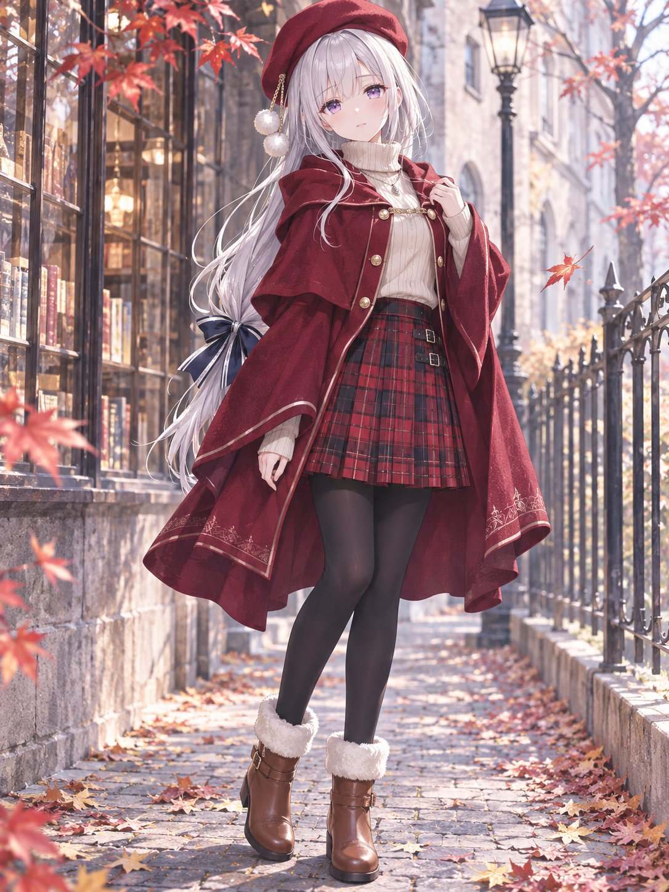
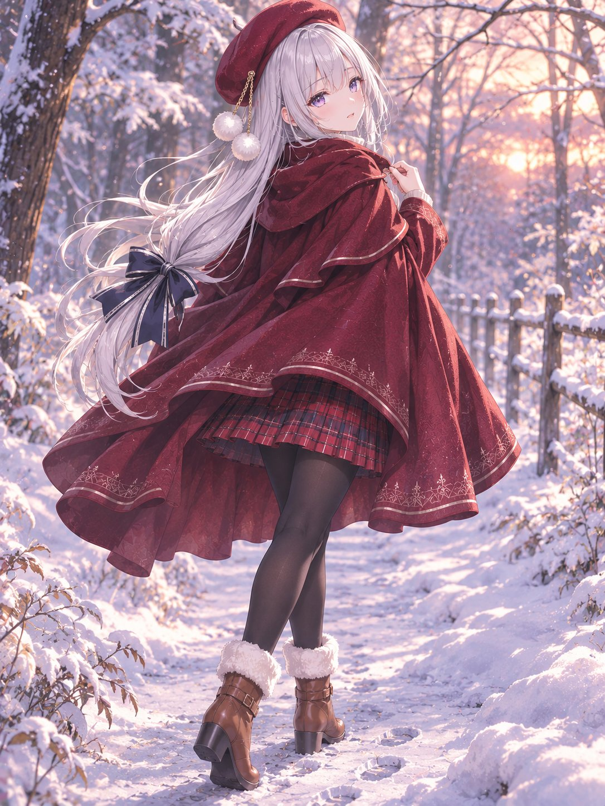
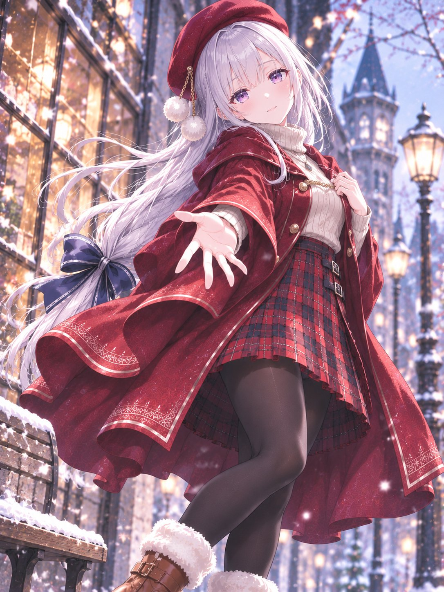

# 「クラシカル・レッドウィンターコーデ」：红色斗篷大衣 + 红黑格纹苏格兰裙 + 贝雷帽的冬季衣装

- 原帖链接：https://x.com/shirase_mio/status/2124782044484108426
- 作者：白瀬澪｜AI少女と小説の日々（@shirase_mio）
- 时间：2026-11-23 16:28 (UTC+8 / Asia/Taipei)
- 互动摘要：点赞 14 · 转发 1 · 回复 1 · 引用 0 · 书签 2 · 浏览 342（采集快照：2026-11-24 20:10 UTC+8）
- 模型/工具：未注明
- 标签：二次元
- 媒体路径：
  - `media/images/2124782044484108426_1.jpg`（）
  - `media/images/2124782044484108426_2.jpg`（）
  - `media/images/2124782044484108426_3.jpg`（）
- 入库日期：2026-11-24
- prompt 来源：https://x.com/shirase_mio/status/2124782098217103492（作者自回复）
- 备注：prompt 在作者自回复（2124782098217103492），整条原样摘录。需上传角色参考图；prompt 写明保持角色体格与年龄感、不夸张体型、黑色不透明连裤袜。

## prompt 原文

```text
添付した参照画像のキャラクターに、以下の衣装を着せて描いてください。
■キャラクターについて
・顔、髪型、髪色、瞳の色、体格、年齢感は参照画像のまま一切変更しない
・キャラクター固有のアクセサリーも参照画像通り維持する
■衣装
ベレー帽: 深みのある赤色のウール製。片側に白いふわふわのボンボンを2個、細い飾り紐で垂らす
アウター: 赤色のクロークコート。ワインレッド寄りの鮮やかな赤、上質なウール。肩から広がるクローク型、袖はケープ状、裾は太もも付近まで。縁に控えめな装飾トリミング
インナー: アイボリー〜ベージュのハイネックニット、縦リブ編み
スカート: 赤と黒のタータンチェック柄キルトスカート。プリーツ明瞭、腰にベルトと装飾バックル
タイツ: 黒の無地、完全不透明
ブーツ: コニャックブラウンのレザー製ショートブーツ。履き口に白いファー
■配色
深みのある赤、黒、ナチュラルアイボリー、コニャックブラウン、白。赤を主役に。
■表現・禁止事項
・ライトノベル挿絵風、透明感のある繊細な描写。体型を誇張しない
・衣装の色・形状・素材を変更しない。キャラクターの別人化、装飾の追加をしない
```

---

个人学习归档，非商业。prompt 与媒体版权归原作者 @shirase_mio，引用请回到原帖。
