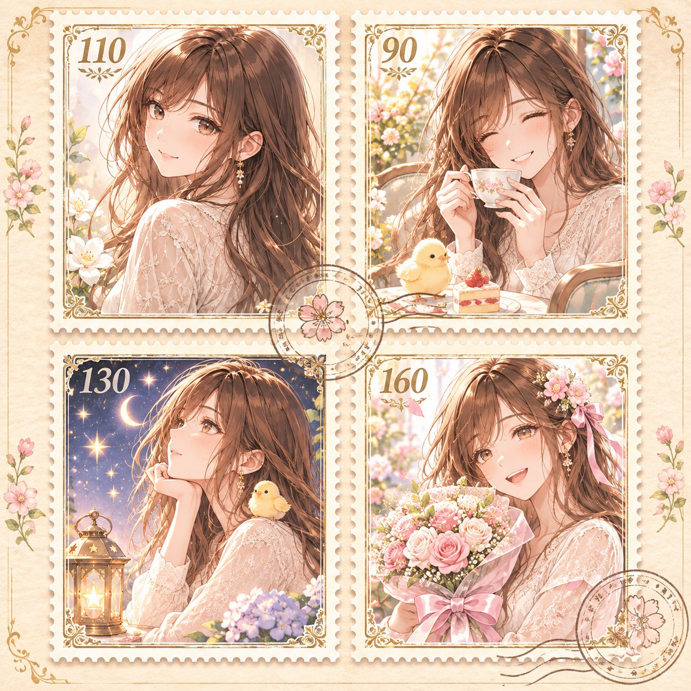
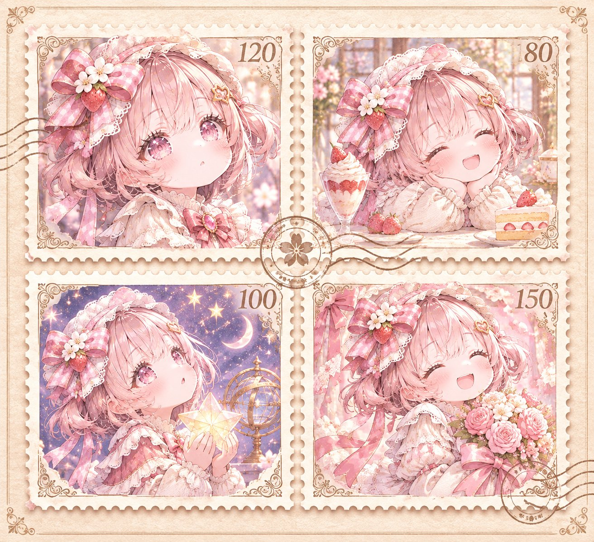

# 「うちの子・記念切手コレクション」：自家角色的 4 款原创纪念邮票（2×2 排版、齿孔边、淡消印）

- 原帖链接：https://x.com/AIXyu1v/status/2124790066866438544
- 作者：ゆき　AIイラストXで収益化（@AIXyu1v）
- 时间：2026-11-23 17:00 (UTC+8 / Asia/Taipei)
- 互动摘要：点赞 74 · 转发 10 · 回复 5 · 引用 9 · 书签 20 · 浏览 2528（采集快照：2026-11-24 20:10 UTC+8）
- 模型/工具：未注明
- 标签：二次元
- 媒体路径：
  - `media/images/2124790066866438544_1.jpg`（）
  - `media/images/2124790066866438544_2.jpg`（）
- 入库日期：2026-11-24
- prompt 来源：https://x.com/AIXyu1v/status/2124790069446004762（作者自回复）
- 备注：prompt 在作者自回复（2124790069446004762），整条原样摘录（含原文的 ** 粗体标记）。需上传角色图作参考。上一轮留待本轮收录。

## prompt 原文

```text
うちの子・記念切手コレクション 💌✨

添付画像のキャラクターを参考に、**その子だけのオリジナル記念切手4種類**を描いてください。

髪型・髪色・瞳・衣装・アクセサリーなど、元キャラの特徴を忠実に再現してください。

【記念切手のデザイン】
**同じキャラクターを主役に、異なる4種類の切手**を制作してください。

💎 **① おすましポートレート**
キャラクターの顔や衣装を美しく見せる、特別な記念肖像。

🌸 **② お気に入りのひととき**
キャラの性格に合った、可愛い日常のワンシーン。

🌙 **③ キャラの象徴モチーフ**
花・星・動物・魔法など、キャラらしい世界観を表現。

🎀 **④ 特別な記念日**
華やかな衣装や花束で、記念切手らしい特別感を演出。

【可愛さのポイント】
・4枚すべて同じキャラクター
・それぞれ違う表情・ポーズ・構図
・キャラのイメージカラーで統一
・繊細なイラストと可愛い装飾
・本当にコレクションしたくなるデザイン

【構図・背景】
**4枚の長方形切手を2×2に整列**させ、1枚のコレクションシートとして描いてください。

各切手には、細かなギザギザの目打ち、上品な飾り枠、小さな額面風の数字を配置。

一部に薄い丸型の消印を重ね、アンティークな雰囲気を演出してください。

4枚とも統一された紙の質感にしつつ、背景やポーズはそれぞれ変えてください。

背景は淡いクリーム色の台紙。切手全体が見える、真上からの商品撮影風の構図。

【仕上がり】
高品質なアニメイラスト。繊細な印刷表現、温かみのある紙の質感、優しいパステルカラー、上品で可愛い記念切手コレクション。

【禁止事項】
元キャラの特徴変更、別キャラクター化、切手の増殖や欠落、4枚すべて同じ構図、顔や手の崩れ、切手枠の変形、実在する国名・郵便局名・公式マーク、読めない文字、ロゴ、透かし。
```

---

个人学习归档，非商业。prompt 与媒体版权归原作者 @AIXyu1v，引用请回到原帖。
