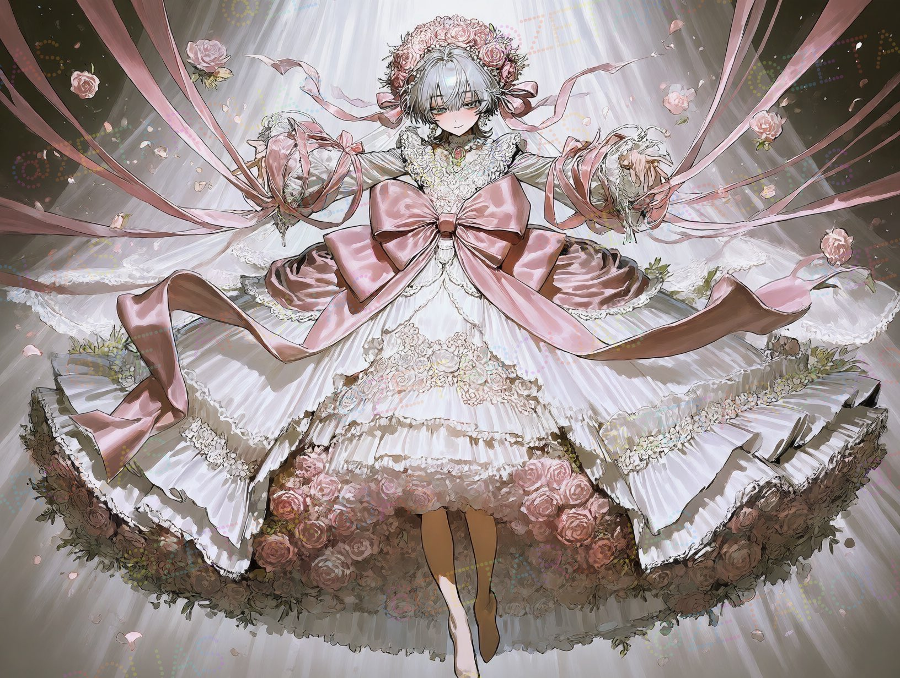
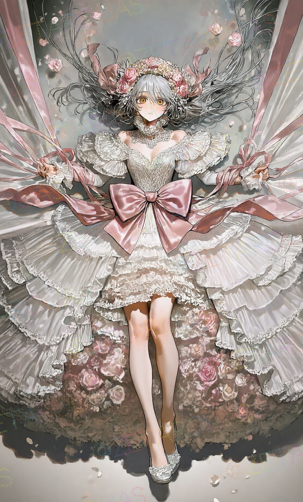

# 「ブーケウェディングドレス」：裙内塞满花束的花束婚纱 + 花冠缎带漂浮姿势（Tsubaki3 版 + SDXL 版）

- 原帖链接：https://x.com/zetarouas/status/2124840794221920498
- 作者：zetarou（@zetarouas）
- 时间：2026-11-23 20:21 (UTC+8 / Asia/Taipei)
- 互动摘要：点赞 30 · 转发 3 · 回复 1 · 引用 0 · 书签 24 · 浏览 1601（采集快照：2026-11-24 20:10 UTC+8）
- 模型/工具：Tsubaki3（作者标注；另附 SDXL 向 prompt）
- 标签：二次元
- 媒体路径：
  - `media/images/2124840794221920498_1.jpg`（）
  - `media/images/2124840794221920498_2.jpg`（）
- 入库日期：2026-11-24
- prompt 来源：https://x.com/zetarouas/status/2124841304945512606（作者自回复）
- 备注：prompt 在图片 ALT 里：主帖两张图 ALT 为 Tsubaki3 用（作者说明一枚目＝礼服、二枚目＝饰品/姿势/背景），自回复图片 ALT 为 SDXL 用；三段各自原样摘录，【】小标题为本仓库所加。作者写「色やポーズなど改変ご自由に」。

## prompt 原文

```text
【Tsubaki3（主帖图 1 ALT：ドレス）】
extravagant floral wedding dress, elegant romantic bridal gown, fitted bodice, elaborate translucent tulle bodice, voluminous tulle neckline, layers of sheer tulle rising upward from the chest, upward-flaring tulle ruffles, fan-shaped tulle layers around the shoulders, airy translucent fabric, soft cascading tulle folds, enormous pink satin ribbon bow at the abdomen, gigantic waist bow, wide luxurious satin ribbon, oversized ribbon tails, extremely voluminous bell-shaped skirt, structured pannier silhouette, fluffy petticoat, enormous rounded skirt, multiple layers of gathered ruffles, cascading tiered frills, elaborate scalloped hems, layered organza, translucent chiffon, dense floral underskirt, countless [花の指定] forming the inner skirt, thick clusters of flowers beneath the outer skirt, flower-covered ruffle layers, flowers integrated into the petticoat, alternating layers of white fabric ruffles and floral ruffles, delicate green foliage, extravagant three-dimensional floral hem

【Tsubaki3（主帖图 2 ALT：アクセサリー、ポーズ、背景）】
elaborate floral crown, abundant rose hair ornaments, delicate pearl ornaments, oversized dusty pink satin ribbons, wide ribbon streamers, long flowing ribbon tails

elegant standing pose, floating gracefully in midair, upright body, legs hanging naturally, arms slightly raised away from the body, enormous skirt fully expanded around the waist, both arms extended slightly outward, long ribbons spiraling around both arms in a tornado-like motion, wide ribbons forming large swirling loops around the forearms, large waist bow prominently displayed, flowing ribbon tails trailing outward

dramatic low angle, looking up at the character, upward perspective, full body composition, strong perspective, skirt viewed from below, emphasis on the voluminous underskirt, visible floral layers beneath the outer skirt

floating flower petals, drifting roses, scattered blossoms, delicate floral particles, romantic wedding atmosphere, flowing translucent white curtains, dreamy ethereal atmosphere

【SDXL 向け（自回复 2124841304945512606 图片 ALT）】
1girl, high resolution, high quality, 
bouquet-inspired, white wedding dress, floral tulle, large amount of flowers inside skirt, long flared skirt, bouquet-like dress, bouquet-like pannier, bouquet-like tulle, flowers filling the inside of skirt, flower crown, ribbon-wrapped arms, very large ribbon on belly, colorful flowers, colorful flowers inside skirt, petals falling, low angle, flowers visible inside skirt, skirt fluttering, full body
```

---

个人学习归档，非商业。prompt 与媒体版权归原作者 @zetarouas，引用请回到原帖。
