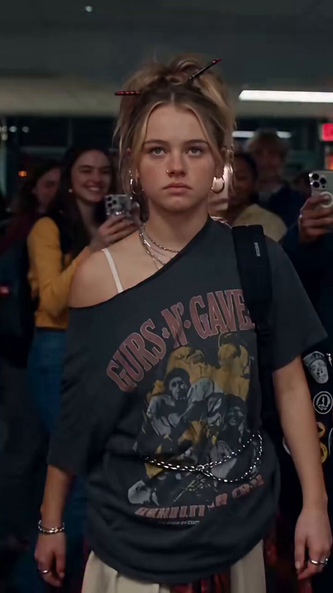

# 湿发雀斑女子在拥挤室内直视镜头的情绪特写：铅笔盘发、鼻环、银链（Seedance 2.5 写实视频）

- 原帖链接：https://x.com/SeeratFatima112/status/2124850381973053842
- 作者：Seerat Fatima（@SeeratFatima112）
- 时间：2026-11-23 20:59 (UTC+8 / Asia/Taipei)
- 互动摘要：点赞 111 · 转发 6 · 回复 19 · 引用 0 · 书签 16 · 浏览 8065（采集快照：2026-11-24 20:10 UTC+8）
- 模型/工具：Seedance 2.5（作者标注）
- 标签：真人
- 媒体路径：
  - `media/video-stills/2124850381973053842_still.jpg`（视频封面截图，）
  - 视频本体未入库，仅保留原帖链接：https://x.com/SeeratFatima112/status/2124850381973053842
- 入库日期：2026-11-24
- prompt 来源：https://x.com/SeeratFatima112/status/2124850387786350708（作者自回复）
- 备注：prompt 在作者自回复（2124850387786350708），整条原样摘录。成年女性写实情绪特写，衣着完整、非性化。视频本体未入库，仅保留原帖链接。

## prompt 原文

```text
Ultra-realistic cinematic close-up portrait of a young woman standing in a crowded indoor environment, with a messy blonde-brown bun hairstyle secured with two red-and-black pencils crossed through her hair. Loose wet strands framing her face, natural freckles across her cheeks and nose, slightly watery blue-green eyes, a small silver nose ring, multiple silver hoop earrings, and layered silver chain necklaces.

She is wearing an oversized dark charcoal graphic T-shirt with a white tank top underneath and a black backpack strap over one shoulder. Her face and hair are wet with visible water droplets, giving her a tired, emotional, intense expression. She looks directly into the camera with a serious, slightly angry expression.

Cinematic moody indoor lighting, realistic skin texture, detailed facial features, shallow depth of field, blurred people in the background, dramatic atmosphere, professional film cinematography, natural color grading, 85mm portrait lens, extremely detailed, photorealistic, 4K quality.

Vertical 9:16 composition, no watermark, no extra text, no distorted facial features.
```

---

个人学习归档，非商业。prompt 与媒体版权归原作者 @SeeratFatima112，引用请回到原帖。
