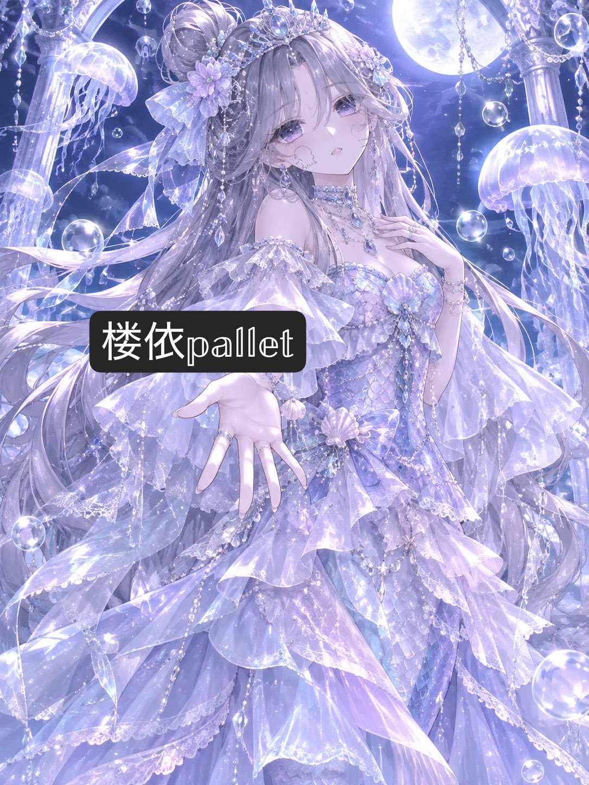
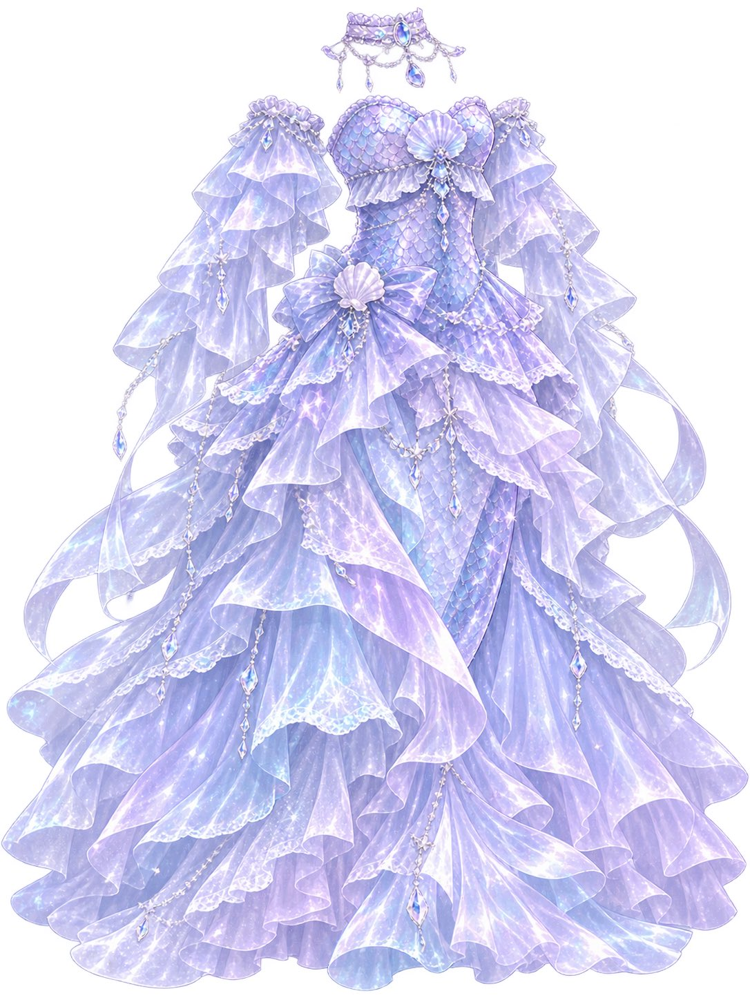

# 《人魚のドレス》：淡紫×冰蓝×珍珠白的人鱼公主礼服设计（贝壳胸饰、鱼鳞纹、尾鳍长裙）

- 原帖链接：https://x.com/YrAn1n/status/2124872082773471239
- 作者：藍月 楼依𓈒𓏸ᖇ𓈒𓋜（@YrAn1n）
- 时间：2026-11-23 22:25 (UTC+8 / Asia/Taipei)
- 互动摘要：点赞 19 · 转发 0 · 回复 2 · 引用 4 · 书签 1 · 浏览 802（采集快照：2026-11-24 20:10 UTC+8）
- 模型/工具：未注明
- 标签：二次元
- 媒体路径：
  - `media/images/2124872082773471239_1.jpg`（）
  - `media/images/2124872082773471239_2.jpg`（）
- 入库日期：2026-11-24
- prompt 来源：https://x.com/YrAn1n/status/2124872086070133154（作者自回复）
- 备注：prompt 在作者自回复（2124872086070133154），整条原样摘录。作者希望使用后引用转发，并标注 #自作発言禁止（未声明禁止转载）。

## prompt 原文

```text
淡いラベンダー×アイスブルー×パールホワイトの人魚姫プリンセスドレス。貝殻モチーフの胸元、魚鱗模様、真珠と宝石の装飾、透け感のあるオーガンジーのフリル袖、尾びれのように広がる豪華なロングスカート。銀色の刺繍と繊細なレース。幻想的で透明感のある高品質なファンタジー衣装デザイン正面全身
```

---

个人学习归档，非商业。prompt 与媒体版权归原作者 @YrAn1n，引用请回到原帖。
