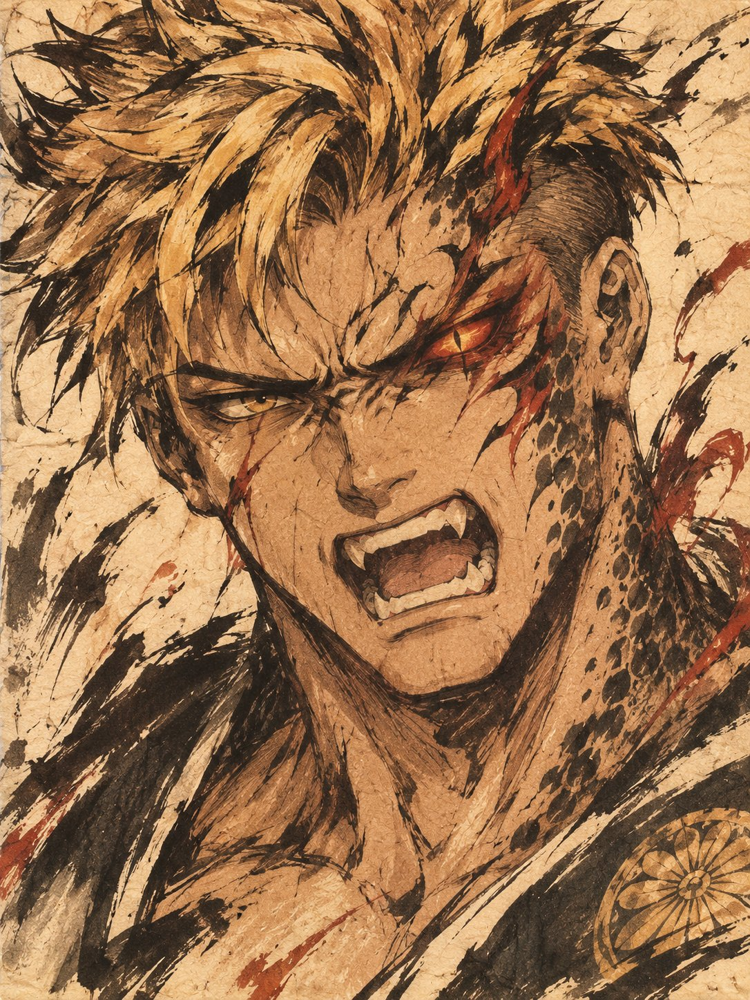
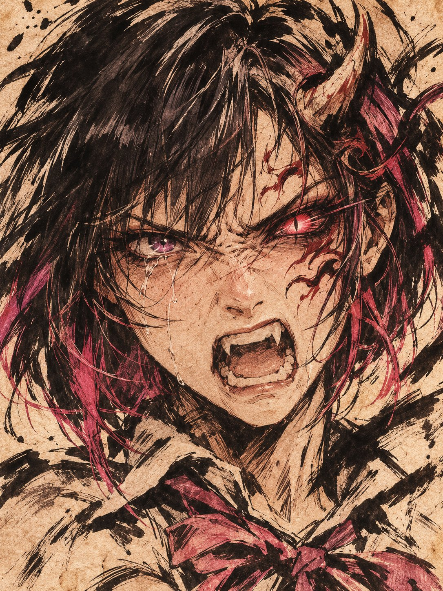
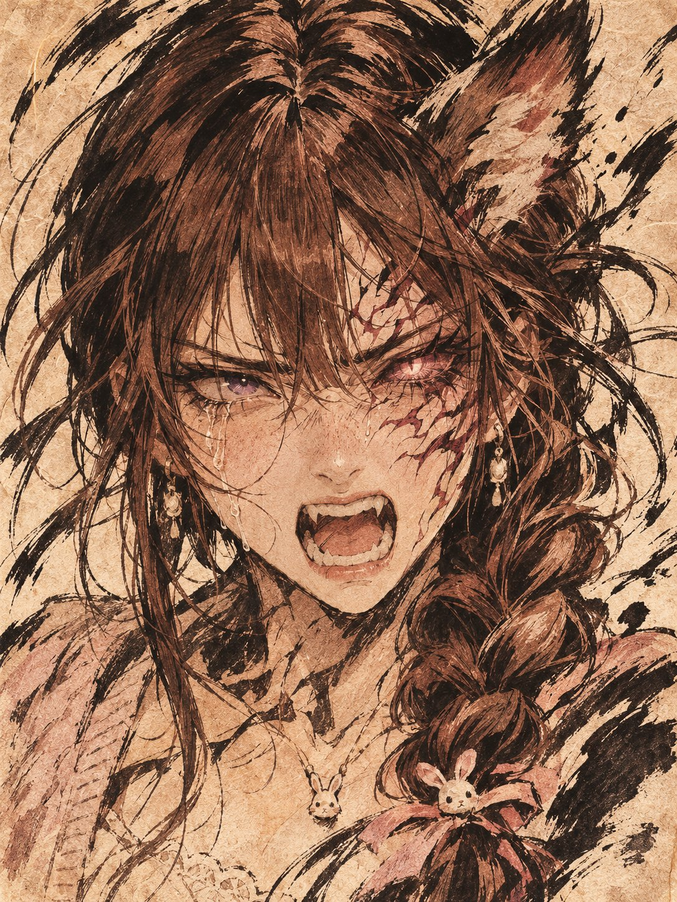
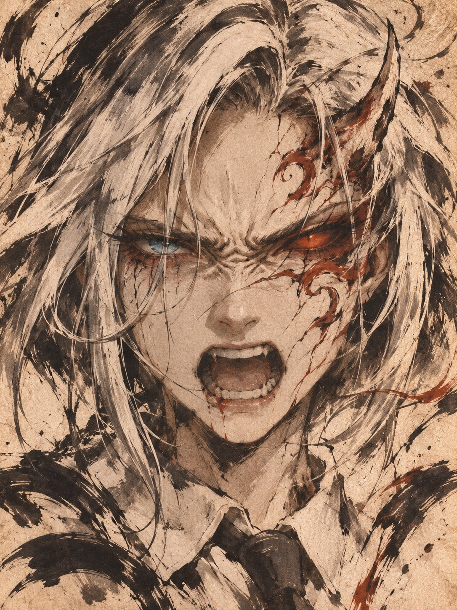

# 「YŌKAI AWAKENING — THE FALL」：角色道德崩坏、开始妖怪化瞬间的粗犷浮世绘 × 水墨面部特写（超长结构化 prompt）

- 原帖链接：https://x.com/Le_Tavernicole/status/2124948154626068785
- 作者：Le Tavernicole（@Le_Tavernicole）
- 时间：2026-11-24 03:28 (UTC+8 / Asia/Taipei)
- 互动摘要：点赞 55 · 转发 11 · 回复 6 · 引用 4 · 书签 11 · 浏览 1080（采集快照：2026-11-24 20:10 UTC+8）
- 模型/工具：未注明
- 标签：二次元
- 媒体路径：
  - `media/images/2124948154626068785_1.jpg`（）
  - `media/images/2124948154626068785_2.jpg`（）
  - `media/images/2124948154626068785_3.jpg`（）
  - `media/images/2124948154626068785_4.jpg`（）
- 入库日期：2026-11-24
- prompt 来源：https://x.com/Le_Tavernicole/status/2124948181515407825（作者自回复）
- 备注：prompt 在作者自回复（2124948181515407825），从「I've reworked」起原样摘录（略去开头 @ 提及）；全文约 2 万字符，含多节结构化指令。需上传角色设定图作参考。示例为 4 张愤怒面部特写，无性化内容。

## prompt 原文

```text
I've reworked the original **Universal Kami Incarnation** into a much more violent, psychologically intense concept: **the exact instant a character's morality collapses and their humanity begins to surrender to a Yōkai nature.**

The new version prioritizes an extreme 3:4 facial close-up, near-feral emotional intensity, partially transformed anatomy, and a substantially rougher, more brutal interpretation of traditional ukiyo-e and sumi-e.

# UNIVERSAL YŌKAI AWAKENING

## THE FALL OF MORALITY — FURY OF THE BROKEN SOUL

### Savage Ukiyo-e × Violent Sumi-e × Ancient Japanese Ink Expressionism

**FORMAT:** Strict vertical 3:4 — Extreme facial portrait.

**CHARACTER REFERENCE:** @Image1

**ARTISTIC DIRECTION:** Ferociously rough Japanese ukiyo-e, savage sumi-e brushwork, fractured woodblock engraving, uncontrolled calligraphic violence, ancient weathered washi paper.

**CORE CONCEPT:** The precise, irreversible instant when the referenced character's morality shatters and their suppressed darkness begins transforming them into a Yōkai from Japanese folklore.

**EMOTIONAL DIRECTION:** Overwhelming fury, psychological collapse, broken restraint, supernatural awakening, inner torment, and terrifying spiritual intensity.

**VISUAL PHILOSOPHY:** One face. One breaking soul. One irreversible transformation.

---

## 01 | CHARACTER IDENTITY — ABSOLUTE REFERENCE LOCK

Use the uploaded reference image as the exclusive authority for the character's original identity.

The resulting portrait must remain **immediately and unmistakably recognizable as the uploaded character**, even under the extreme emotional and supernatural transformation.

Preserve faithfully:

- Original facial bone structure, proportions, and distinctive anatomy.
- Eye shape, placement, iris characteristics, and natural facial asymmetry.
- Original nose, lips, mouth proportions, cheekbones, jawline, and chin.
- Hair color, length, hairstyle, hairline, volume, and distinctive strands.
- Original skin tone and characteristic markings.
- Scars, freckles, tattoos, symbols, and other recognizable features.
- Original species and species-specific anatomical characteristics.
- Existing horns, ears, fur, scales, feathers, or other nonhuman features.
- Character-defining accessories and visible clothing elements.
- Original apparent age and mature facial characteristics.

**The Yōkai must emerge FROM the original character, never replace them.**

Do not substitute the original face with a generic oni, demon, monster, or Japanese mythological archetype.

Do not beautify, standardize, or redesign the original character.

The face must remain recognizable through its original structure, not merely its hairstyle or accessories.

The supernatural transformation must be adapted to the character's existing anatomy.

**IDENTITY IS ABSOLUTE. TRANSFORMATION IS PARTIAL.**

---

## 02 | THE FALL — THE EXACT MOMENT MORALITY SHATTERS

Depict the character at the precise instant when their final moral restraint breaks.

This is not a portrait of someone who has already become evil.

**This is the moment of becoming.**

Their original personality is being consumed by something ancient, furious, and profoundly supernatural.

The expression must communicate a violent internal contradiction:

- Fury overwhelming reason.
- Anguish becoming hatred.
- Desperation transforming into cruelty.
- Suppressed instincts escaping control.
- The last remnants of conscience fighting against an awakening monstrous nature.
- A terrible realization that something irreversible is happening.
- A fraction of recognizable humanity still surviving beneath the emerging Yōkai.

The character may be screaming, snarling, baring their teeth, grimacing, or holding an almost unbearable expression of restrained rage.

Select the expression best suited to their original facial anatomy and identity.

Their eyes are the emotional epicenter.

One may retain a trace of their former self while the other becomes frighteningly supernatural.

The mouth, brow, cheeks, and jaw must respond convincingly to the same overwhelming emotion.

**The expression must look involuntary, raw, devastating, and psychologically authentic.**

Not theatrical anger.

Not a fashionable villain pose.

Not a confident demonic smile.

It is the terrifying instant when someone realizes they can no longer stop what they are becoming.

---

## 03 | PARTIAL YŌKAI TRANSFORMATION — THE MONSTER BENEATH

The character undergoes a spontaneous, incomplete metamorphosis into a unique Yōkai incarnation inspired by authentic Japanese folklore.

The supernatural manifestation must feel intrinsically connected to the character's identity, personality, and moral collapse.

The portrait should convey approximately **70–80% recognizable original character and 20–30% Yōkai alteration**, prioritizing visual recognition rather than literal anatomical percentages.

Draw upon the visual language of traditional Yōkai folklore, such as oni, onryō, hannya, kitsune, or other appropriate supernatural beings, without mechanically combining unrelated creatures.

Choose **one coherent folkloric direction**, adapted to the subject.

Potential manifestations include:

- One original eye becoming unnaturally intense, its pupil distorted by supernatural fury.
- Irregular dark ink veins emerging beneath the skin.
- Small, asymmetric horn growths breaking through the original hairline when appropriate to the chosen Yōkai.
- Subtle sharpening or elongation of existing canine teeth.
- Portions of the cheek, temple, or jaw becoming darker, rougher, or spiritually corrupted.
- Fractured markings spreading across the face like cracks in ancient lacquer.
- The original skin pattern developing into sinister, organic Yōkai markings.
- Hair erupting into aggressive, chaotic calligraphic strands.
- A creeping shadow that seems to originate beneath the flesh rather than fall upon it.
- One portion of the facial silhouette becoming slightly less human while the original face remains structurally intact.

These are possible manifestations, not a checklist.

**Select only the features that naturally support the transformation.**

The changes should emerge organically from the existing face.

Avoid a perfectly divided human-versus-demon face.

Instead, make the transformation irregular, invasive, asymmetric, and still progressing.

The character is neither fully human nor fully Yōkai.

The monstrous nature appears to be growing through the original identity.

Never obscure both eyes.

Never replace the entire jaw or nose with an animal muzzle.

Never add an oversized mask that conceals the expression.

Do not turn the character into a generic horned demon.

**The original face must remain the dominant anatomical foundation.**

---

## 04 | THE FACE — PSYCHOLOGICAL AND ANATOMICAL VIOLENCE

**ABSOLUTE PRIORITY: THE FACE IS THE ENTIRE SUBJECT.**

This image must possess exceptional emotional intensity and facial precision beneath its violently rough execution.

Preserve anatomically accurate facial construction while allowing expressive exaggeration driven by fury.

Emphasize:

- Brows drawn together or violently distorted by tension.
- Eyes opened with frightening intensity or narrowed by overwhelming hatred.
- Unevenly contracted facial muscles.
- Tension across the forehead and temples.
- Deep, expressive creases around the nose and mouth.
- Cheek muscles reacting to the character's emotional breaking point.
- A tightly clenched or violently opened jaw.
- Teeth revealed only when naturally supported by the expression.
- Original facial markings remaining visible through the corruption.

The facial deformation must be caused by **emotion and partial supernatural transformation**, not careless anatomical distortion.

The eyes require extraordinary attention.

They must remain recognizable as the original character's eyes while communicating the overwhelming emergence of their Yōkai nature.

Build the eye sockets through brutal black ink shadows.

Use extremely sharp, expressive strokes for the eyelids and eyelashes where applicable.

Let the pupils and irises retain a concentrated sense of consciousness.

A tiny untouched point of ivory washi within an eye may create a piercing, almost unbearable gaze.

**The viewer must feel that they are witnessing the exact moment a soul breaks.**

---

## 05 | ARTISTIC STYLE — SAVAGE, EXTREMELY ROUGH UKIYO-E

**CRITICAL PRIORITY: FAR ROUGHER, DARKER, MORE AGGRESSIVE, AND MORE INSTINCTIVE THAN TRADITIONAL POLISHED UKIYO-E.**

The painting must resemble a ferociously expressive Japanese ink master attempting to capture a supernatural transformation before the moment disappears.

Combine:

- Ancient Japanese sumi-e ink painting.
- Aggressively fractured ukiyo-e woodblock aesthetics.
- Raw Japanese brush calligraphy.
- Primitive-looking, deeply expressive woodcut textures.
- Spontaneous, almost violent gestural portraiture.
- Physical pigment irregularities from traditional handmade materials.

The image must feel **furious in its physical execution**.

Use abundantly:

- Brutally thick, heavily saturated black ink strokes.
- Jagged and fractured facial contours.
- Violent dry-brush scraping.
- Deep crushed-black ink masses.
- Broken and overlapping construction lines.
- Rough, uneven woodcut hatching.
- Sharp calligraphic slashes.
- Abrupt directional brushstrokes.
- Splintered charcoal-like textures.
- Aggressive pressure variation.
- Coarse bristle streaks.
- Uncontrolled-looking ink bleeding.
- Hard black-to-ivory contrasts.
- Partially dissolved silhouettes.
- Overloaded brush marks.
- Scratched and interrupted outlines.
- Dense ink deposits around the eyes and jaw.
- Wildly energetic hair contours.
- Rapid, instinctive gestural corrections.
- Fiercely uneven pigment distribution.
- Heavy, irregular cross-hatching.
- Almost illegible peripheral strokes.
- Ink splatter emerging directly from the transformed features.

**PUSH THE ROUGHNESS BEYOND THE ORIGINAL PROMPT.**

The artwork must appear nearly overwhelmed by the force of its own brushwork.

However, all apparent chaos must remain artistically controlled.

The roughness must never destroy the face's recognizable structure.

### Controlled anatomical mastery within artistic chaos

The original eyes, nose, mouth, jawline, and hairstyle must remain intelligently constructed.

The important facial landmarks are rendered through confident, expressive strokes rather than neat outlines.

The outer regions of the portrait may become radically more chaotic.

Hair, shoulders, neck shadows, and emerging supernatural markings may fracture into furious gestures.

The face must appear as though it is struggling to remain recognizable while the surrounding ink tears its familiar identity apart.

**The transformation is expressed as much through the violence of the brushwork as through the supernatural anatomy.**

---

## 06 | COMPOSITION — EXTREME 3:4 FACE PORTRAIT

**CANVAS: STRICT VERTICAL 3:4.**

**FRAMING: INTIMATE, OPPRESSIVE, FACE-DOMINATED CLOSE-UP.**

Show only:

- Head.
- Hair.
- Neck.
- Minimal upper shoulders or collarbones where needed for composition.

No full body.

No waist.

No hands unless an absolutely essential, naturally framed gesture reinforces the emotional moment.

The face must dominate the composition, occupying approximately 65–80% of the image's visual height.

The eyes should form the principal focal point.

Use an intense frontal or subtle three-quarter orientation.

A slight head tilt or asymmetric turn may reinforce the psychological instability.

The character must feel almost too close to the viewer.

Avoid excessive perspective distortion that would alter recognizable facial proportions.

Leave enough space around the hair and transformed silhouette for the most aggressive brushstrokes to escape into the surrounding paper.

The face must remain completely legible.

The emotional power must come from the portrait itself, never from elaborate scenery.

### Negative space

The background consists exclusively of weathered Japanese washi paper.

No landscape.

No temple.

No shrine.

No architecture.

No horizon.

No scenery.

No secondary figures.

No decorative composition.

Any ink eruption must originate from the head, hair, neck, or transformation.

**The entire image is a confrontation between one breaking face and the empty paper surrounding it.**

---

## 07 | MATERIAL — ANCIENT WASHI UNDER VIOLENT INK

The portrait is physically painted on a single sheet of authentically aged Japanese handmade washi paper.

The paper must feel historical, fragile, fibrous, and absorbent.

Use:

- Warm ivory parchment tones.
- Natural mulberry-fiber texture.
- Visible coarse paper grain.
- Slight unevenness in the surface.
- Subtle centuries-old yellowing.
- Sparse organic imperfections.
- Delicate pigment bleeding into the fibers.
- Raised paper tooth catching dry pigment.
- Slightly feathered edges around saturated ink.
- Occasional soft, naturally aged discoloration.

Some strokes appear nearly dry, catching only the upper fibers.

Others appear so heavily loaded with sumi ink that the pigment has saturated the paper.

The ink must feel physically embedded in the material.

No artificial digital paper overlay.

No excessive stains or decorative aging.

No torn edges or ornamental manuscript framing.

The washi paper should remain authentic, restrained, and visually subordinate to the face.

**Untouched paper provides the light. Violent black ink provides the darkness.**

---

## 08 | COLOR AND LIGHT — THE DARKNESS OF TRANSFORMATION

**DOMINANT MEDIUM: TRADITIONAL BLACK SUMI INK.**

Primary palette:

- Dense carbon black.
- Deep warm ink black.
- Crushed charcoal grey.
- Smoky diluted grey.
- Naturally aged ivory.

Use dramatic, irregular black ink masses to establish facial volume and emotional tension.

No conventional cinematic lighting setup.

No digital rim lighting.

No smooth airbrushed gradients.

Highlights must be carved from untouched washi paper.

### Optional restrained supernatural pigment

When appropriate to the character's identity and transformation, use extremely limited traditional pigment accents.

Possible tones:

- Deep oxidized vermilion.
- Muted blood red.
- Dark mineral indigo.
- Weathered ochre.
- Faded character-specific identifying colors.

Color should appear as uneven physical pigment applied through ancient Japanese techniques.

A single partially transformed eye may contain a restrained supernatural accent.

Existing important identifying colors may be preserved sparingly.

**At least 85–90% of the artwork's visual impression must remain monochromatic black ink and aged paper.**

No neon.

No glowing digital effects.

No saturated modern fantasy colors.

The supernatural terror must originate from expression, anatomy, and brushwork.

---

## 09 | CALLIGRAPHIC FURY — PAINT THE MORAL COLLAPSE

The brushwork must embody the psychological transformation.

The final surviving humanity should be represented by the most deliberate, accurately controlled facial strokes.

The awakening Yōkai nature should be represented by increasingly savage, fragmented, and destabilized marks.

Allow a visible tension between these artistic languages.

**HUMANITY — Precision**

Recognizable facial anatomy, original eye structures, characteristic markings, controlled contours.

**CORRUPTION — Fracture**

Broken lines, irregular shadows, asymmetrical markings, emerging supernatural anatomy.

**YŌKAI — FURY**

Savage calligraphic slashes, crushed ink masses, violent dry-brush eruptions, fragmented peripheral forms.

These three states must coexist within the same face.

The brushwork should become noticeably more aggressive around the regions undergoing supernatural transformation.

The original identity seems to resist being swallowed by the surrounding black ink.

The transitions must be organic rather than divided into clearly separated panels or sections.

There is no literal boundary between human and monster.

**The very act of painting must feel like the character's morality is being destroyed stroke by stroke.**

The artist's hand appears impossibly fast, furious, and masterfully controlled.

The portrait feels created in one brief episode of extraordinary emotional violence.

---

## 10 | STRICT VISUAL EXCLUSIONS

Do not include:

- Full-body compositions.
- Wide environmental scenes.
- Landscapes, buildings, temples, or shrines.
- Decorative flowers, petals, clouds, or waves.
- Secondary characters or spirits.
- Floating kanji, lettering, inscriptions, or captions.
- Artist signatures or red seals.
- Ornamental frames.
- Generic oni masks concealing facial identity.
- Oversized horns replacing the hairstyle.
- Complete monster transformations.
- Unnecessary animal muzzles or unrelated species traits.
- Extra eyes, faces, heads, or limbs.
- Perfectly symmetrical supernatural mutations.
- A clean, artificial half-human/half-demon division.
- Generic anime expressions.
- Conventional pretty anime portrait rendering.
- Attractive or glamorous villain styling that softens the rage.
- Comedic or cartoonish anger.
- Excessive gore or exposed internal anatomy.
- Delicate, polished, decorative ukiyo-e.
- Clean vector contours.
- Smooth digital gradients.
- Airbrushed shading.
- Modern concept-art rendering.
- Glossy three-dimensional effects.
- Digital supernatural particles.
- Cinematic lens flares.
- Excessive color saturation.
- Decorative ink splashes disconnected from the character.
- Anatomical errors disguised as stylization.
- Loss of recognizable facial features.

**Do not make the Yōkai transformation more important than the original character's identity.**

**Do not make the portrait beautiful at the expense of its emotional brutality.**

**Do not confuse visual chaos with artistic incompetence.**

---

## 11 | FINAL ARTISTIC DIRECTIVE — THE IRREVERSIBLE INSTANT

Create a terrifyingly expressive, intimately framed Japanese ink portrait of the uploaded character at the exact moment their morality collapses.

Their face remains unmistakably their own.

Yet something ancient and monstrous is beginning to emerge.

Their eyes reveal a desperate struggle between the last remnants of conscience and an overwhelming supernatural fury.

Their original anatomy is partially corrupted by a distinctive Yōkai manifestation inspired by Japanese folklore.

Their hair and facial silhouette erupt into brutal, savage calligraphic gestures.

Dense black ink devours portions of the face while the original identity fights to remain visible.

The portrait must appear physically painted with extraordinary speed, violence, and artistic mastery upon centuries-old Japanese washi.

The painting is unfinished only in its wild peripheral brushwork, never in its anatomical understanding.

It should resemble an impossible historical masterpiece: a forbidden portrait created by an ancient ink master who witnessed the precise moment a mortal soul became something monstrous.

No scenery.

No ornaments.

No distractions.

Only the face, the rage, the transformation, and the paper.

### ULTIMATE PRIORITY ORDER

1. **Absolute recognition of the uploaded character.**
2. **The precise emotional moment of moral collapse.**
3. **Extreme facial intensity, fury, and psychological conflict.**
4. **Partial, character-adapted Yōkai transformation.**
5. **Savage, exceptionally rough ukiyo-e × sumi-e execution.**
6. **Anatomically masterful facial expression and structure.**
7. **Extreme close-up composition in vertical 3:4.**
8. **Authentic ancient Japanese ink and washi materiality.**
9. **Minimalism, concentrated emotion, and explosive calligraphic energy.**

**ONE FACE. ONE SHATTERED MORALITY. ONE AWAKENING YŌKAI.**

**THE HUMAN REMAINS RECOGNIZABLE. THE MONSTER HAS ALREADY BEGUN TO EMERGE.**
```

---

个人学习归档，非商业。prompt 与媒体版权归原作者 @Le_Tavernicole，引用请回到原帖。
