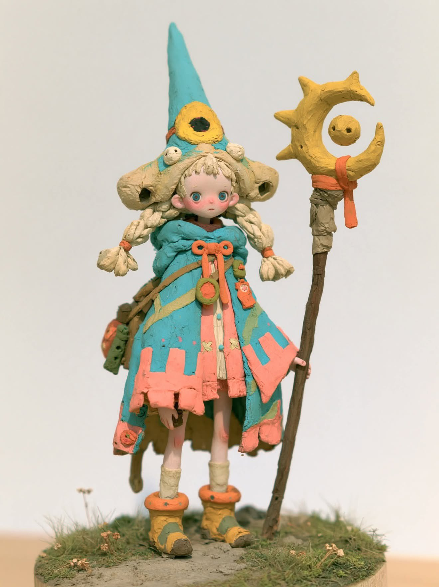
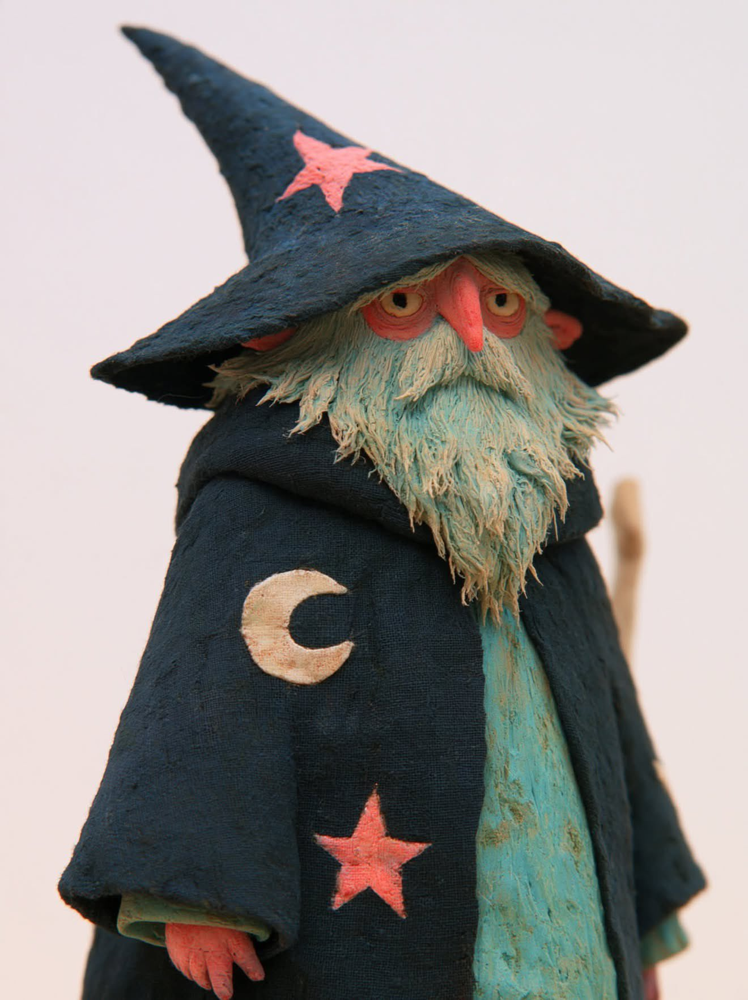
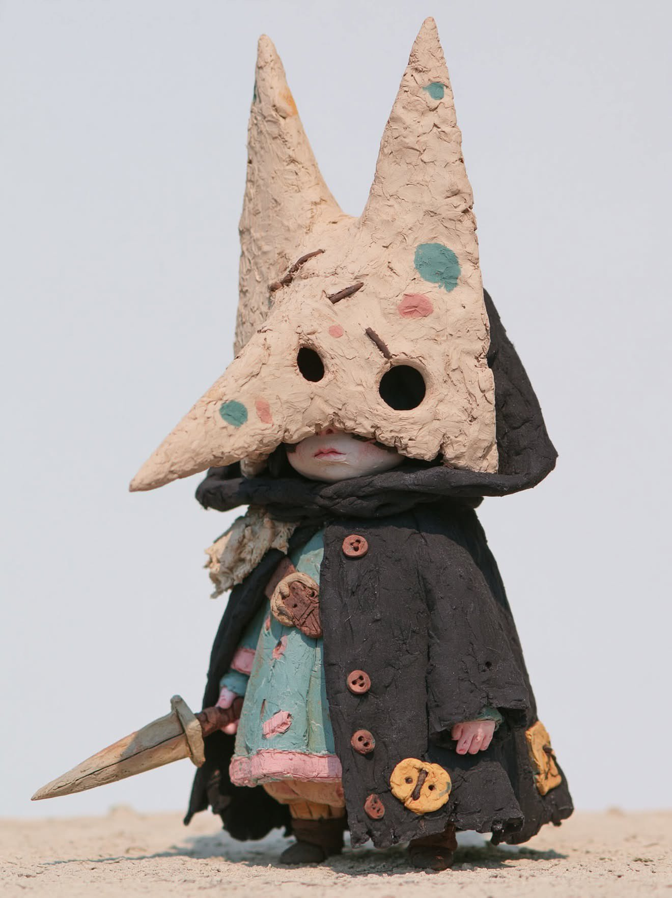
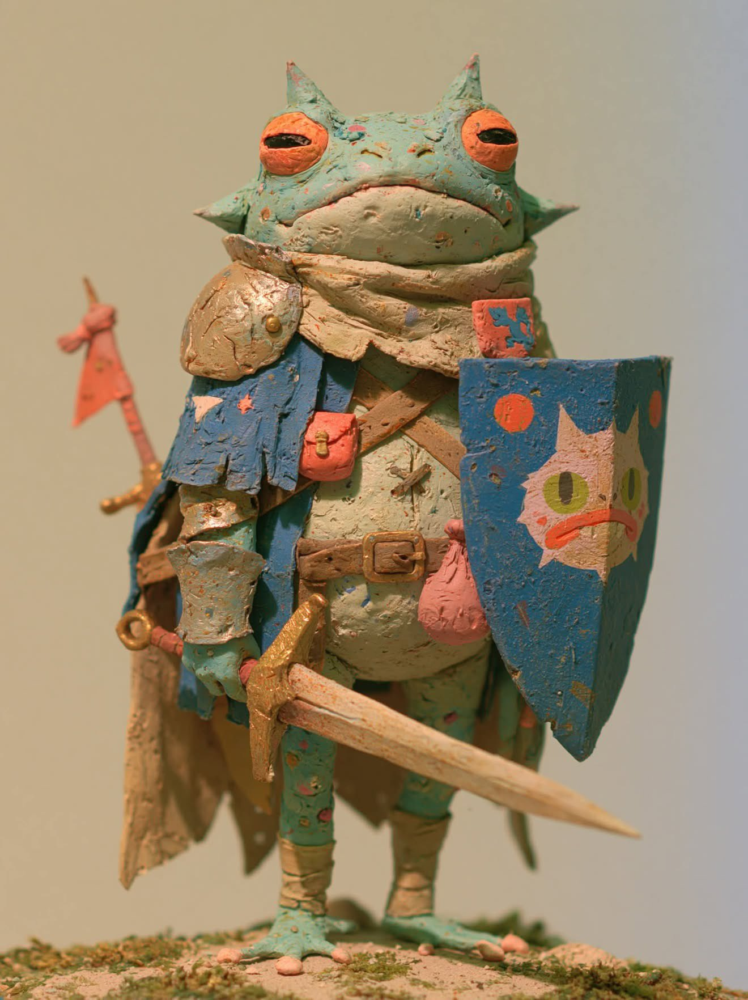

# Midjourney V8.2 黏土艺术角色：用 Niji 6 sref 做成的 moodboard（profile）移植到 V8.2（附 Niji 6 原版写法）

- 原帖链接：https://x.com/imhealmachine/status/2125046427500114018
- 作者：imhealingmachine（@imhealmachine）
- 时间：2026-11-24 09:58 (UTC+8 / Asia/Taipei)
- 互动摘要：点赞 34 · 转发 2 · 回复 1 · 引用 0 · 书签 21 · 浏览 1116（采集快照：2026-11-24 20:10 UTC+8）
- 模型/工具：Midjourney V8.2（另附 Niji 6 版）
- 标签：其它
- 媒体路径：
  - `media/images/2125046427500114018_1.jpg`（）
  - `media/images/2125046427500114018_2.jpg`（）
  - `media/images/2125046427500114018_3.jpg`（）
  - `media/images/2125046427500114018_4.jpg`（）
- 入库日期：2026-11-24
- prompt 来源：https://x.com/imhealmachine/status/2125046440795984066（作者自回复）
- 备注：第一行为主帖正文首行（V8.2 版），第二段为作者自回复（2125046440795984066）首行（Niji 6 版），均原样摘录；{Character Description} 为占位符。作者说明：把 Niji 6 时代 sref 生成的图做成 moodboard（profile lxqvzhw），与个人化代码组合以在 V8.2 复现黏土质感。媒体只收主帖 4 张图。

## prompt 原文

```text
clay art, {Character Description}, simple white background --ar 3:4 --exp 20 --profile z7c2z8i lxqvzhw --stylize 500 --hd --v 8.2

clay art, {Character description} --ar 3:4 --sref 1176294011 1416064392 --profile g7vdrgl wc9gyme lxqvzhw --stylize 500 --niji 6
```

---

个人学习归档，非商业。prompt 与媒体版权归原作者 @imhealmachine，引用请回到原帖。
