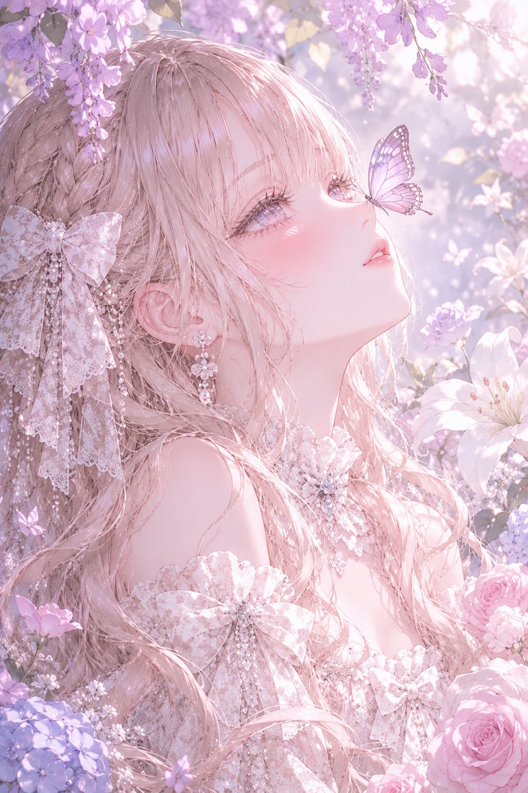
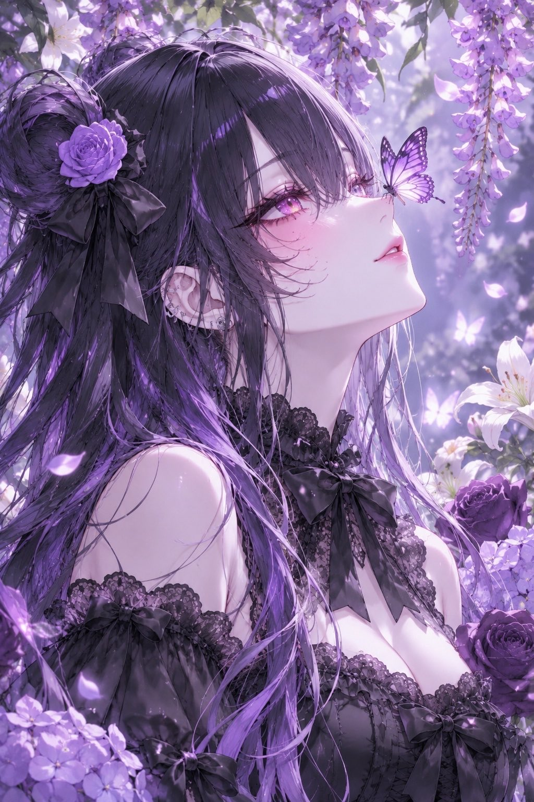
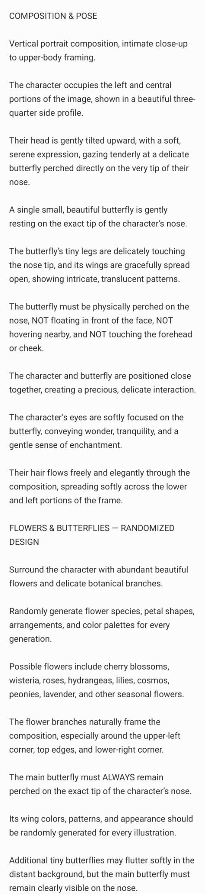

# 鼻尖停着一只蝴蝶的侧颜特写：花枝环绕、花种与蝶翼颜色随机（ChatGPT / PixAI 通用）

- 原帖链接：https://x.com/mirano_rano00/status/2125056224672760207
- 作者：ミラノ（@mirano_rano00）
- 时间：2026-11-24 10:37 (UTC+8 / Asia/Taipei)
- 互动摘要：点赞 20 · 转发 1 · 回复 0 · 引用 8 · 书签 20 · 浏览 1771（采集快照：2026-11-24 20:10 UTC+8）
- 模型/工具：ChatGPT / PixAI（作者标注均可用）
- 标签：二次元
- 媒体路径：
  - `media/images/2125056224672760207_1.jpg`（）
  - `media/images/2125056224672760207_2.jpg`（）
  - `media/images/2125056224672760207_3.jpg`（）
- 入库日期：2026-11-24
- 备注：prompt 在主帖图 1、图 2 的 ALT 里，按作者说明拼接（两段 ALT 之间空一行），各自原样摘录。图 3 为文字截图，无 ALT，未转写。

## prompt 原文

```text
COMPOSITION & POSE

Vertical portrait composition, intimate close-up to upper-body framing.

The character occupies the left and central portions of the image, shown in a beautiful three-quarter side profile.

Their head is gently tilted upward, with a soft, serene expression, gazing tenderly at a delicate butterfly perched directly on the very tip of their nose.

A single small, beautiful butterfly is gently resting on the exact tip of the character’s nose.

The butterfly’s tiny legs are delicately touching the nose tip, and its wings are gracefully spread open, showing intricate, translucent patterns.

The butterfly must be physically perched on the nose, NOT floating in front of the face, NOT hovering nearby, and NOT touching the forehead or cheek.

The character and butterfly are positioned close together, creating a precious, delicate interaction.

The character’s eyes are softly focused on the butterfly, conveying wonder, tranquility, and a gentle sense of enchantment.

Their hair flows freely and elegantly through the composition, spreading softly across the lower and left portions of the frame.

FLOWERS & BUTTERFLIES — RANDOMIZED DESIGN

Surround the character with abundant beautiful flowers and delicate botanical branches.

Randomly generate flower species, petal shapes, arrangements, and color palettes for every generation.

Possible flowers include cherry blossoms, wisteria, roses, hydrangeas, lilies, cosmos, peonies, lavender, and other seasonal flowers.

The flower branches naturally frame the composition, especially around the upper-left corner, top edges, and lower-right corner.

The main butterfly must ALWAYS remain perched on the exact tip of the character’s nose.

Its wing colors, patterns, and appearance should be randomly generated for every illustration.

Additional tiny butterflies may flutter softly in the distant background, but the main butterfly must remain clearly visible on the nose.
```

---

个人学习归档，非商业。prompt 与媒体版权归原作者 @mirano_rano00，引用请回到原帖。
