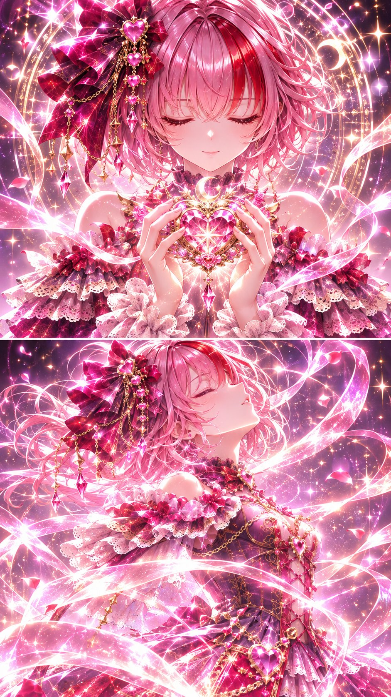
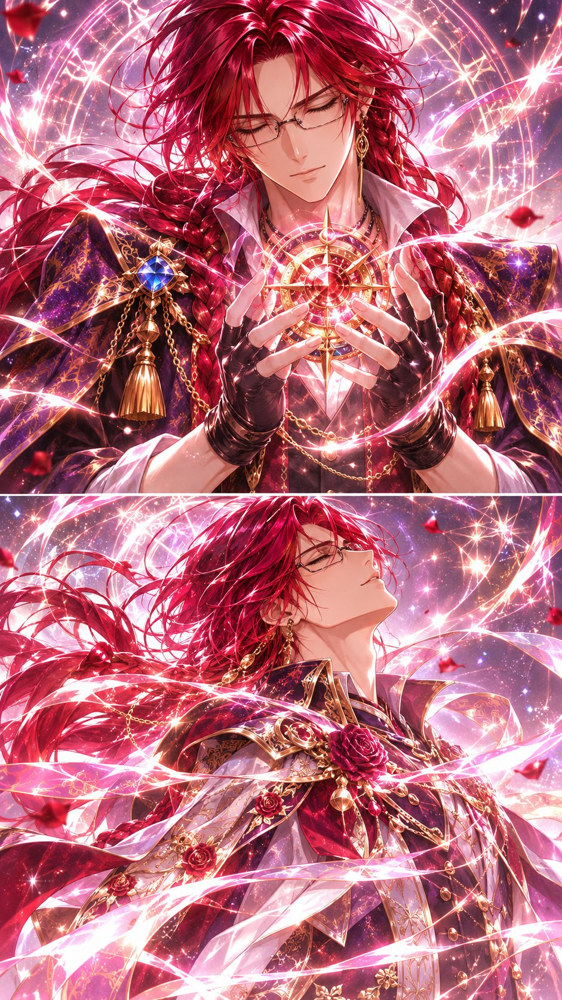
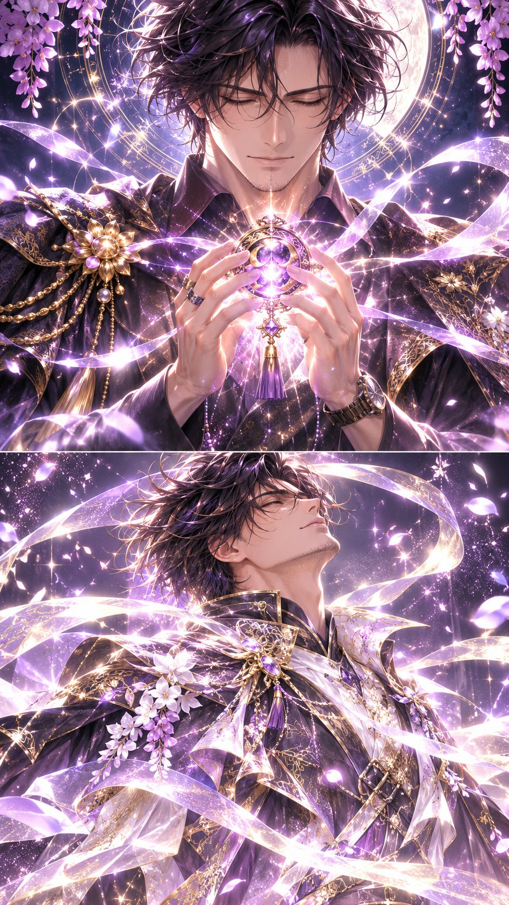

# 「MAGICAL TRANSFORMATION」：自家角色的魔法少女式变身桥段，上下 2 格（举起变身道具 → 光之缎带包裹）

- 原帖链接：https://x.com/irohachang77/status/2125089151158743060
- 作者：のらる（@irohachang77）
- 时间：2026-11-24 12:48 (UTC+8 / Asia/Taipei)
- 互动摘要：点赞 16 · 转发 2 · 回复 1 · 引用 2 · 书签 3 · 浏览 444（采集快照：2026-11-24 20:10 UTC+8）
- 模型/工具：未注明
- 标签：二次元
- 媒体路径：
  - `media/images/2125089151158743060_1.jpg`（）
  - `media/images/2125089151158743060_2.jpg`（）
  - `media/images/2125089151158743060_3.jpg`（）
- 入库日期：2026-11-24
- prompt 来源：https://x.com/irohachang77/status/2125089180279791840（作者自回复）
- 备注：prompt 在作者自回复（2125089180279791840），整条原样摘录。需上传 OC 图作参考；prompt 写明不限性别、年龄、种族，变身中以光缎带包裹、不描绘身体。

## prompt 原文

```text
🎀 MAGICAL TRANSFORMATION

うちの子の魔法変身｜上下2コマ演出

添付されたオリジナルキャラクター（OC）を主人公に、魔法少女アニメの変身バンクを思わせる、幻想的で華やかな変身シーンを制作してください。

完成画像は縦長9:16、上下2コマ構成。

性別・年齢・種族を問わず対応します。

【STEP 1｜キャラクター分析】

添付画像を唯一のキャラクター資料として使用してください。

以下の特徴を忠実に維持します。

- 顔立ち・目の形・瞳の色
- 髪型・髪色・メッシュ
- 年齢・性別・種族的特徴
- 耳・角・尻尾などの固有特徴
- キャラクター本来の雰囲気

変身後も同一人物と明確に認識できるようにしてください。

【STEP 2｜変身アイテム】

キャラクターの外見・象徴・配色から、専用の魔法変身アイテムを自動設計してください。

例：

- 宝石付きコンパクト
- 魔法の懐中時計
- 月や星を象ったペンダント
- 花を模したブローチ
- 魔法の鍵
- 宝石付きの指輪

アイテムには精巧な金属細工・透明感のある宝石・繊細な装飾を施します。

【STEP 3｜上段：変身開始】

画面上半分：胸元から頭部を中心にしたクローズアップ。

キャラクターが変身アイテムを両手で優しく包み込み、胸元に掲げています。

目を静かに閉じ、祈るような穏やかな表情。

変身アイテムの中心から強い光が生まれ、細いリボン状の魔法光が身体の周囲へ広がり始めます。

まだ変身途中であり、衣装の一部には変身前の特徴が残っています。

宝石の輝き、光の粒子、繊細な魔法陣。

静寂から魔法が目覚める瞬間を描写してください。

【STEP 4｜下段：光に包まれる】

画面下半分：横向きに近い上半身のダイナミックな構図。

キャラクターは目を閉じ、顔を少し上に向けています。

髪が魔力によって美しく舞い上がり、身体の周囲を幾重もの発光するリボンが螺旋状に取り囲みます。

魔法の光によって衣装が変身後のデザインへ変化していく瞬間です。

光のリボンは身体を包みながら流れ、宝石の粒子や花びら、星屑が舞い散ります。

変身後の衣装はキャラクターの特徴に合わせて自動設計します。

可憐・優雅・神秘的・勇壮など、元のキャラクターにふさわしい方向性にしてください。

【STEP 5｜衣装デザイン】

魔法変身後の衣装は、元の衣装の単純な色違いではなく、キャラクターの象徴や個性を活かした新しいデザインにしてください。

- リボン・宝石・レース・刺繍
- 魔法陣・紋章・装飾金具
- キャラクターに似合うシルエット
- 年齢や性別に自然なデザイン
- 華やかで精巧なファンタジー衣装

男性キャラクターには魔法騎士・魔導士・幻想的な王子風などのデザインも使用可能です。

【STEP 6｜画風・仕上げ】

高精細アニメイラスト、セミリアルな厚塗り、宝石のようなグロッシーな質感。

繊細な髪の描写、発光するリボン、幻想的な逆光、無数の光粒子。

キャラクターの代表色を中心に、統一された魔法エフェクトを構築してください。

上下のコマで顔・髪型・衣装・変身アイテムの整合性を維持してください。

【最重要ルール】

- 縦長9:16
- 上下2コマのみ
- 2コマとも同じキャラクター
- 上段は変身アイテムを胸元に掲げる
- 下段はリボン状の魔法光に包まれる
- 両コマとも目を閉じた神秘的な表情
- 指は片手5本、自然な手の構造
- 文字・ロゴ・透かし・余計なコマは禁止
- 変身後の決めポーズは描かない

静かな祈りから、光のリボンが全身を包み込む瞬間へ。魔法変身の最も美しい一瞬を描いてください。
```

---

个人学习归档，非商业。prompt 与媒体版权归原作者 @irohachang77，引用请回到原帖。
