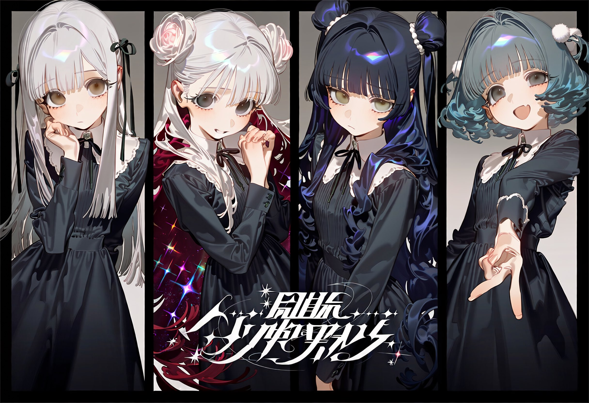
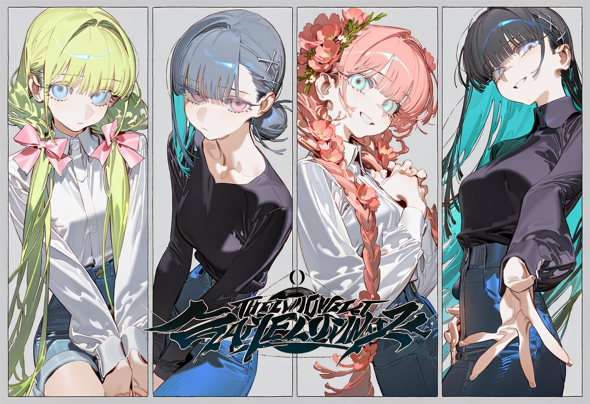
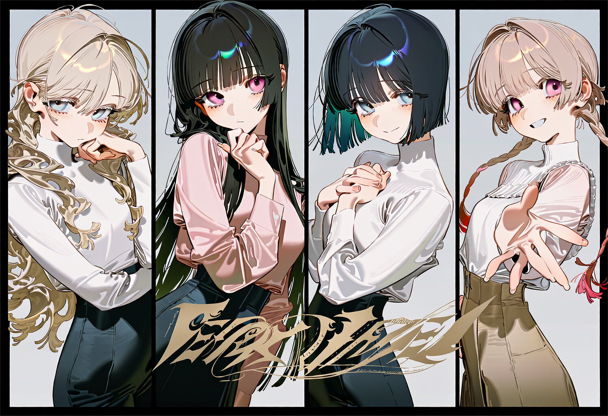

# 「構図のみ」4 格竖长条杂志风排版：4 名角色各占一格、不同机位与表情 + 统一日文标题字

- 原帖链接：https://x.com/huwria/status/2124708299325255755
- 作者：ふりる（@huwria）
- 时间：2026-11-23 11:35 (UTC+8 / Asia/Taipei)
- 互动摘要：点赞 592 · 转发 48 · 回复 1 · 引用 15 · 书签 536 · 浏览 28988（采集快照：2026-11-25 09:20 UTC+8）
- 模型/工具：未注明
- 标签：二次元
- 媒体路径：
  - `media/images/2124708299325255755_1.jpg`（）
  - `media/images/2124708299325255755_2.jpg`（）
  - `media/images/2124708299325255755_3.jpg`（）
- 入库日期：2026-11-25
- prompt 来源：https://x.com/huwria/status/2124708309249003670（作者自回复）
- 备注：prompt 在作者自回复（2124708309249003670），整条原样摘录。仅构图 prompt（作者标注「構図のみ／全1種」），角色外观需自行补充或上传；示例图中的角色借自作者在另一条自回复里列出的创作者。

## prompt 原文

```text
LAYOUT:
4 tall, narrow vertical panels arranged side by side,
equal-width panels with thin black borders,
stylish editorial manga layout,
each character isolated within their own panel,
portrait-oriented composition,
varied camera angles and framing across panels,
slightly dynamic compositions with intentional negative space,
characters positioned at different heights and offsets within each panel,
fashion-editorial visual composition,
cinematic close-up feeling,
clean, sophisticated, visually striking layout,

PANEL 1:
upper-body to thigh framing,
slightly tilted camera angle,
one elbow resting on an unseen surface,
one hand supporting the cheek,
body leaning diagonally toward the viewer,
face positioned slightly off-center,
relaxed confident expression,
soft half-lidded eyes,
direct eye contact,
casual yet stylish pose,

PANEL 2:
upper-body to thigh framing,
slightly low camera angle,
both hands gently clasped near the chest,
body subtly angled,
bright sparkling eyes,
warm delighted smile,
slightly excited expression,
upright graceful posture,
face and hands emphasized in the composition,

PANEL 3:
upper-body to thigh framing,
slightly high camera angle,
body turned diagonally,
one hand placed behind the head,
head tilted slightly,
looking away from the viewer,
subtle embarrassed smile,
slightly bashful expression,
relaxed shoulders,
soft, candid feeling,

PANEL 4:
upper-body to thigh framing,
slightly low camera angle,
body angled toward the edge of the panel,
one hand resting confidently on the hip,
the other hand casually extended toward the viewer,
slight perspective exaggeration on the extended hand,
bright confident smile,
playful charismatic expression,
dynamic diagonal composition,

Large cohesive Japanese title typography, stylish music-video thumbnail lettering, bold decorative font, beautifully arranged as one unified title design, eye-catching, artistic typography.
```

---

个人学习归档，非商业。prompt 与媒体版权归原作者 @huwria，引用请回到原帖。
