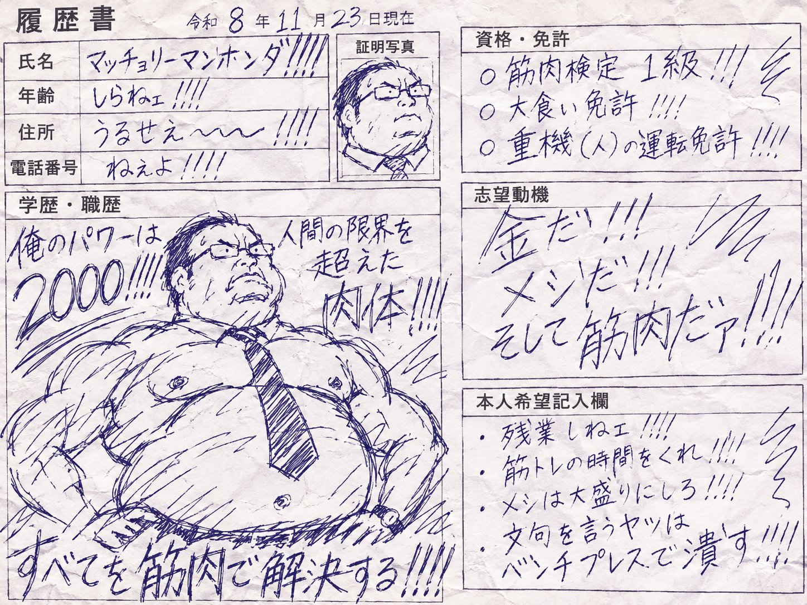

# 「働く気ゼロの履歴書」：把角色变成日式履历表上潦草圆珠笔涂鸦 + 暴言填写栏

- 原帖链接：https://x.com/AI_Illust_000/status/2124726885506846862
- 作者：シトラス(柑橘系)（@AI_Illust_000）
- 时间：2026-11-23 12:48 (UTC+8 / Asia/Taipei)
- 互动摘要：点赞 55 · 转发 12 · 回复 3 · 引用 4 · 书签 21 · 浏览 7118（采集快照：2026-11-25 09:20 UTC+8）
- 模型/工具：ChatGPT / muse 等（作者标注）
- 标签：二次元
- 媒体路径：
  - `media/images/2124726885506846862_1.jpg`（）
- 入库日期：2026-11-25
- prompt 来源：https://x.com/AI_Illust_000/status/2124726888673513948（作者自回复）
- 备注：prompt 在作者自回复（2124726888673513948），整条原样摘录（含原文的 ** 粗体与 ### 标记）。需上传角色图作参考；搞笑恶搞向，无性化内容。

## prompt 原文

```text
元画像のキャラクターの特徴を維持し、以下の画風に変換してください。
 
**画面比率は4:3の横長。**
 
全体を、履歴書の余白にボールペンで信じられないほど雑に殴り書きした落書きとして表現する。画力の低さ、投げやりな筆跡、破綻した人体構造を徹底的に再現する。綺麗なイラストには絶対に仕上げない。
 
背景は日本の履歴書。左右に項目を分け、罫線と記入欄を設ける。
 
左側：「氏名」「年齢」「住所」「電話番号」「学歴・職歴」｢証明写真｣
 
右側：「資格・免許」「志望動機」「本人希望記入欄」
 
各項目には「うるせぇ〜〜〜！！！！」「しらねェ！！！！」「ねぇよ！！！！」など、乱暴で意味不明な回答を汚い手書き文字で記入する。
これらの元の画像にセリフがあればそれを参考に改変し、セリフはキャラクターの特徴から見てギリギリ言わなそうな暴言を出力し当てはめます。
 
**最も広い「学歴・職歴」欄にキャラクターを大きく落書きし、その周囲にそのキャラの表情や特徴から推測して言いそうな巨大な自己アピールを殴り書きする。**
 
文字は枠からはみ出し、一部はイラストと重なってもよい。履歴書の様式は判別できるよう維持する。
 
### 1. 線画
 
**線の太さ：** 安物の0.7mmボールペンで描いた不均一な細線。輪郭は何度もなぞられ、無意味な線が大量に重なる。
 
**線の強弱：** 筆圧が異常に強い箇所と、インクがかすれた箇所が混在。直線すらまともに引けず、線が激しく震える。
 
**線の色：** 濃紺または黒のボールペンインク。部分的にインクだまりやかすれが生じる。
 
### 2. 塗り
 
**塗りの技法：** 雑な斜線、ぐちゃぐちゃの往復線、意味不明な丸い塗りつぶし。丁寧な彩色は禁止。
 
**色の境界：** 輪郭から大きくはみ出す。塗り残しが大量に存在する。
 
**ぼかし・グラデーション：** 使用しない。線の密度だけで無理やり濃淡を表現。
 
### 3. 質感
 
**ブラシの質感：** 紙に強く押しつけたボールペン特有の硬い線とインクのムラ。
 
**表面の質感：** 安っぽいコピー用紙。細かなシワ、筆圧によるへこみ、インク汚れ。
 
**素材の表現：** 印刷された履歴書の罫線と、後から書き込まれた汚い落書きの対比。
 
### 4. 色彩
 
**色調：** 白い紙、薄灰色の印刷文字、黒または濃紺のインクのみ。
 
**彩度・明度：** ほぼ無彩色。紙の白さを主体とする。
 
**コントラスト：** 強い筆圧の黒い線と白い余白が無秩序に混在。
 
### 5. 陰影
 
**光の表現：** 平面的。光源を意識しない。
 
**影の表現：** 適当に引いた大量の斜線。影の位置や方向は矛盾してよい。
 
**ハイライト：** 基本的になし。偶然できた塗り残しで表現。
 
### 6. デフォルメ
 
**頭身・体型：** 人体構造を無視した極端に下手な落書き。頭が巨大、腕の長さが左右で違う、脚が異常に短いなど、意図的な作画崩壊。
 
**顔・目の比率：** 左右非対称。目の位置、大きさ、輪郭が不自然。ただし元キャラクターの髪型や特徴的な装飾は残す。
 
**立体感：** ほぼ皆無。平面的で、関節や身体のつながりも怪しい。
 
### 7. ディテール密度
 
**全体の描き込み量：** 極端に少ない。ただし無駄な描き直し線だけは多い。
 
**髪・顔の描き込み：** 髪は数本の乱雑な線の集合。顔は福笑いのように崩れている。
 
**衣装・装飾の描き込み：** 元の衣装を最低限判別できる程度に単純化。装飾は適当な記号に置き換える。
 
**最重要事項：** 上手な人が下手に描いたような洗練されたヘタウマではなく、本当に絵が絶望的に下手な人間が、履歴書を提出する気もなく、怒りに任せて数十秒で殴り書きしたような完成度にする。美しい線、整った構図、魅力的なデフォルメ、プロらしい仕上げを一切禁止する。
```

---

个人学习归档，非商业。prompt 与媒体版权归原作者 @AI_Illust_000，引用请回到原帖。
