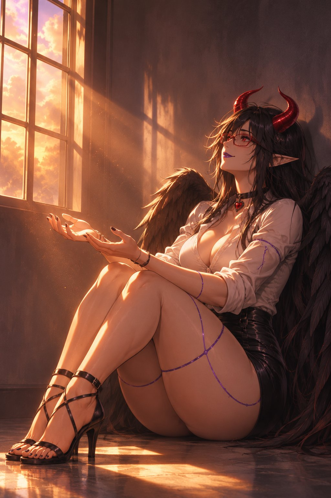
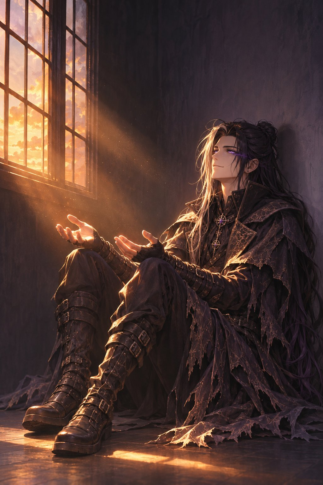

# 「No matter how long the night, the morning always comes」：上传角色设定图，倚墙坐在空房间地板上沐浴最后一缕暖阳（结构化角色 prompt）

- 原帖链接：https://x.com/AurenVossVT/status/2124916343770169698
- 作者：Auren（@AurenVossVT）
- 时间：2026-11-24 01:21 (UTC+8 / Asia/Taipei)
- 互动摘要：点赞 80 · 转发 14 · 回复 10 · 引用 19 · 书签 29 · 浏览 3286（采集快照：2026-11-25 19:40 UTC+8）
- 模型/工具：未注明
- 标签：二次元
- 媒体路径：
  - `media/images/2124916343770169698_1.jpg`（）
  - `media/images/2124916343770169698_2.jpg`（）
  - `media/images/2124916343770169698_3.jpg`（）
- 入库日期：2026-11-25
- prompt 来源：https://x.com/AurenVossVT/status/2124916347410755986（作者自回复）
- 备注：prompt 在作者自回复（2124916347410755986），整条原样摘录（API 返回的长文正文不含开头 @ 提及）。需上传角色设定图作参考；示例 3 张为作者感谢的 3 位创作者角色（成年角色，衣着完整）。

## prompt 原文

```text
Use the uploaded character sheet as the only person. Keep the face, hair, body type, and outfit recognizable. Do not invent a second figure.

Scene:
An empty room at the end of day. One tall window. The character sits on the floor with their back against the wall, knees drawn up. The last direct sun enters low and warm, striking their hands, the side of their face, and a small patch of floor. The rest of the room is in soft shadow, but the light feels arriving rather than leaving. Dust turns slowly in the beam. Quiet, open, hopeful.

Art style:
Refined painterly illustration. Controlled edges, warm precise light, restrained texture. Emotional and gentle. Not flat. Not a photo.

Canvas:
Tall portrait. Character in the lower half, full seated body. Window and the entering beam occupy the upper left. Shadow remains large but not heavy.

Body:
One head, two eyes, one nose, one mouth, two arms, two hands, two legs. Five fingers. Face half-lit and fully readable. Posture relaxed, not closed.

Color:
Hair, skin, and clothes use the sheet. The sunbeam is warm gold. Shadows are cool but soft, carrying a pale version of the sheet’s primary. Light feels kind.

Clothes:
Draw the clothes on the sheet. Fabric settles naturally. No default outfit.

Pose:
Seated on the floor, back to the wall. Knees up but loose. Hands resting open in the light, palms slightly up or one hand extended as if feeling the warmth. Head tilted gently toward the beam. Eyes open, soft, looking at the light or just past it. A small, quiet ease in the shoulders. Still, but not weighed down.

Must show:
Seated figure against the wall.
Warm low sunbeam on the hands and face.
Open, hopeful posture.
Sheet face readable and calm.
No text. No logo. No second person.

Variation:
Keep the warm beam and the seated pose. Change only one of these each time:

Hands: both open in the light, or one reaching slightly farther

Gaze: on the beam, or toward the window

Expression: faint smile, or simply peaceful

The result is a quiet, hopeful illustration of the uploaded character sitting in the last warm light of the day, at ease.
```

---

个人学习归档，非商业。prompt 与媒体版权归原作者 @AurenVossVT，引用请回到原帖。
