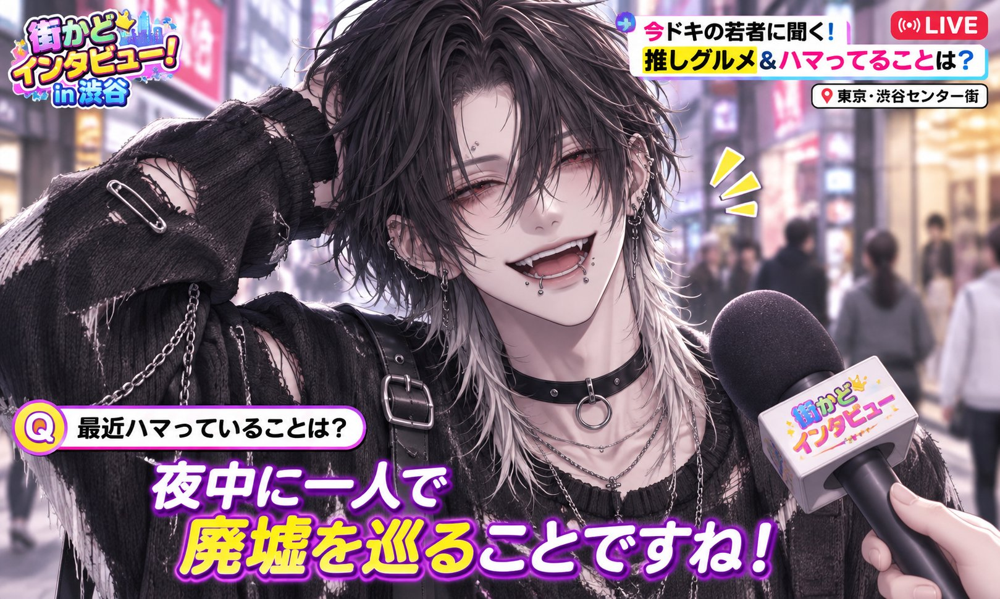

# 日本综艺「街头采访」截图风：角色占画面七成、话筒入镜、随机字幕条（ChatGPT 用）

- 原帖链接：https://x.com/xx_ren25/status/2125055964605038943
- 作者：RЁN🚬🐺（@xx_ren25）
- 时间：2026-11-24 10:36 (UTC+8 / Asia/Taipei)
- 互动摘要：点赞 79 · 转发 7 · 回复 1 · 引用 29 · 书签 62 · 浏览 7352（采集快照：2026-11-25 09:20 UTC+8）
- 模型/工具：ChatGPT（作者标注）
- 标签：二次元
- 媒体路径：
  - `media/images/2125055964605038943_1.jpg`（）
- 入库日期：2026-11-25
- prompt 来源：https://x.com/xx_ren25/status/2125055967687807063（作者自回复）
- 备注：prompt 在作者自回复（2125055967687807063），整条原样摘录（行尾的反斜杠为原文所有）。作者说明：字幕等随机，贴角色图 + prompt 即可；使用时请引用原帖。

## prompt 原文

```text
Japanese TV variety show street interview broadcast screenshot, 5:3 landscape composition.

MAIN COMPOSITION:\
The featured character is the clear central subject, occupying approximately 70% of the image.\
Waist-up or chest-up portrait, dynamic candid moment during a street interview.\
A professional television interview microphone enters the frame from the bottom corner, held by an unseen interviewer, positioned close to the character's mouth.\
Only the microphone and a small portion of the interviewer's hand are visible.\
The interviewer must remain completely outside the frame.\
The character is naturally answering the interviewer's question, with expressive facial expressions and spontaneous gestures.\
The character is the absolute visual focal point.

RANDOM INTERVIEW CONTENT:\
Generate a unique random Japanese interview question and character-specific answer for every generation.\
Random topics, unexpected opinions, hobbies, food preferences, secrets, romance, daily routines, unusual habits, dreams, and humorous experiences.\
Display the question and answer in readable Japanese television subtitles.\
Never reuse fixed dialogue.

RANDOM EXPRESSIONS AND GESTURES:\
Automatically generate facial expressions and gestures matching the randomly generated answer.\
Playful laughter, embarrassed smile, mischievous grin, surprised expression, thoughtful look, confident response, deadpan humor, or excited reaction.\
Each generation should feel like a different candid interview moment.

CHARACTER CUSTOMIZATION:\
Automatically design a unique outfit and hairstyle that suit the character's personality and original visual identity.\
Preserve the original hair color and recognizable features.\
Fashionable coordinated clothing and accessories.

TELEVISION BROADCAST GRAPHICS:\
Authentic Japanese TV variety show broadcast screenshot.\
Colorful program logo in the upper left.\
LIVE broadcast indicator in the upper right.\
Japanese TV lower-third question banner.\
Large readable Japanese answer subtitles near the bottom.\
Small location caption and broadcast-style graphic accents.\
Bright pop colors, bold television typography, playful decorative elements.

BACKGROUND:\
Lively Japanese city street, colorful storefronts, urban signage, softly blurred pedestrians, natural daylight or atmospheric city lighting.

VISUAL STYLE:\
Polished anime illustration, vibrant Japanese television variety show aesthetic, professional broadcast screenshot composition, lively spontaneous atmosphere.

STRICT RULES:\
One main character only.\
No visible interviewer.\
No interviewer face or body.\
No second person.\
Only an interview microphone and optionally the interviewer's hand may enter the frame.\
The microphone must clearly look like a professional television reporter's microphone.\
Do not turn the image into an infographic or character profile card.\
Keep the character large and visually dominant.\
The final image must look like a genuine Japanese TV street interview broadcast screenshot.
```

---

个人学习归档，非商业。prompt 与媒体版权归原作者 @xx_ren25，引用请回到原帖。
