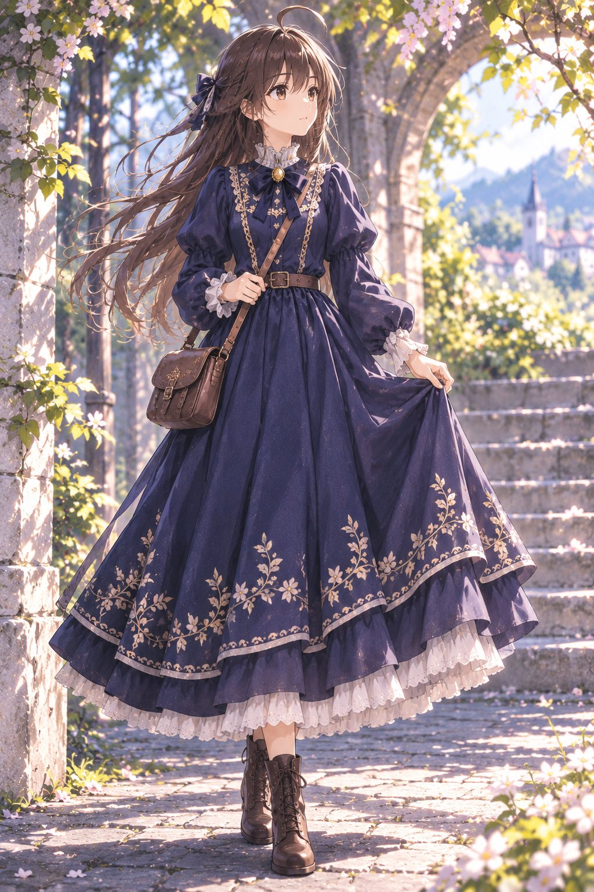
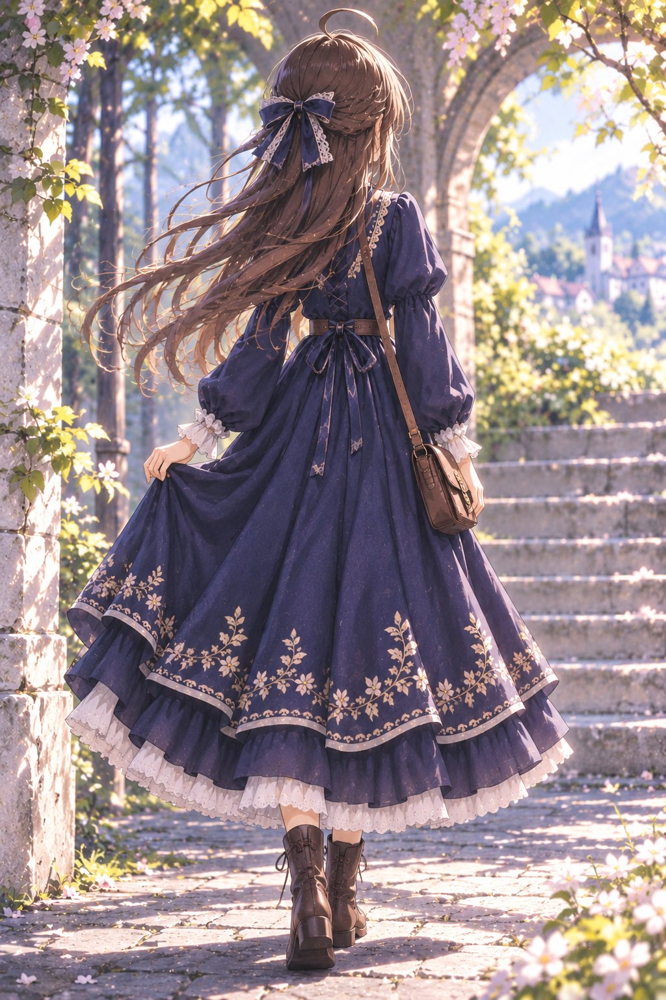

# 「月夜のアンティーク・クラシカルワンピース」：深海军蓝古典长裙、白蕾丝领、金色藤蔓刺绣的换装 prompt

- 原帖链接：https://x.com/chocolat07126/status/2125077014587855310
- 作者：ショコラ（@chocolat07126）
- 时间：2026-11-24 12:00 (UTC+8 / Asia/Taipei)
- 互动摘要：点赞 155 · 转发 51 · 回复 2 · 引用 5 · 书签 30 · 浏览 3256（采集快照：2026-11-25 09:20 UTC+8）
- 模型/工具：未注明
- 标签：二次元
- 媒体路径：
  - `media/images/2125077014587855310_1.jpg`（）
  - `media/images/2125077014587855310_2.jpg`（）
  - `media/images/2125077014587855310_3.jpg`（）
- 入库日期：2026-11-25
- prompt 来源：https://x.com/chocolat07126/status/2125077112046629197（作者自回复）
- 备注：prompt 在作者自回复（2125077112046629197），整条原样摘录。需上传角色图作参考，只替换衣装。

## prompt 原文

```text
添付したキャラクター画像を参照し、キャラクター本人の個性・外見を維持したまま、衣装だけを以下のオリジナル衣装へ変更してください。

衣装コンセプト

「月夜のアンティーク・クラシカルワンピース」

上品で落ち着いたアンティーク調のロングワンピース。
可愛らしさだけに寄せず、クラシカルで繊細、少しノスタルジックな雰囲気に仕上げてください。

ワンピース

深いネイビー〜ブルーブラックを基調としたロングワンピース
足首付近まであるロング丈
ウエストから自然に広がるクラシカルなフレアシルエット
上半身は程よく身体に沿わせ、スカート部分には豊かな布のボリュームと自然なドレープ
光沢は控えめで、上質な布地の繊細な質感
袖はふんわりとしたクラシカルなパフスリーブ＋ロングスリーブ
袖口には繊細な白いレース
首元は小さなフリルを重ねた白いレースカラー

胸元・装飾

首元に大きめのネイビーのリボン
リボン中央に小さなアンティーク調の金色のブローチ
胸元からウエストにかけて、細い淡いゴールドの植物・蔓模様の刺繍
刺繍は華美になりすぎず、上品で繊細に

ウエスト

細身のダークブラウンの革ベルト
アンティーク調の金属バックル
後ろ側にはワンピースと一体感のある細いリボン結び
コルセットのように過度に締め付けるデザインにはしない

スカート

たっぷりとしたロングスカート
裾に淡いゴールド〜アイボリー系の植物・小花の刺繍
刺繍は裾全体に細く連続するようなアンティーク調のボタニカルパターン
裾には細いアイボリー系のトリム
スカートの内側から白〜アイボリーのレース付きペチコートが少し見える
ペチコートは控えめで上品に
フリルを過剰に増やしてゴスロリ衣装にならないようにする

後ろ姿

後ろ髪の下あたりに、ネイビーの大きめリボン
リボンには細い白いレースの縁取り
背中から腰にかけて自然な縦方向の布の流れ
ウエスト部分には後ろで結んだ細いリボン
スカート後ろ側にも裾のボタニカル刺繍を自然につなげる
正面と背面で衣装デザインに矛盾がないようにする

靴

ダークブラウンのクラシカルなレースアップ・アンクルブーツ
アンティーク調の革素材
小さめで上品なヒール
ワンピースとの色調を統一

バッグ

ダークブラウンの小さなアンティーク革製ショルダーバッグ
シンプルな金属バックル
控えめな植物モチーフの型押し
衣装の雰囲気を邪魔しないサイズ

キャラクター維持

添付画像のキャラクター本人であることを最優先してください。

以下は変更しないでください。

顔立ち
目の形・瞳の色
髪色
髪型
髪の長さ
体型
年齢設定
キャラクター固有の特徴
キャラクターの雰囲気・個性

衣装だけを変更し、元画像のキャラクターを別人化しないでください。

衣装のデザインはオリジナルとして再現し、既存作品のキャラクター衣装を模倣しないでください。

全身が確認できる構図の場合は、ワンピース全体のシルエット、袖、ウエスト、裾の刺繍、ペチコート、靴まで明確に見えるようにしてください。

衣装確認を目的とする場合、座らせたり、スカートで下半身を隠したりせず、自然な立ち姿で衣装全体が分かるようにしてください。
```

---

个人学习归档，非商业。prompt 与媒体版权归原作者 @chocolat07126，引用请回到原帖。
