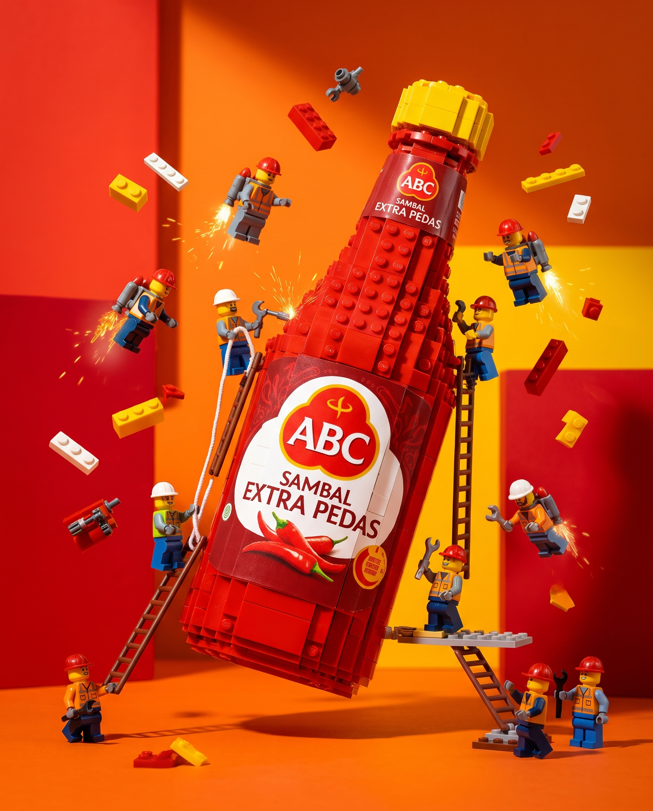
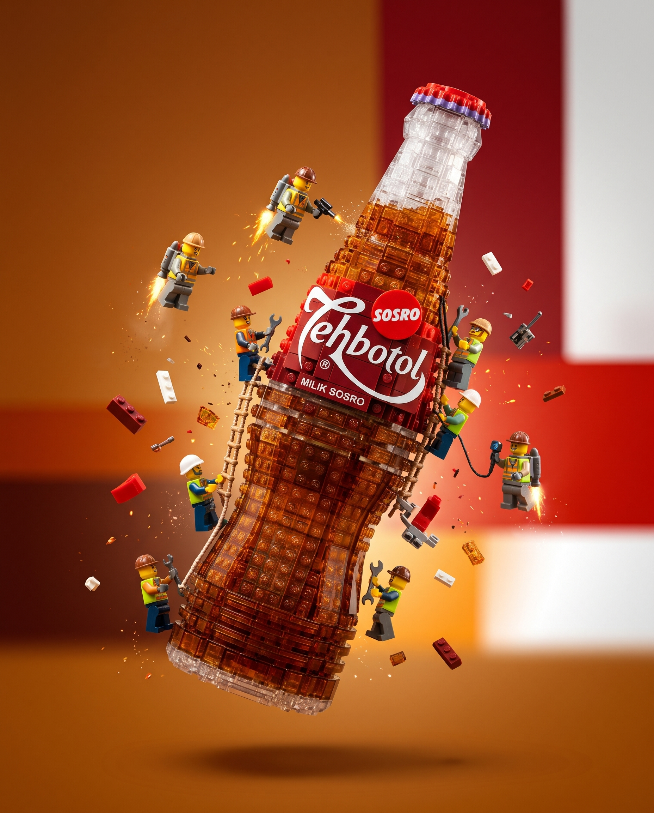
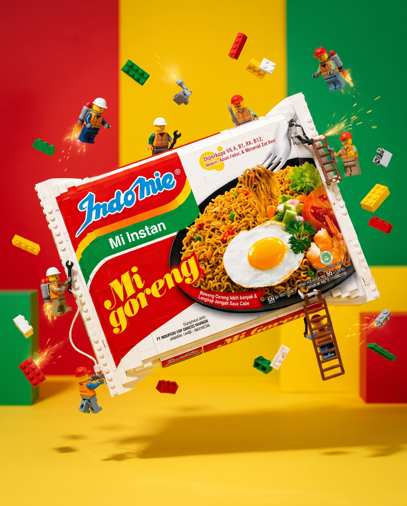
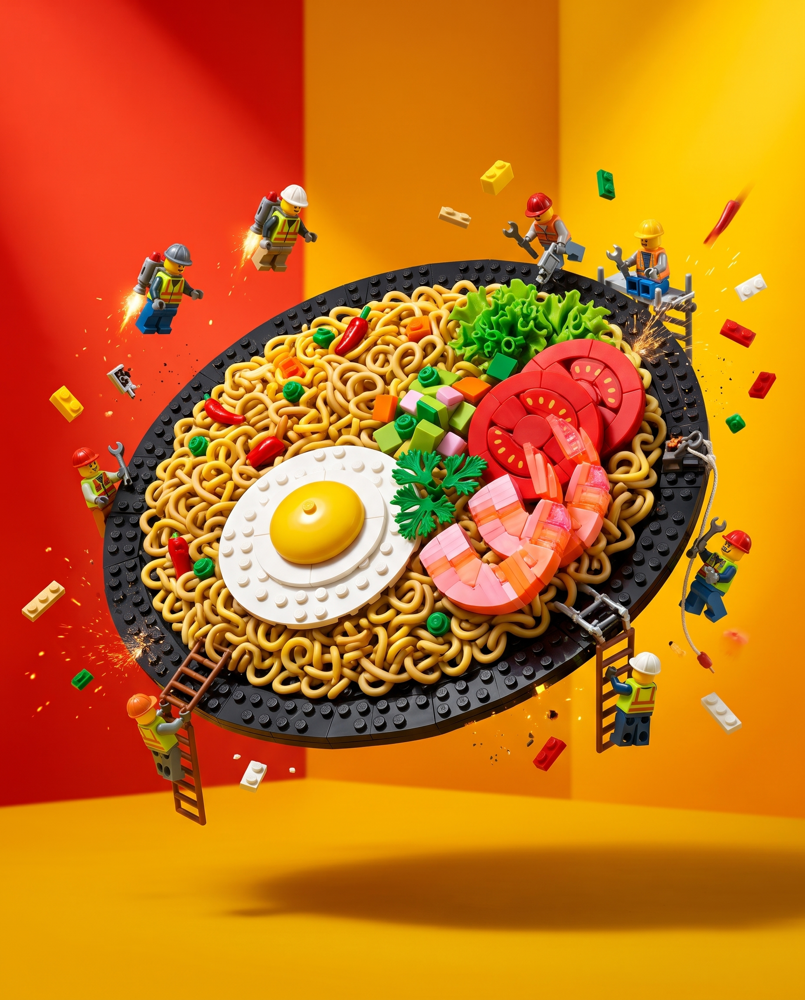
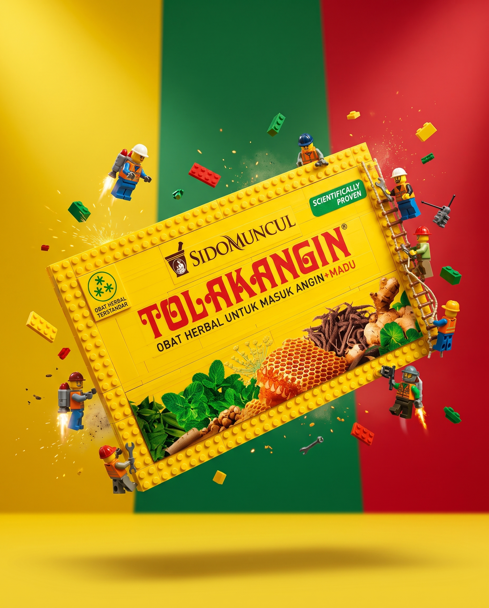
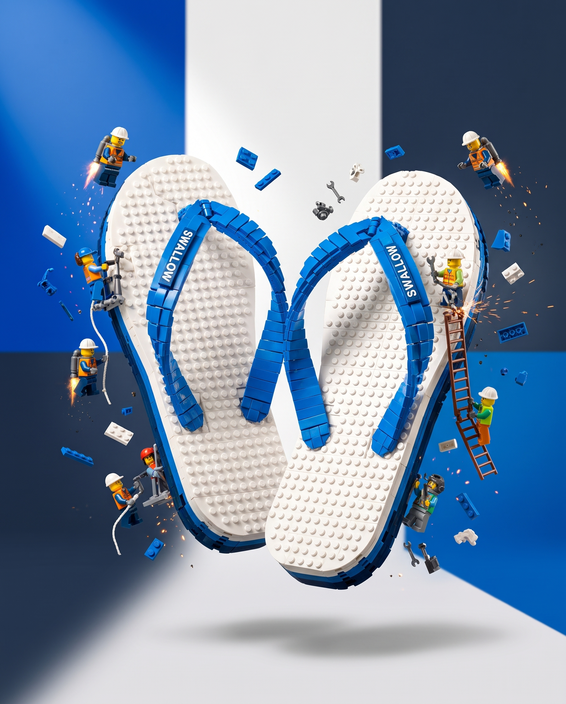

# 把印尼国民商品做成积木：上传商品照，飘浮在亮色影棚里的玩具积木版商品广告（喷气背包小人施工）

- 原帖链接：https://x.com/borryshasian/status/2125161484477169919
- 作者：Borrys Hasian（@borryshasian）
- 时间：2026-11-24 17:35 (UTC+8 / Asia/Taipei)
- 互动摘要：点赞 10 · 转发 0 · 回复 2 · 引用 0 · 书签 23 · 浏览 1925（采集快照：2026-11-25 19:40 UTC+8）
- 模型/工具：Gemini Hydrogen（作者自回复标注；称任意图像模型均可）
- 标签：其它
- 媒体路径：
  - `media/images/2125161484477169919_1.jpg`（）
  - `media/images/2125161484477169919_2.jpg`（）
  - `media/images/2125161484477169919_3.jpg`（）
  - `media/images/2125161484477169919_4.jpg`（）
  - `media/images/2125161484477169919_5.jpg`（）
  - `media/images/2125161484477169919_6.jpg`（）
- 入库日期：2026-11-25
- prompt 来源：https://x.com/borryshasian/status/2125161488952484098（作者自回复）
- 备注：prompt 在作者自回复（2125161488952484098），从「Using the attached product photo」起原样摘录（略去开头「The prompt:」标签）；[product name, ...] 为占位符。需上传真实商品照片作参考。所用模型见作者另一条自回复（2125162166181609773）。上一轮因互动过低留待观察，本轮收录。

## prompt 原文

```text
Using the attached product photo, create a bold 4:5 product advertisement for [product name, e.g Sambal ABC Extra Pedas]. Turn into toy bricks: the product's exact shape, proportions, label, colors, cap, and every physical detail. Show the real product floating tilted at the center of a bright studio scene, with no tabletop, platform, floor, or other surface. Surround it with clearly recognizable tiny toy-like builders wearing jetpacks, miniature tools, and colorful floating toy bricks, arranged around the bottle without covering its branding or silhouette. The builders should feel like playful non-human miniature figures rather than a full-size human model.

Use a strong product-focused composition viewed from slightly above at a three-quarter angle. Build the background and surrounding atmosphere from the product’s own vivid tones, with bold saturated color blocks, deep shadows, and crisp directional lighting. Add a soft, subtle floating shadow beneath the bottle to suggest suspension in midair. Keep the image energetic, graphic, and dramatic, with sharp silhouettes, lively motion, and plenty of clean space around the product. No hands, body parts, extra objects, or readable text beyond the original packaging.
```

---

个人学习归档，非商业。prompt 与媒体版权归原作者 @borryshasian，引用请回到原帖。
