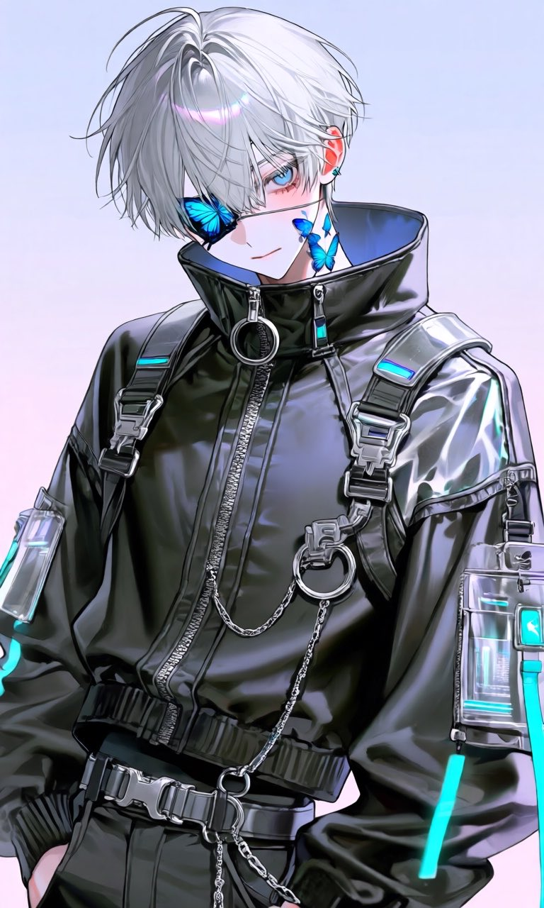
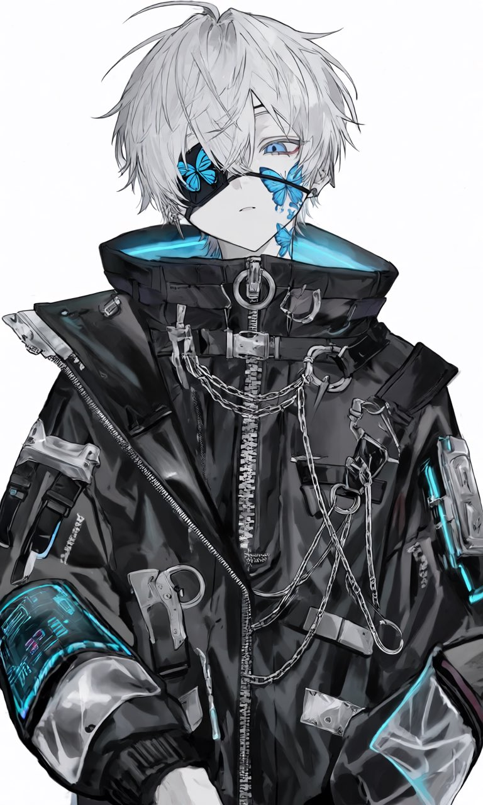
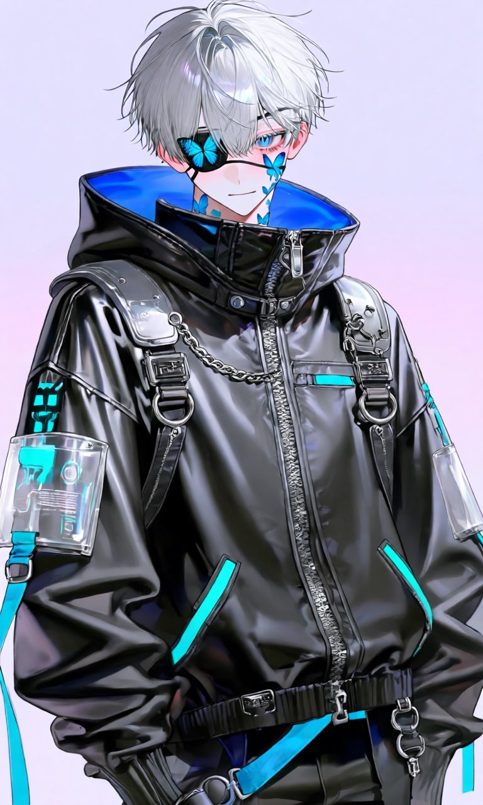

# 赛博朋克衣装：超大号黑色光面皮夹克、金属扣件与链条、青色发光线条的 techwear

- 原帖链接：https://x.com/YdyWg/status/2125162348562505795
- 作者：れんこん（@YdyWg）
- 时间：2026-11-24 17:39 (UTC+8 / Asia/Taipei)
- 互动摘要：点赞 163 · 转发 24 · 回复 1 · 引用 4 · 书签 120 · 浏览 4045（采集快照：2026-11-25 09:20 UTC+8）
- 模型/工具：未注明（作者推荐 Tsubaki）
- 标签：二次元
- 媒体路径：
  - `media/images/2125162348562505795_1.jpg`（）
  - `media/images/2125162348562505795_2.jpg`（）
  - `media/images/2125162348562505795_3.jpg`（）
  - `media/images/2125162348562505795_4.jpg`（）
- 入库日期：2026-11-25
- 备注：prompt 在主帖图 1 的 ALT 里，整段原样摘录（图 2–4 无 ALT）。作者说明：随模型/LoRA 有差异，推荐 Tsubaki，使用后请引用展示。衣着完整、无性化内容。

## prompt 原文

```text
oversized black cyberpunk leather jacket, futuristic streetwear, glossy black leather, dropped shoulders, oversized silhouette, high collar, asymmetrical design, large metallic zipper, silver mechanical buckles, metal shoulder plates, layered straps, dangling chains, metallic rings, techwear details, glowing cyan lines, LED accents, digital panels on sleeves, gunmetal hardware, translucent panels, futuristic fashion, intricate clothing design, detailed leather texture
```

---

个人学习归档，非商业。prompt 与媒体版权归原作者 @YdyWg，引用请回到原帖。
