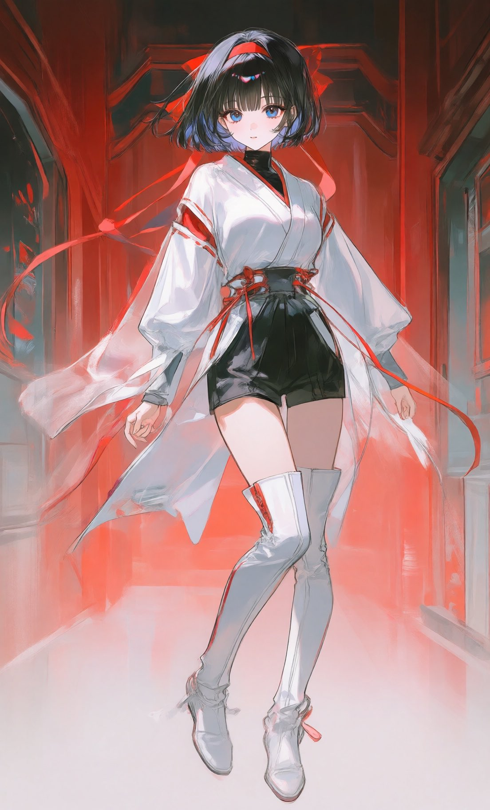
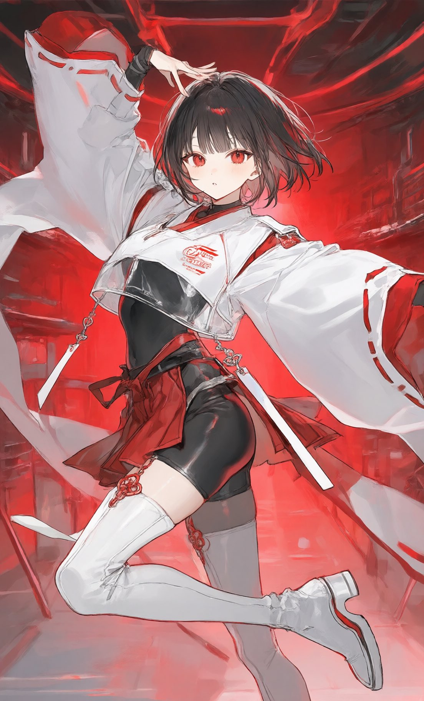
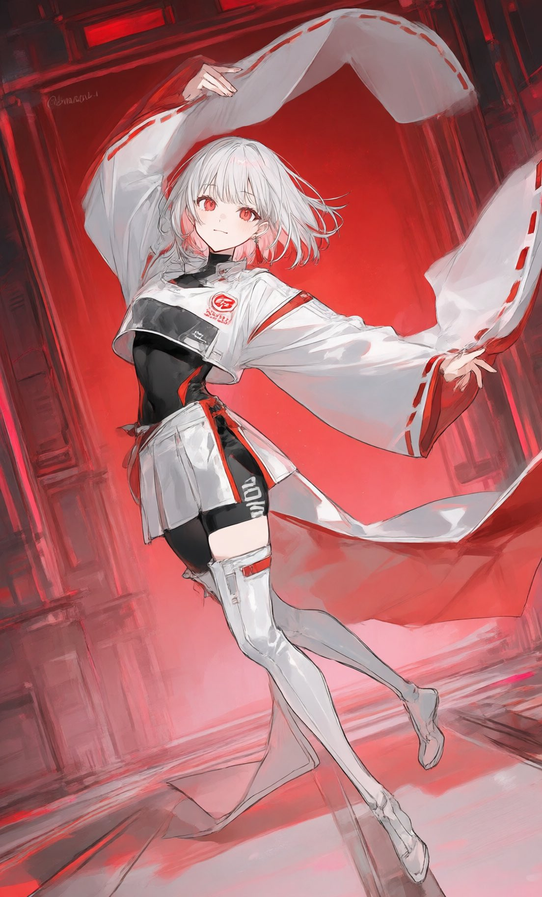

# 「レーシング巫女」：白红巫女风机能夹克 × 黑色紧身连体内衬 × 赛车配色的衣装设计

- 原帖链接：https://x.com/danierunobobu/status/2125182658762465538
- 作者：ダニエルのボブ🍩AIボブっ子メーカー（@danierunobobu）
- 时间：2026-11-24 19:00 (UTC+8 / Asia/Taipei)
- 互动摘要：点赞 74 · 转发 20 · 回复 1 · 引用 2 · 书签 18 · 浏览 2268（采集快照：2026-11-25 19:40 UTC+8）
- 模型/工具：未注明
- 标签：二次元
- 媒体路径：
  - `media/images/2125182658762465538_1.jpg`（）
  - `media/images/2125182658762465538_2.jpg`（）
  - `media/images/2125182658762465538_3.jpg`（）
- 入库日期：2026-11-25
- 备注：prompt 在主帖图 1 的 ALT 里，整段原样摘录（首行「レーシング巫女」为衣装名）。图 2、图 3 无 ALT。作者系列「衣装プロンプト公開 Day17」，写明「ぜひ合わせてみてくださーい」；示例为运动风全身立绘，非性化。

## prompt 原文

```text
レーシング巫女

oversized short miko-style tech jacket, pure white jacket with bold red accent lines, short front hem, extended back hem, fully closed front, no hood, black fitted bodysuit innerwear, black short spats integrated with the bodysuit, short black hakama-inspired waist panels, separate black fitted high-neck top, separate black fitted short pants, red and white racing-inspired color scheme, sleek sporty silhouette, modern shrine maiden racing outfit, futuristic miko design
```

---

个人学习归档，非商业。prompt 与媒体版权归原作者 @danierunobobu，引用请回到原帖。
