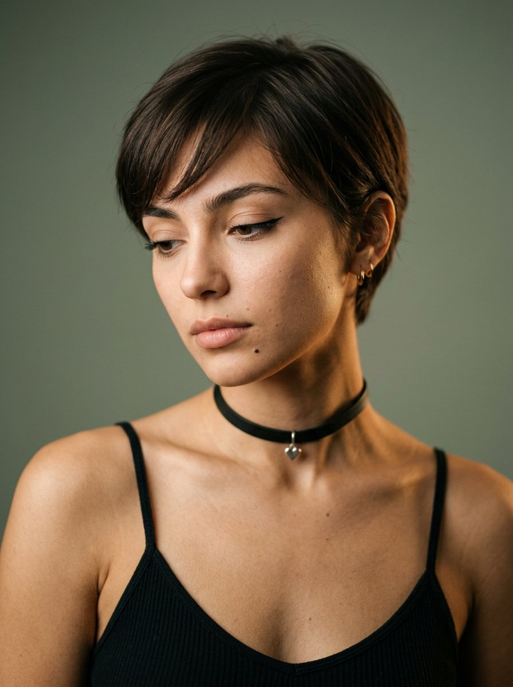

# 黑色细肩带上衣 + 心形吊坠 choker 的深棕精灵短发女子：暖调影棚时尚人像特写

- 原帖链接：https://x.com/dreamydigiarts/status/2125182660406550918
- 作者：dreamy digital arts（@dreamydigiarts）
- 时间：2026-11-24 19:00 (UTC+8 / Asia/Taipei)
- 互动摘要：点赞 48 · 转发 3 · 回复 5 · 引用 0 · 书签 26 · 浏览 1367（采集快照：2026-11-25 19:40 UTC+8）
- 模型/工具：Nano Banana 2（经 @weryai，作者标注）
- 标签：真人
- 媒体路径：
  - `media/images/2125182660406550918_1.jpg`（）
- 入库日期：2026-11-25
- 备注：prompt 在主帖正文，从「Ultra-realistic portrait」起原样摘录（略去开头工具说明与「Try it」推广链接）。成年女性肩部以上人像，非性化。

## prompt 原文

```text
Ultra-realistic portrait of a young woman, short dark brown pixie haircut with soft side-swept bangs partially covering the forehead, natural olive skin, defined jawline, small beauty mark near the lips, subtle winged eyeliner, soft nude lips, elegant facial features, looking slightly downward with a calm and thoughtful expression.

Wearing a black fitted spaghetti-strap top and a black leather choker with a small heart pendant, small gold hoop earrings. No headband, no hair accessories.

Warm cinematic studio lighting, soft shadows, smooth green-gray background, shallow depth of field, highly detailed skin texture, photorealistic, professional fashion photography, 85mm lens, ultra sharp focus, realistic eyes, natural skin pores, high-end editorial portrait, 8k quality.
```

---

个人学习归档，非商业。prompt 与媒体版权归原作者 @dreamydigiarts，引用请回到原帖。
