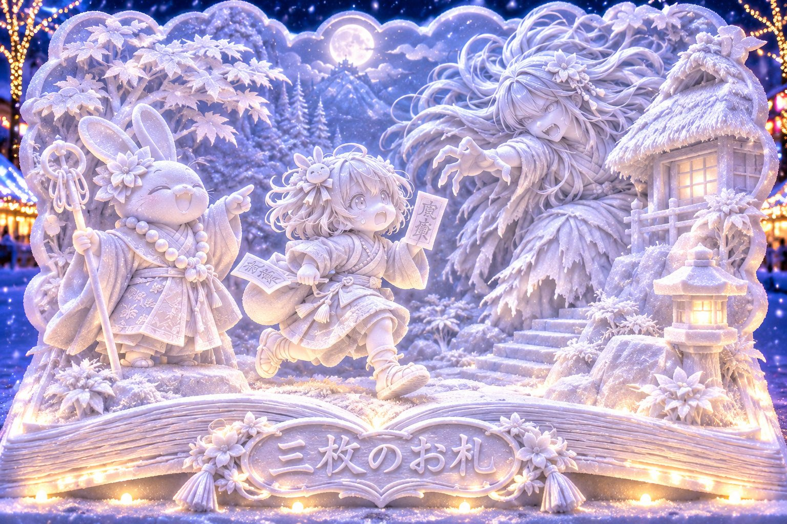
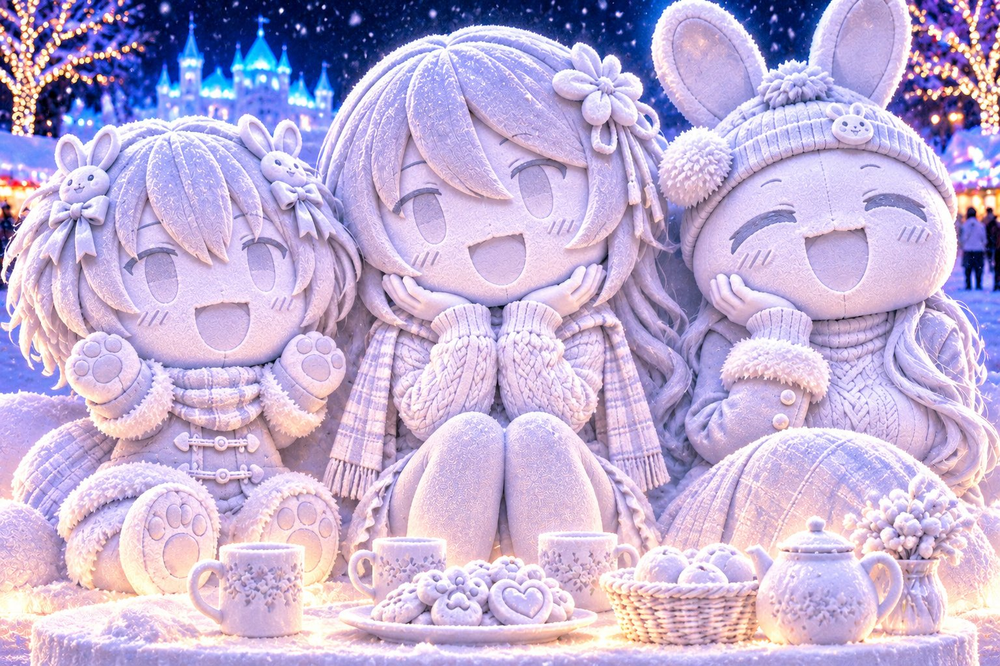
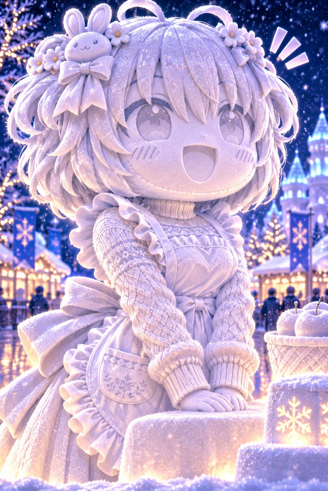

# 把角色插画变成冬祭会场的精致雪雕：纯白结晶雪质、蓝影 + 暖色彩灯

- 原帖链接：https://x.com/tete1342/status/2125183784886964461
- 作者：村人Ａ（@tete1342）
- 时间：2026-11-24 19:04 (UTC+8 / Asia/Taipei)
- 互动摘要：点赞 79 · 转发 27 · 回复 2 · 引用 2 · 书签 1 · 浏览 835（采集快照：2026-11-25 09:20 UTC+8）
- 模型/工具：未注明
- 标签：二次元
- 媒体路径：
  - `media/images/2125183784886964461_1.jpg`（）
  - `media/images/2125183784886964461_2.jpg`（）
  - `media/images/2125183784886964461_3.jpg`（）
- 入库日期：2026-11-25
- prompt 来源：https://x.com/tete1342/status/2125183844576067590（作者自回复）
- 备注：prompt 在作者自回复（2125183844576067590），整条原样摘录。需上传角色插画作为构图参考。

## prompt 原文

```text
添付画像のキャラクターと構図をベースに、夜の冬祭り会場に展示された「精巧な雪像」として再生成してください。

【必須条件】
・キャラクターのポーズ・表情・服装の特徴を雪像として忠実に再現する
・全体を純白の雪で彫られた彫刻にする
・雪の質感は結晶質で半透明、細かい粉雪のようなディテールを入れる
・青みがかった影と、下からの温かい祭りライトによる美しいライティングを加える
・背景は夜の雪景色とイルミネーションのある冬祭り会場にする
・元のイラストの雰囲気を残しつつ、雪像らしい立体感と重厚感を出す

超高精細、8k、シネマティック、写実的な雪の質感とアニメ調のキャラクターデザインが融合した傑作
```

---

个人学习归档，非商业。prompt 与媒体版权归原作者 @tete1342，引用请回到原帖。
