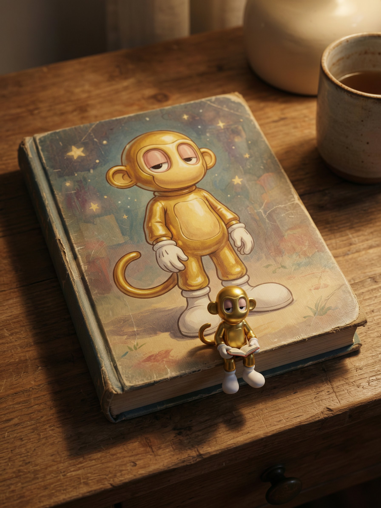

# 「角色在读自己的冒险绘本」：床头旧精装绘本封面印着上传角色，指尖大小的同款 3D 小人坐在封面边读书

- 原帖链接：https://x.com/edizkan_/status/2125285058483249242
- 作者：Edizkan ⭕🦇（@edizkan_）
- 时间：2026-11-25 01:46 (UTC+8 / Asia/Taipei)
- 互动摘要：点赞 32 · 转发 7 · 回复 7 · 引用 11 · 书签 3 · 浏览 2196（采集快照：2026-11-25 19:40 UTC+8）
- 模型/工具：未注明
- 标签：其它
- 媒体路径：
  - `media/images/2125285058483249242_1.jpg`（）
- 入库日期：2026-11-25
- 备注：prompt 在主帖正文（长文），从「A photorealistic shot」起原样摘录到结尾（含末行「ar 4:5」）。需上传角色参考图。正文 @ 了 @akidcalledbeast，帖子未说明二者关系（是否为 prompt 出处不详）。

## prompt 原文

```text
A photorealistic shot of a worn hardcover children's picture book lying on a wooden bedside table at night, seen from a slightly elevated angle looking down at the book, its cover illustrated with the uploaded reference character's exact likeness (maintain exact proportions, eye shape, silhouette and stylization; do not humanize, do not add nose or mouth if the character doesn't have them). Standing on the cover is a tiny miniature 3D figure of the same character, very small, about the size of a fingertip, The tiny miniature sits on the edge of the cover with its legs dangling over the side, reading an even tinier open book, glancing up at the camera as if interrupted, over its chest, head tilted up, looking straight into the camera with a cool, confident attitude, casting a small soft shadow on the cover. Soft warm glow from a small lamp, shallow depth of field focused on the cover and the miniature, faded corners and a creased spine, a blurred mug in the background. No readable text, no logos.
ar 4:5
```

---

个人学习归档，非商业。prompt 与媒体版权归原作者 @edizkan_，引用请回到原帖。
