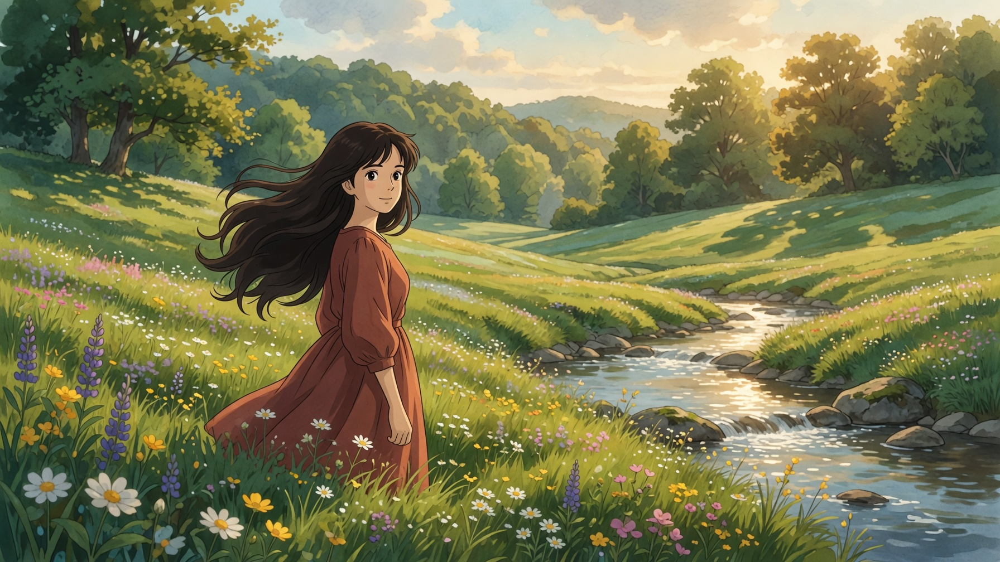

# 吉卜力风田园午后：阳光草地小溪边长发随风飘动的女子（手绘水彩背景 + 赛璐璐角色）

- 原帖链接：https://x.com/RockGrokAI/status/2125410894863835213
- 作者：AI Aimee（@RockGrokAI）
- 时间：2026-11-25 10:07 (UTC+8 / Asia/Taipei)
- 互动摘要：点赞 19 · 转发 0 · 回复 2 · 引用 0 · 书签 3 · 浏览 415（采集快照：2026-11-25 19:40 UTC+8）
- 模型/工具：未注明
- 标签：二次元
- 媒体路径：
  - `media/images/2125410894863835213_1.jpg`（）
- 入库日期：2026-11-25
- 备注：prompt 在主帖图片 ALT 里，整段原样摘录。

## prompt 原文

```text
A serene nature scene in classic Studio Ghibli animation style: a young woman stands in a sun-dappled meadow beside a gentle stream, her long hair windswept and flowing in a soft breeze. Hand-painted watercolor backgrounds, lush green hills, wildflowers, distant forest, warm golden afternoon light, magical realism, whimsical and peaceful mood, detailed cel-shaded character with expressive eyes, Hayao Miyazaki-inspired pastoral fantasy.
```

---

个人学习归档，非商业。prompt 与媒体版权归原作者 @RockGrokAI，引用请回到原帖。
