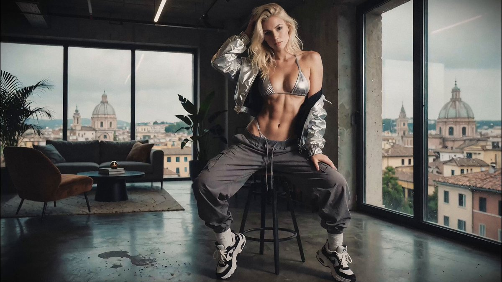

# 「By the Window」：落地窗前从吧凳起身、甩出银色夹克再走到窗边的金发女子（15 秒伪一镜到底舞蹈视频 prompt）

- 原帖链接：https://x.com/ou_zhen599/status/2125166263345533153
- 作者：Loriel.AI（@ou_zhen599）
- 时间：2026-11-24 17:54 (UTC+8 / Asia/Taipei)
- 互动摘要：点赞 72 · 转发 4 · 回复 6 · 引用 1 · 书签 82 · 浏览 5837（采集快照：2026-11-26 09:30 UTC+8）
- 模型/工具：Krea 2 + MiniMax-H3（ComfyUI，作者标注）
- 标签：真人
- 媒体路径：
  - `media/video-stills/2125166263345533153_still.jpg`（视频封面截图，）
  - 视频本体未入库，仅保留原帖链接：https://x.com/ou_zhen599/status/2125166263345533153
- 入库日期：2026-11-26
- prompt 来源：https://x.com/ou_zhen599/status/2125166395776500125（作者自回复）
- 备注：prompt 在作者自回复（2125166395776500125），从「### integrated_multimodal_description」起原样摘录到结尾（略去开头「MiniMax-H3 prompt👇」标签），含负面提示、环境音与配乐段落。图生视频，需以 `<Picture 1>` 首帧图起始。prompt 多次写明 adult / mature，人物衣着完整（银色上衣 + 工装裤），舞蹈动作带挑逗感但不露骨。视频本体未入库，仅保留原帖链接。

## prompt 原文

```text
### integrated_multimodal_description

Live-action, cinematic, realistic film texture, pseudo one-take 15s 16:9 sequence, starting exactly from <Picture 1>: same adult blonde woman, mature facial structure and proportions, silver metallic jacket, silver top, loose gray cargo pants, sneakers, bar stool, floor-to-ceiling window, distant city dome, sofa, plants, industrial high-rise layout. Cool gray-blue window light enters from the right through the tall glass — side backlight and fine shoulder-edge highlights; faint linear ceiling lights add minimal cool-white top fill; glass carries thin rain streaks and condensation dots, fine dust hangs in the air.

**Opening** — she starts in the right foreground at the bar-stool edge, legs apart, torso leaning forward, one hand in her hair, the other pressing her thigh. Already in motion: toe taps the floor, stool rotates half an inch, trouser hem brushes the sneaker, hand combs back through hair, shoulder drops, hips settle into the beat. Eyelids slightly low, pupils half an inch off the lens — deliberately delaying acknowledgment. Camera pushes in from a low floor-level angle past sneakers, stool base, and floor reflections, then tilts up into a medium close as she unlocks from sitting through a continuous body wave: knees draw inward, abdomen curls, chest rises with delayed timing, shoulders open last. One restrained chest expansion from the inhale and lift — a subtle, motion-caused tremor beneath the silver top and jacket collar; metallic fabric catches narrow moving highlights without clipping. Lips closed, lip line tightened; gaze presses at the camera for the first time with a slight lift at the brow tail.

**Jacket throw** — same shot, movement accelerates: she stands fully, grabs both sides of the jacket, snaps her shoulders back so it slips off the shoulder line while the sleeves lag behind; a second brief recoil passes through chest, collarbones, breath, and silver top as the motion reverses. Next beat she whips the jacket toward the camera — arm leads first, fabric unfolds after into a flashing silver arc sweeping across the near foreground with light motion blur, fabric friction, and a short gust-like pressure. The jacket never covers the full frame or blocks her for more than a brief moment, then drops as a soft silver blur. Throughout, eyes locked on the lens, upper lids pressing slightly down, one mouth corner lifting into a controlled challenge — fully aware of being watched.

**Walk to window** — foreground clears, same apparent take; camera tracks beside her upper body and face as she leaves the stool area, sliding out from behind the blurred silver foreground and moving along the right side toward the window. Tracking pace stays half a beat slower than her body. Her walk carries dance precision: first step low and grounded, second lifts through the hip and rebounds, third accelerates slightly. She refuses the full frontal look — only side profile, shoulder line, narrowed outer eye corners, pulling attention after her. Fine dust stirs from the rise, throw, and sliding steps, sparkling in window light before settling. Hair follows real inertia: body first, roots second, tips last, then falls back. At the window she stops sharply; the camera pushes in half a beat, then recoils as if caught by the sudden braking. Foot plants, hips stop first, chest/shoulder/hair-tips arrive a fraction later — a third subtle motion-caused rebound through chest and silver top, a short breath at the collarbone.

**Reflection** — she doesn't turn back immediately; her eyes find the camera first in the glass reflection, holding a brief predatory invitation while the city dome stays softly blurred and rain marks stay fixed. Camera does a smooth depth transition reflected-eyes → real eyes. One fingertip touches the glass and slides a very short distance, leaving an almost invisible fog trace; the other hand rests near the waistline. Head turns slowly after the eyes; mouth lifts only slightly, no teeth; upper lids gently lowered, outer eye line softens, one tiny nasal inhale — confirming the viewer is already caught.

**Slide back + final pose** — same pseudo one-take, camera arcs slowly ~a quarter turn (never a full circle) as she slides half a step back toward the interior; hips shift sideways in a short accent, shoulders and hair follow late. Window frame, city dome, and stool stay locked in arrangement. A fourth restrained recoil passes through chest and breath, then she suppresses it with a brief held breath. Gaze locks the lens, one brow tail lifts, expression turns playful-control → certainty. Camera gives a final low-angle medium-close push and settles. She stops between window and stool without sitting: one leg bent forward, the other stretched back, torso angled toward the lens, one hand lifting beside her head to part the blonde strands, the other near the waistline. Silver top intact and stable with clean window highlights; cargo pants sway softly; floor keeps a muted reflection; jacket stays as a blurred silver foreground/near-front object. Breathing visible but restrained, hair slowly returns, window light traces neck, silver top, and skin edges. She finishes looking directly into the camera with quiet, provocative calm. No cut to black, no fade — holds on window light, floating dust, rain streaks, soft room air, and the low afterimage of her breath.

**Negative:** no dialogue, subtitles, on-screen text, watermark, logo, extra people, outdoor action, scene change, exaggerated stage performance, identity drift, face distortion, body warping, extra fingers/limbs, exaggerated chest deformation, vulgar nudity, or disruption of the apartment's spatial anchors.

### overall_soundscape

Soft high-rise room tone and fine rain against the window throughout. Sneakers scrape lightly across the floor, loose cargo fabric shifts with each step, the stool turns with a small friction sound, the silver jacket slides off with layered rustle before whipping past the camera with a brief air-pressure hush. Dust stirs in the moving air; breath tightens slightly during the stop; final seconds stay open with quiet room resonance, no cut-away.

### non_diegetic_music

A restrained low-frequency beat enters from a distance and gradually feels closer as her movement gains control. Minimal sub-bass pulses and dry electronic percussion tighten during the jacket throw and the window stop, then thin to a sustained low pulse for the final held pose — never fading to silence.
```

---

个人学习归档，非商业。prompt 与媒体版权归原作者 @ou_zhen599，引用请回到原帖。
