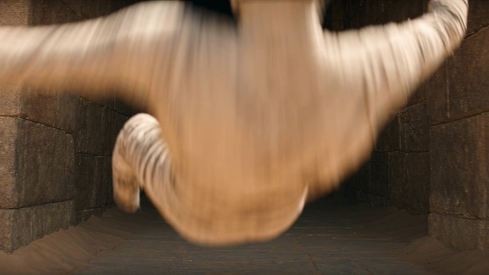

# 「子弹打光，被木乃伊大军包围」：沙漠神庙 30 秒动作冒险分镜（冒险家 + 考古学家 vs 大祭司，Seedance 2.5）

- 原帖链接：https://x.com/tokyo_Valentine/status/2125237996639400020
- 作者：とすくん（@tokyo_Valentine）
- 时间：2026-11-24 22:39 (UTC+8 / Asia/Taipei)
- 互动摘要：点赞 50 · 转发 10 · 回复 10 · 引用 2 · 书签 21 · 浏览 1468（采集快照：2026-11-26 19:55 UTC+8）
- 模型/工具：Seedance 2.5（经 @PolloAIJP，作者标注）
- 标签：真人
- 媒体路径：
  - `media/video-stills/2125237996639400020_still.jpg`（视频封面截图，）
  - 视频本体未入库，仅保留原帖链接：https://x.com/tokyo_Valentine/status/2125237996639400020
- 入库日期：2026-11-26
- prompt 来源：https://x.com/tokyo_Valentine/status/2125237999948681345（作者自回复）
- 备注：prompt 在作者自回复（2125237999948681345），从「30 seconds, 16:9」起原样摘录到结尾（略去开头「Prompt Seedance 2.5」标签）。按秒分镜，需配 4 张参考图（@ Image 1–4）；prompt 写明无血腥、无 gore。视频本体未入库，仅保留原帖链接。

## prompt 原文

```text
30 seconds, 16:9. Photoreal live-action adventure. Hard noon sun on a sandstone temple in open desert. Twin obelisks stand in a wide sand courtyard. Broad stone stairs lead up to a shadowed doorway, then a short, straight torchlit passage to an altar chamber lit by a single shaft of sunlight.
Action-movie camerawork continues every second throughout the entire video.

Match the four reference sheets exactly in every shot: faces, costumes, colors and proportions.
@ Image 1 = the adventurer. Dark wavy hair, short beard, dark scarf at the neck, worn olive long coat with frayed edges, mustard-yellow sash at the waist, leather cross-body strap with a canvas satchel, laced brown boots. Props not on the sheet: a revolver in each hand, and a bronze khopesh tucked through the left side of his yellow sash.
@ Image 2 = the archaeologist. Freckles, low brown ponytail, ivory blouse, cropped dark jacket with brass buttons, dark neckerchief, rust sash, fingerless gloves, long dark overskirt, knee-high buckled boots.
@ Image 3 = the High Priest. Tall and gaunt. Ivory hood over a skull face, a black disk set into his forehead, spiked dark metal pauldrons, ribbed segmented tubes draped across his chest and back, a small skull ornament at his waist, long tattered ivory robes, clawed bandaged hands. Prop not on the sheet: a tall staff of black metal.
@ Image 4 = every soldier in the mummy legion. Skull faces under plain crossed linen wraps, pale red-rimmed eyes, clawed hands, bare feet, no weapons. Only the High Priest @ Image 3 has the black disk and controls the sand.

00-01s  Low dolly back at boot height. A mummy soldier @ Image 4 is already flying over the lens from the first gunshot. Through the gap, the adventurer @ Image 1 charges with a revolver in each hand.
01-02s  Track beside the yellow sash of the adventurer @ Image 1 as he fires on the run. Two mummy soldiers @ Image 4 tumble out of his path.
02-03s  Crane up over the shoulder of the adventurer @ Image 1 on the last muzzle flash. Dozens of mummy soldiers @ Image 4 fill the sunlit courtyard between the obelisks and close around him at the foot of the stairs.
03-04s  Push tight on both revolvers of the adventurer @ Image 1. Two dry clicks. The mummy soldiers @ Image 4 keep coming through the sudden quiet.
04-05s  Tilt down to his sash. The adventurer @ Image 1 drops both empty revolvers into the sand, and his right hand draws the bronze khopesh from the left side of his sash with a metallic rasp.
05-06s  Arc around the melee. The khopesh of the adventurer @ Image 1 sweeps one mummy soldier @ Image 4 sideways into two others. Dust bursts from their wraps.
06-07s  Track the returning blade as the adventurer @ Image 1 drives another mummy soldier @ Image 4 aside, opening a narrow view of the stairs.
07-08s  Rack focus through that gap. At the top of the stairs, the High Priest @ Image 3 carries the archaeologist @ Image 2 over his left shoulder, staff in his right hand.
08-09s  Push in on the face of the archaeologist @ Image 2. She locks eyes with the adventurer @ Image 1 just before the High Priest @ Image 3 carries her into the dark doorway.
09-10s  Climb beside the adventurer @ Image 1 as he sweeps a final mummy soldier @ Image 4 off the steps with the khopesh and races upward.
10-11s  From just inside the doorway, tilt up with the rising staff of the High Priest @ Image 3. The black disk on his brow flashes.
11-12s  Pan past the receding robes of the High Priest @ Image 3 out to the courtyard. Behind the climbing adventurer @ Image 1, a wall of sand rises higher than the obelisks.
12-13s  Dolly back ahead of the adventurer @ Image 1 as he runs up the stairs. Two vast eye sockets open in the moving wall of sand behind him.
13-14s  Keep pulling back. The hooded skull face of the High Priest @ Image 3 takes shape in the storm, sculpted entirely from swirling sand, the outline of his disk swirling on its brow, towering above the obelisks.
14-15s  Widen on the same axis. Keep the giant sand face and the small running adventurer @ Image 1 both in focus as its shadow overtakes him.
15-16s  Track sideways from inside the passage as the adventurer @ Image 1 dives across the threshold. The edge of the storm just misses his boots.
16-17s  Glide with the landing of the adventurer @ Image 1. Sand hammers the lintel behind him. The outdoor roar drops to a muffled hiss.
17-18s  Skim the floor toward a dark wave racing at the adventurer @ Image 1 from the altar end of the passage. Torchlight picks out thousands of glossy scarab shells.
18-19s  Tilt up as the left hand of the adventurer @ Image 1 pulls a lit torch from the wall. His right hand still holds the khopesh.
19-20s  Arc with one sweep of the torch by the adventurer @ Image 1. The scarab wave shies from the flame and splits to either side.
20-21s  Pull back ahead of the boots of the adventurer @ Image 1 as he runs down the strip of bare stone between the beetles.
21-22s  At the mouth of the altar chamber, the adventurer @ Image 1 spins and hurls the torch back down the passage. As the storm passes, mummy soldiers @ Image 4 crowd the outer doorway; the torch bursts into flame in front of them and they halt.
22-23s  Slide past the High Priest @ Image 3 to reveal the archaeologist @ Image 2 half-sitting on the altar, one wrist pinned to the stone by a cuff of living sand.
23-24s  Track sideways as the staff of the High Priest @ Image 3 crashes against the khopesh of the adventurer @ Image 1 and drives him back a step. Show the weapons meet.
24-25s  Arc with the return clash. The black disk of the High Priest @ Image 3 flickers on impact. Sand trickles from the cuff on the wrist of the archaeologist @ Image 2 as it slackens for a beat.
25-26s  Push in on the face of the archaeologist @ Image 2. She looks at the adventurer @ Image 1 and taps her own forehead with her free hand.
26-27s  Follow one decisive swing. The curved blade of the adventurer @ Image 1 strikes the black disk on the brow of the High Priest @ Image 3 and splits it in two.
27-28s  Pull wide beside the altar, looking down the passage. The High Priest @ Image 3 pours into sand in the foreground. At the far doorway, the entire mummy legion @ Image 4 collapses into sand on the same beat.
28-29s  Dip to the wrist of the archaeologist @ Image 2 as the sand cuff falls away. She takes the outstretched left hand of the adventurer @ Image 1.
29-30s  Rise with them as the adventurer @ Image 1 pulls the archaeologist @ Image 2 to her feet and off the altar. Frame both faces in the shaft of sunlight as the last sand falls.

Sound effects only. Let the two empty clicks land in a gap in the gunfire. Give the storm a deep wind roar, the beetles a dry skitter, the torch a brief flare and each staff clash a distinct ring. End on sand pattering on stone. No BGM, dialogue or narration.
Bloodless fantasy combat, no gore. Clear silhouettes through the dust. No captions, logos, split screens or reference panels.
```

---

个人学习归档，非商业。prompt 与媒体版权归原作者 @tokyo_Valentine，引用请回到原帖。
