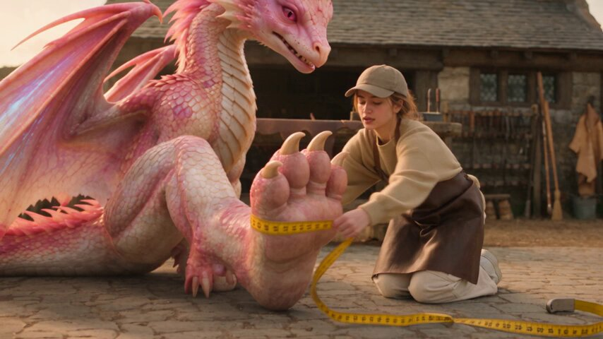

# 巨龙与超大号皮靴：乡村鞋匠 Daisy 给龙量脚、做靴、系鞋带的 30 秒奇幻喜剧短片

- 原帖链接：https://x.com/Alina_with_Ai/status/2125410341744247086
- 作者：Alina Ai（@Alina_with_Ai）
- 时间：2026-11-25 10:04 (UTC+8 / Asia/Taipei)
- 互动摘要：点赞 643 · 转发 33 · 回复 42 · 引用 1 · 书签 267 · 浏览 17127（采集快照：2026-11-26 19:55 UTC+8）
- 模型/工具：Seedance 2.5（作者标注）
- 标签：真人
- 媒体路径：
  - `media/video-stills/2125410341744247086_still.jpg`（视频封面截图，）
  - 视频本体未入库，仅保留原帖链接：https://x.com/Alina_with_Ai/status/2125410341744247086
- 入库日期：2026-11-26
- prompt 来源：https://x.com/Alina_with_Ai/status/2125410346596991085（作者自回复）
- 备注：prompt 在作者自回复（2125410346596991085），从「Photorealistic Hollywood fantasy comedy」起原样摘录到结尾（略去开头「Video prompt ⤵️」）。按 3 秒一段分镜，需配 Daisy 与巨龙参考图。视频本体未入库，仅保留原帖链接。

## prompt 原文

```text
Photorealistic Hollywood fantasy comedy, 16:9, 4K, shot on ARRI Alexa 65 with 35mm anamorphic lenses, 24fps cinematic film look, soft warm afternoon sunlight, clean low-noise image, creamy shallow depth of field with oval anamorphic bokeh, ultra-sharp detail, natural film grain, rich warm color grade, smooth stable camera, fast comedic hard cuts. Setting stays the same in every shot: an open-air cobbler's yard in a sunny village courtyard with a stone cottage workshop behind, a huge wooden workbench with giant leather pieces, a giant hammer, a giant needle as long as Daisy's arm, thick rolls of thread, a stone-paved floor, a wooden fence, and soft green hills. Match Daisy and giant dragon references. The dragon is the same size in every shot, about as tall as the cottage; show its full body, wings, legs and tail in wide shots. The dragon is eager, clumsy and sweet. Daisy wears her usual dress with only an added leather apron. The dragon's boots are two huge brown leather boots, each as big as a wagon, with thick laces; they look the same in every shot. Natural English dialogue for Daisy only, accurate lip-sync. The dragon NEVER speaks; it only makes giggles, huffs, whimpers, gulps and purrs. Only Daisy and the dragon appear: no animals, no insects, no extra characters, and nothing stuck on the dragon's face.

0-3s: Hook, slow dolly-in at eye level: Daisy kneels and stretches a long measuring rope along the dragon's huge foot, while the dragon sits on the paving with its foot raised, giggling because its toes are being tickled. "Rule number one: don't wiggle."

3-6s: Macro close-up with shallow focus on the dragon's toes: they wiggle and push Daisy's cap off. Cut to a medium shot: the dragon squeezes its eyes shut, trembling with effort to stay still, one toe still twitching. Daisy writes the numbers on a board. "Almost done!"

6-9s: Smooth side-tracking shot: Daisy works at the giant workbench: she hammers the leather, stitches with the giant needle, and thread spirals through the air, while the dragon watches from behind with its chin on its claws. She then holds up two huge brown leather boots. "Try these!"

9-12s: Medium shot: the dragon pushes its foot into the first boot, but it is too tight and its foot gets stuck. It hops around on one foot with the boot refusing to come on, and Daisy pulls the heel with all her weight. The boot pops off and flies over the cottage roof; a distant thud. Daisy, deadpan: "Okay... bigger."

12-15s: Wide static shot: Daisy sews a bigger boot, and the dragon puts it on. This one is far too loose; the dragon takes a step and the boot stays behind while it walks on. It looks back at the boot, confused.

15-18s: Low tracking shot at ground level: Daisy ties the laces tight in double knots. The dragon walks in two boots, and with each step the leather squeaks loudly: "SQUEAK." It stops with wide eyes, takes another step, "SQUEAK", and giggles.

18-21s: Wide static shot: the dragon starts stomping on purpose, squeak, squeak, squeak, spinning on one boot with its tail swinging, wings partly open like a dancer, while Daisy claps along, laughing.

21-24s: Medium shot: the dragon tries a big jump; the laces come untied and both boots fly off in opposite directions, bouncing across the courtyard, while the dragon lands on its bare claws and sits down, wiggling its toes, whimpering with embarrassment.

24-27s: Close shot: Daisy ties huge bows in the laces, double-checks them, and pats each boot. "Now they stay." The dragon stands up and walks proudly in a straight line in front of the camera, the boots squeaking softly in rhythm like a march.

27-30s: Wide golden shot, slow dolly-out: the dragon strides proudly across the yard, Daisy walks behind it with the measuring rope draped on her shoulders like a scarf. Daisy, to the camera, deadpan: "Next time... sandals." The dragon freezes mid-step, its boot lets out one "SQUEAK", and it looks down guiltily. Freeze on that. Hold this shot until the end.

Realistic leather, thread, wood and fabric physics, expressive acting, cinematic scale. No slow motion, modern objects, subtitles or watermark.
```

---

个人学习归档，非商业。prompt 与媒体版权归原作者 @Alina_with_Ai，引用请回到原帖。
