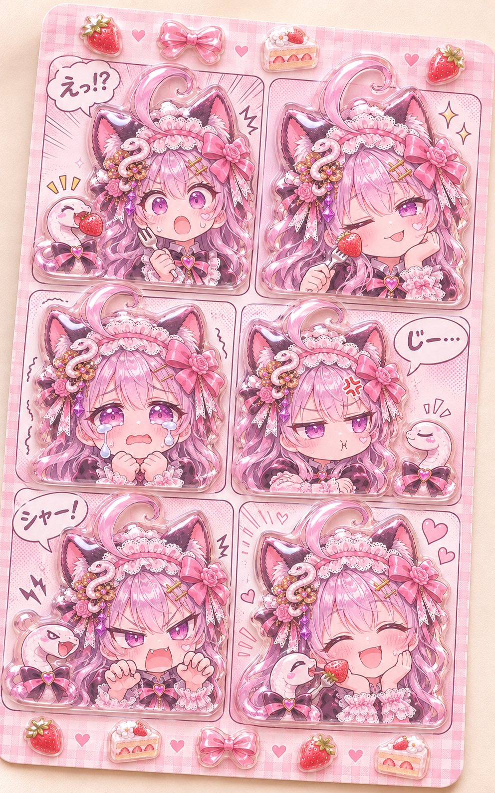
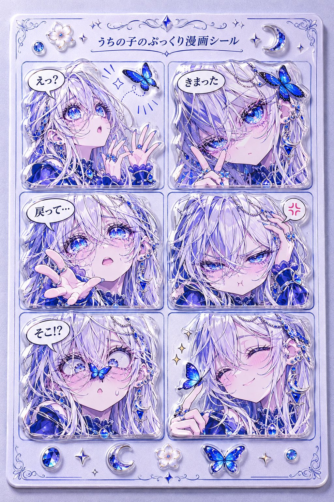

# 「うちの子のぷっくり漫画シール」：上传角色图，做成 2×3 六格小故事的透明树脂立体贴纸商品照

- 原帖链接：https://x.com/qW8n40tP5N48525/status/2125533953000198310
- 作者：chimaฅ^•ω•^ฅAI動画師（@qW8n40tP5N48525）
- 时间：2026-11-25 18:15 (UTC+8 / Asia/Taipei)
- 互动摘要：点赞 39 · 转发 11 · 回复 4 · 引用 6 · 书签 18 · 浏览 2300（采集快照：2026-11-26 19:55 UTC+8）
- 模型/工具：未注明
- 标签：二次元
- 媒体路径：
  - `media/images/2125533953000198310_1.jpg`（）
  - `media/images/2125533953000198310_2.jpg`（）
- 入库日期：2026-11-26
- prompt 来源：https://x.com/qW8n40tP5N48525/status/2125534172324524477（作者自回复）
- 备注：prompt 在作者自回复（2125534172324524477），整条原样摘录。作者称为「テンプレプロンプト」并标 #プロンプト配布。示例 2 张中蓝色那张为作者感谢的 @sakuya_ai_notea 的角色。

## prompt 原文

```text
うちの子のぷっくり漫画シール

添付画像のキャラクターを使って、透明樹脂でぷっくり盛り上がった立体シールのシートを、実物を撮影したような商品写真にしてください。縦長9:16で、シート全体と四隅が見える構図にします。

【キャラクター】
添付画像をキャラクターの資料にします。顔立ち、髪型と髪色、瞳、衣装、耳や角などの種族の特徴、トレードマークの小物を再現してください。デフォルメの度合いは元絵に合わせ、表情とポーズはその子らしく変えてください。相棒が写っている場合は、同じ見た目で、物語に合うコマに登場させてください。相棒がいない場合は主役だけでお話を作ってください。

【漫画シール】
台紙は2列×3段の6コマ。右上から右→左、上→下に読むと、短いお話になるようにしてください。添付画像の小物やキャラの雰囲気から小さな事件を考えて、キメ顔、びっくり、むすっ、うるうる、にっこり、オチの顔など、6コマすべて別の表情とポーズに。表情例はその子の性格に合うものに差し替えてOK。吹き出し、集中線、汗マークなどで漫画らしい間を作り、セリフを入れる場合は短い日本語にしてください。

【ぷっくり感と撮影】
コマ枠や吹き出しは台紙に印刷し、キャラの絵柄は輪郭に沿って型抜きしたシールにします。シール1枚ごとに隙間を空け、透明樹脂の丸い縁、横から見える厚み、窓光の反射、台紙に落ちる小さな影を描いてください。少し斜め上から撮ったマクロ写真のように、絵柄の線や表情も鮮明に。台紙の配色や柄はキャラに合わせ、空いたところにその子らしいモチーフのミニシールを数枚添えてください。
```

---

个人学习归档，非商业。prompt 与媒体版权归原作者 @qW8n40tP5N48525，引用请回到原帖。
