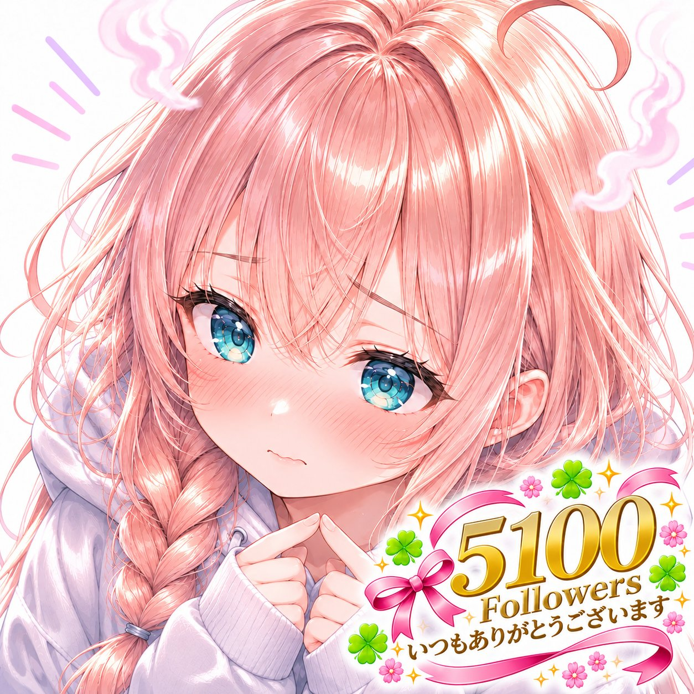

# 「限界照れ顔」：上传角色图，满脸通红、脑袋冒蒸汽、眼神躲闪的极度害羞面部特写（结构化 2D 动画 prompt）

- 原帖链接：https://x.com/shirumayo/status/2125544651092595034
- 作者：しるまよ🍀（@shirumayo）
- 时间：2026-11-25 18:58 (UTC+8 / Asia/Taipei)
- 互动摘要：点赞 274 · 转发 74 · 回复 102 · 引用 34 · 书签 16 · 浏览 11301（采集快照：2026-11-26 19:55 UTC+8）
- 模型/工具：未注明
- 标签：二次元
- 媒体路径：
  - `media/images/2125544651092595034_1.jpg`（）
- 入库日期：2026-11-26
- prompt 来源：https://x.com/shirumayo/status/2125544709351448639（作者自回复）
- 备注：prompt 在作者自回复（2125544709351448639），整条原样摘录。作者为庆祝 5100 关注发布并写明「プロンプトを配布するよ」。需上传角色图作参考；prompt 要求保留原角色年龄印象，示例为面部特写，衣着完整，非性化。

## prompt 原文

```text
Create one ultra-high-quality 2D anime illustration using ONLY the character in the attached image.

**ASPECT RATIO:** 1:1 square.

**CHARACTER IDENTITY — ABSOLUTE PRIORITY:**

Preserve the original face, hairstyle, hair color, eye color, outfit, accessories, age impression, body proportions, and art style. Do not redesign.

**COMPOSITION:**

Extreme facial close-up, with the face occupying approximately 80–83% of the image height.

Camera slightly above eye level, looking gently downward.

Face turned 15–20° sideways in natural three-quarter perspective, with a subtle 10–15° Dutch tilt.

Head tilted slightly forward, chin gently tucked downward.

Keep both eyes, mouth, cheeks, chin, shoulders, and both hands visible.

Leave a small amount of space above the head for the overheating steam effect.

**FACIAL PROPORTIONS — HIGHEST PRIORITY:**

Compact, softly rounded face with naturally full cheeks.

Eyes, nose, and mouth closely grouped in the center.

Very short nose-to-mouth distance and short, rounded chin.

Preserve the original facial width, eye spacing, and proportions.

Never elongate the face or jaw.

**EXPRESSION — EXTREME EMBARRASSMENT AND MENTAL OVERHEATING:**

The character has become so overwhelmingly embarrassed that her brain can no longer process the situation.

She has just received an unexpectedly sweet compliment that she was completely unprepared for.

She desperately wants to hide her embarrassment, but her face has already turned bright red.

She cannot maintain eye contact or form a proper response.

Her expression is flustered, helpless, bashful, and visibly overwhelmed by embarrassment.

She looks as though her brain is overheating from receiving too much affection at once.

**EYES — ABSOLUTE HIGHEST PRIORITY:**

Both eyes remain open with a slightly widened, bashful expression.

The gaze is directed diagonally downward and sideways, avoiding direct eye contact with the viewer.

Both eyes look naturally toward the same direction.

Upper eyelids show subtle nervous tension.

Lower eyelids are gently raised by the flushed cheeks.

Preserve the original iris color, eye shapes, iris size, and proportions.

Beautiful, slightly moist, translucent eyes with delicate highlights.

The eyes must communicate overwhelming embarrassment rather than fear, sadness, anger, or surprise.

No tears, spiral eyes, heart-shaped pupils, or closed eyes.

**EYEBROWS:**

Soft, visibly troubled 八の字 eyebrows.

The inner ends are gently raised while the outer ends slope downward.

The eyebrows express bashful helplessness and uncertainty.

Avoid exaggerated sadness or frightened expressions.

**MOUTH — HIGH PRIORITY:**

A tiny, horizontally wavy, slightly parted mouth.

The mouth forms a delicate trembling contour, as though the character is trying to speak but cannot produce a proper sentence.

The lips appear slightly tense and unsteady.

Keep the mouth extremely close beneath the nose.

No smile, visible teeth, protruding tongue, or large open mouth.

The mouth should communicate a silent, embarrassed "あぅ……".

**CHEEKS AND FACIAL MUSCLES — HIGH PRIORITY:**

Naturally full, softly rounded cheeks.

Strong, warm pink-red blush covering both cheeks and extending across the bridge of the nose.

The visible ears are noticeably flushed.

A delicate blush also extends toward the temples.

Use soft, natural color gradients and fine anime-style blush lines.

The embarrassment must be immediately recognizable without making the skin look unnaturally red or sunburned.

Maintain beautiful skin texture, natural facial depth, and the original facial proportions.

**HANDS AND POSE:**

Both hands are raised close to the upper chest.

The index fingertips gently touch each other in a small, hesitant, bashful gesture.

The remaining fingers are naturally curled and relaxed.

The hands appear slightly awkward, as though the character does not know what to do with them.

Keep both hands visible and anatomically correct.

Do not cover the face or mouth.

Preserve the original outfit and sleeves.

**OVERHEATING STEAM EFFECT — HIGH PRIORITY:**

Two or three small, soft, semi-transparent white steam wisps gently rise from above the character's head.

The steam forms delicate, rounded, curling shapes with faint pastel pink and lavender accents.

The steam must clearly resemble the charming Japanese anime visual metaphor for extreme embarrassment and mental overheating.

It should appear soft, airy, weightless, and slightly luminous.

Keep the steam small and secondary, never competing with the main character's face.

The steam must not obscure the hairstyle or facial features.

No fire, smoke clouds, explosions, mechanical effects, or actual physical injury.

**OVERALL IMPRESSION:**

The character has become completely overwhelmed by embarrassment.

Her face is bright red.

She cannot look directly at the viewer.

She cannot find the right words.

Her fingertips nervously touch each other.

Her brain has overheated, and tiny wisps of steam are gently rising from her head.

Her expression communicates:

"あ、あの……"

"そ、そんなこと言われても……"

"もう無理……恥ずかしい……"

The mood is adorably flustered, gently humorous, and unmistakably expressive of extreme embarrassment.

**BACKGROUND:**

Clean white background with subtle, thin pastel pink and lavender radial lines.

Keep the background bright, simple, and unobtrusive.

No text, lettering, hearts, or unnecessary decorations.

**LIGHTING AND RENDERING:**

Ultra-high-quality cinematic anime rendering.

Bright, soft, evenly distributed facial lighting.

Keep the forehead, both eyes, nose, cheeks, mouth, and chin clearly illuminated.

No dark shadows cast across the face by the hair.

Beautiful translucent eyes, delicate hair highlights, natural skin tones, and soft facial shading.

Maintain natural facial depth without overexposure.

Preserve the original character's beautiful anime art style.

**AVOID:**

Ordinary gentle blush, confident smile, cheerful laughter, seductive expression, frightened expression, crying, angry face, sleepy eyes, vacant stare, exaggerated surprise, crossed eyes, spiral eyes, heart-shaped pupils, closed eyes, large open mouth, visible teeth, protruding tongue, excessive facial redness, dark facial shadows, excessive sweat, oversized steam clouds, fire, smoke, childish redesign, elongated face, long chin, frontal flat portrait, distorted hands, extra fingers, character redesign.

**FINAL PRIORITY:**

Create a naturally adorable "EMBARRASSMENT OVERHEAT" expression.

1. Strong pink-red blush across the cheeks, nose, and visible ears.
2. Bashful eyes looking diagonally downward and sideways.
3. Soft, troubled eyebrows.
4. Tiny, slightly parted, trembling wavy mouth.
5. Both index fingertips gently touching near the upper chest.
6. Compact, softly rounded face.
7. Small, delicate steam wisps rising above the head.
8. Bright, beautifully illuminated facial features.

**The main character must look so overwhelmingly embarrassed that she can no longer maintain eye contact or form a proper response, as though her brain has completely overheated from embarrassment.**

Preserve the original character identity and beautiful anime art style above all else.
```

---

个人学习归档，非商业。prompt 与媒体版权归原作者 @shirumayo，引用请回到原帖。
