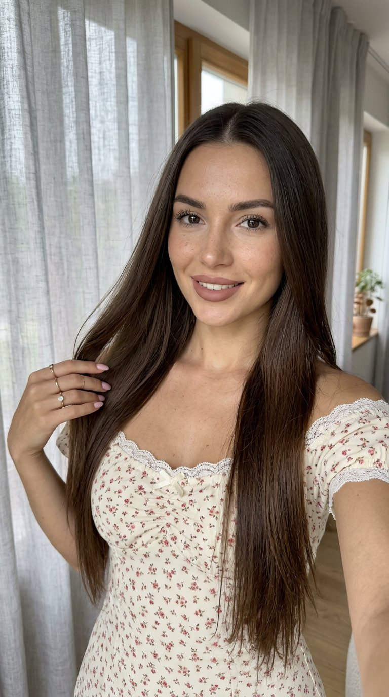

# 奶白碎花露肩连衣裙的长直发女子：柔和窗光下的竖版手机自拍（iPhone 16 Pro 质感）

- 原帖链接：https://x.com/dreamydigiarts/status/2125582778716881206
- 作者：dreamy digital arts（@dreamydigiarts）
- 时间：2026-11-25 21:30 (UTC+8 / Asia/Taipei)
- 互动摘要：点赞 53 · 转发 3 · 回复 8 · 引用 0 · 书签 19 · 浏览 1287（采集快照：2026-11-26 19:55 UTC+8）
- 模型/工具：Nano Banana 2（经 @weryai，作者标注）
- 标签：真人
- 媒体路径：
  - `media/images/2125582778716881206_1.jpg`（）
- 入库日期：2026-11-26
- 备注：prompt 在主帖正文（长文），从「Realistic vertical smartphone selfie」起原样摘录（略去开头工具说明与「Try it」推广链接）。成年女性半身自拍，非性化。

## prompt 原文

```text
Realistic vertical smartphone selfie of a young woman in a medium close-up, captured in soft natural daylight. The woman is standing slightly turned toward the camera, with her torso tilted, looking directly into the lens with a soft, calm, and confident facial expression. She has long, straight, smooth, thick hair, parted in the center and falling freely over both shoulders and her chest. Her face has clearly defined eyebrows, large eyes with neat makeup (mascara, light eyeshadow), long eyelashes, lips in a matte nude-mauve shade, and even skin with a warm undertone. She is wearing a creamy white off-the-shoulder dress with a small pink-and-red floral print, lace trim along the neckline and sleeves, a ruched bodice, and a small bow at the center of the chest. One hand is raised to her shoulder; fingers with long, light-colored manicured nails and a ring on one finger are holding a strand of hair. The background consists of light gray-white translucent curtains with vertical folds, slightly out of focus. Soft, even window lighting with delicate shadows, a clean social-media aesthetic, shallow depth of field, natural skin and fabric texture. 2:3 High detail in the skin and fabric Reduced exposure Realistic skin texture No blur or blurring Strictly preserve the facial features Image quality like an iPhone 16 Pro
```

---

个人学习归档，非商业。prompt 与媒体版权归原作者 @dreamydigiarts，引用请回到原帖。
